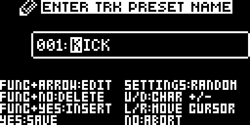
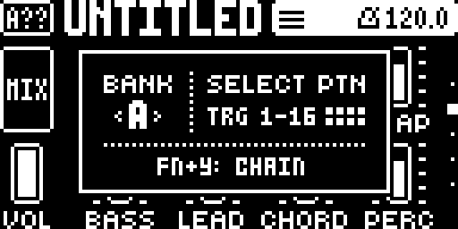

# Track Names

A Digitakt II mod by @crisp909. Version 0.1.2-experimental. OS 1.17, core 1.0.

## Overview

The Internal Mixer labels its faders TRK1 to TRK16. With Track Names it shows the name you gave each track
instead, and every fader gets its track number in an inverted box at its top left, so you still know which track
it is.

The names are the Digitakt II's own track names from SETUP > RENAME. The OS keeps them in each pattern's kit, so
every pattern has its own names, copying a pattern copies them, and they are saved with the project. Track Names
only reads them and draws them on the mixer: it saves nothing and changes no project data.

## Controls

Track Names adds no controls. Names are entered with the stock editor:

- SETUP (FUNC + FLTR) > RENAME, the last row of the TRACK section: opens ENTER TRK PRESET NAME.
- UP/DOWN change a character, LEFT/RIGHT move the cursor, FUNC + NO deletes, FUNC + YES inserts, YES saves, NO cancels.

## Usage

The mixer shows the first **5 characters** of a name, so name tracks short: KICK, SNARE, BASS, VOX1. A longer name
is cut after 5 characters on the mixer and stays whole in SETUP. A track whose name is still the stock default
(PRESET 1, PRESET 2 and so on) keeps its stock label, TRKn.

### Quick tutorial

1. Select a track with TRK + its trig, open SETUP with FUNC + FLTR and scroll down to RENAME, the last row of the TRACK section.
2. Press YES, enter a short name with UP/DOWN and LEFT/RIGHT (FUNC + NO deletes) and press YES to save it.
3. Open FUNC + MOD, then press FUNC + MOD again for Internal Mixer 2/5 (tracks 1-8); once more for 3/5 (tracks 9-16).
4. Each fader shows its track number at the top left and the first 5 characters of its name below; a track still named PRESET n keeps TRKn.

## Compatibility and limitations

- Digitakt II, OS 1.17, core 1.0. Needs no other module and declares the claim `ui:Internal Mixer track labels`.
- Only Internal Mixer pages 2/5 and 3/5 show names. The compressor, FX mixer, external mixer and all other pages are unchanged.
- The mixer shows the first 5 characters of a name.
- Pop-ups the OS draws over the mixer (pattern select, for example) stay on top: names under them are cut at the
  pop-up's edge, and a track number the pop-up partly covers is drawn only where it is not covered.
- With PERFORM KIT on, the names shown are those of the pattern you are on. Not tested.
- The faint lines along a pop-up's edges on the unit are the OLED's own row crosstalk; they show with the stock OS too.

## Tests and measurements

- Hardware, reported by the author on 2026-11-13: the package built with the pinned toolchain in Docker (sha256
  `cc908de8…a03a8f`) on a Digitakt II, OS 1.17, core 1.0. Names on mixer pages 2/5 and 3/5, each pattern its own
  names with PERFORM KIT off, names back after SAVE PROJECT and a reload, other pages unchanged.
- Emulator (digikit): names entered through SETUP > RENAME on a fresh project show on both mixer pages; tracks named
  PRESET n keep TRKn; pattern select pop-ups stay on top. Details in [TESTING.md](TESTING.md).
- Memory: 3,026 bytes of code and 184 bytes of data. Load: UI task only, at most about 150,000 instructions per
  frame on the mixer pages (static count), a few dozen elsewhere; no audio-path code.

## Authorship and licences

Original work by crisp909 (with Claude), GPL-3.0-or-later ([LICENSE](LICENSE)). The screenshots are documentation
captures of the Elektron interface; the thumbnail is an original illustration. Stock OS addresses appear only as
build metadata in `build.json`; the repository holds no firmware.

## Screens and audio

Name a track in SETUP > RENAME:

Internal Mixer 2/5, tracks 1-8:

Internal Mixer 3/5, tracks 9-16; tracks 11 and 13-16 still have their default names:

Pattern select over the mixer:

No audio: the mod draws on the screen only.
