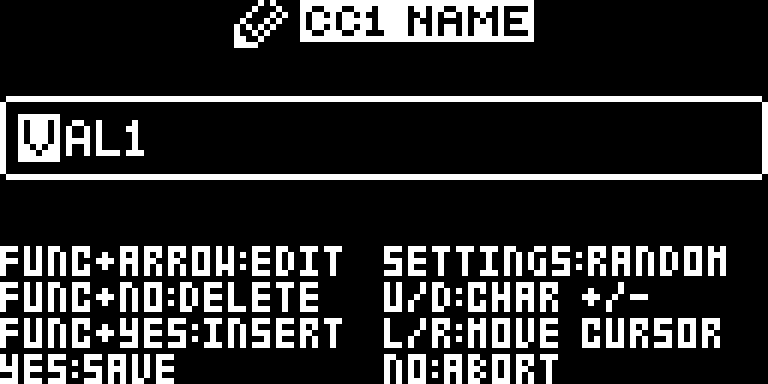
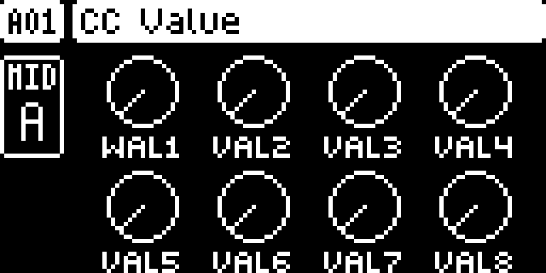

# CC Assignment Names

## Overview

Give each MIDI CC assignment a label of up to five characters. Labels appear on CC VALUE and follow native pattern and project operations.

Version **2.1.1** for Digitakt I OS **1.53 and 1.54**, with separate packages
for each OS. Do not use a 1.53 package on 1.54. Hardware testing is recorded in the
[hardware report](evidence/hardware-testing.json) and [TESTING.md](TESTING.md).

## Controls

| Control | Action |
| --- | --- |
| FUNC + hold A–H | Open the native name editor for that CC VALUE slot. |
| LEFT/RIGHT and UP/DOWN | Move the text cursor and change a character in the name editor. |
| YES / NO | Accept the name / cancel the edit. |
| Short FUNC + encoder press | Retains the native CC-enable toggle; hold longer to rename. |

## Usage

Follow these steps on either supported OS release.

### Quick tutorial

1. Select MIDI A with TRK + trig 9. Set the desired CC number on CC SELECT, then press FLTR for CC VALUE.
2. Hold FUNC and press and hold the encoder for the assignment you want to name.
3. Use LEFT/RIGHT to select a character and UP/DOWN to change it. Enter a short name such as CUTO.
4. Press YES to accept, or NO to cancel. The label appears below that assignment; turning its encoder still sends the assigned CC.

## Compatibility and limitations

Requires Core 2.1, dt-support.
Use original stock firmware in Elekloader. Install each dependency once.

- Labels are limited to five characters.
- Labels do not change CC numbers or MIDI values.
- Stock firmware can discard the added name data when saving projects.

The earlier whole-build format-1 packages cannot be combined with these format-2
modules. Compatibility with the wider Modwerk catalogue still needs checking.

## Tests and measurements

See [TESTING.md](TESTING.md) for exact evidence and remaining checks. Screenshots
show a real booted combined build; they do not prove standalone behavior, MIDI
output, audio quality, worst-case timing or hardware operation.

## Authorship and licences

sumedho: module design/development with Codex assistance; author identity confirmed. irpina: Elekloader, Core 2.1, the Core 3.0 header and Machine Pages (1.2 is adapted by sumedho to run on Core 2.1).
Code: [GPL-2.0-or-later](LICENSE). Screens show Elektron's interface solely to
document the modification. No Elektron firmware is included.

## Screens and audio

The following OS 1.53 gallery documents the **OS 1.53 all-mods build on Core 2.1**. See
[capture provenance](media/capture.json) for hashes, inputs and any retained
regression frames, which explicitly identify their fixture setup.
No audio demonstration is supplied yet.

Hold FUNC and the slot’s encoder to open CC NAME. Move the cursor and edit the label.

Press YES to accept. The assignment keeps its MIDI function and shows its new label.

## OS 1.54 screenshots

These captures use the actual **OS 1.54 all-mods SysEx on Core 2.1**. See [1.54 provenance](media/1.54/capture.json).

Hold FUNC and the slot’s encoder to open CC NAME. Move the cursor and edit the label.

Press YES to accept. The assignment keeps its MIDI function and shows its new label.
