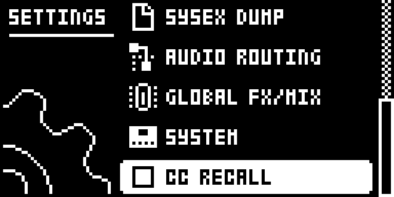

# CC Recall

## Overview

A MIDI track sends a control change when its value changes: a CC VAL knob turn, a parameter lock or its LFO. When a pattern is reloaded, changed or loaded with its project, or the sequencer stops, the Digitakt puts the track’s saved CC VAL values back on screen but sends them only with the track’s next trig, a note or a lock trig. Until then external gear, and the Digitakt’s own effects through FX CONTROL CH, keep the values they last received, so a reload while stopped, or a track whose first trig comes late, leaves them out of step with the pattern.

With **SETTINGS > CC RECALL** ticked, each MIDI track with CHAN on sends its pattern’s values straight away instead: the eight CC VAL slots that have a CC SEL, and the mod wheel, breath, pitch bend and aftertouch values, exactly what its next trig would send. The trig still sends them as stock.

Unticked, every MIDI message goes out exactly as stock.

Version **0.1.0-experimental** for Digitakt I OS **1.54** on Core 2.1.

## Controls

| Control | Action |
| --- | --- |
| SETTINGS > CC RECALL | Ticked: after a pattern reload, a pattern change, a project load or STOP, the MIDI tracks send their pattern’s CC values at once. Unticked: stock. YES toggles it; RIGHT ticks and LEFT unticks it. Ticking it sends nothing by itself. Unticked at every power-on. |
| MIDI track CHAN, CC SEL, CC VAL | Stock. A track with CHAN off sends nothing, as stock. |

## Usage

The row is in the stock SETTINGS menu, below SYSTEM. The MIDI track’s CHAN, CC SEL and CC VAL are its SRC, AMP and FLTR pages.

### Where to find it

SETTINGS > CC RECALL

1. Use a build containing CC Recall for the original Digitakt on OS 1.54.
2. Press SETTINGS and go down to CC RECALL, below SYSTEM, with UP/DOWN.
3. Press YES to tick or untick it. RIGHT ticks it and LEFT unticks it.

### Quick tutorial: reload a pattern and hear the saved sound

1. Connect a synth to MIDI OUT. On MIDI track A switch CHAN on (SRC page, FUNC + knob A) and set it to the synth’s channel.
2. On the AMP page set SEL1 to the synth’s filter cutoff CC, and on the FLTR page set VAL1. Save the pattern or the project.
3. Open SETTINGS and tick CC RECALL.
4. Turn VAL1 so the synth’s filter moves, then reload the pattern (FUNC + NO): VAL1 jumps back on screen and the synth’s filter follows at once, playing or stopped.
5. With FX Track also ticked, a MIDI track on FX CONTROL CH resets the delay, reverb, compressor and External Mixer the same way.

## Compatibility and limitations

Requires Core 2.1. Built for OS 1.54 only.

- **Not saved.** CC RECALL starts unticked (stock) at every power-on. Projects store nothing for it.
- **Also on STOP.** The Digitakt treats STOP like a new pattern for the MIDI tracks, so with the row ticked STOP sends the pattern’s values too. That ends a parameter lock or LFO excursion at once; the track’s next trig sends the same values again, as stock.
- **Sends every value.** Like the stock first trig, it sends each value whether or not the gear already has it: up to 12 messages a track, one track every clock of the MIDI tracks’ task (about every 33 ms when stopped, faster while playing), so all eight tracks are done within about 0.3 s.
- **Pitch bend and aftertouch.** They are sent as the stock first trig sends them, so a held note on the synth can bend back to the pattern’s value.
- **The same messages as a trig.** Only what the track’s next trig would send goes out, on the track’s own channel and ports.
- **What it patches.** Four 6-byte `jsr` sites on OS 1.54: the three stores of the pattern for the MIDI tracks (0x400e0b08 and 0x400e0b56 for a reload, STOP, a pattern change while stopped or a project load; 0x400e126c for the sequencer’s own pattern change while playing), which count a new pattern, and a test in the MIDI tracks’ clock record (0x400e128c), which does the sending in that task. They overlap no other Modwerk module’s bytes; FX Track’s site is the function the messages pass through, so with both ticked a recalled CC on FX CONTROL CH sets the effects.
- **Stock flows.** It adds one SETTINGS row (`settings:CC RECALL`) and changes no stock page, gesture or saved data. Unticked, the MIDI output is stock.

## Tests and measurements

See [TESTING.md](TESTING.md) for the exact evidence and the checks still open. The author tested a pattern change while playing (also between banks, in a chain and in song mode) and a reload on a Digitakt I, alone and with FX Track. The emulator results add STOP, project load and the SETTINGS row; nothing here proves behaviour beside every other module on hardware.

## Authorship and licences

draadpiraat: design and code, with Claude Code assistance. Core 2.1, the hook bus and the memory map: irpina (elekloader) and Em D (digikit).
Code: [GPL-3.0-or-later](LICENSE). Screens show Elektron’s interface solely to document the modification. No Elektron firmware is included.

## Screens and audio

These captures show the **OS 1.54 build with Core 2.1 and this module alone**, booted in the pinned digiemu with firmware-native drawing. See [capture provenance](media/capture.json) for hashes and panel inputs. No audio demonstration is supplied yet.

Press SETTINGS and go down to CC RECALL, below SYSTEM. Unticked, the MIDI tracks send a reloaded pattern’s values with their next trig, as on the stock OS.

Press YES or RIGHT to tick it. A reload, pattern change, project load or STOP now sends the MIDI tracks’ values straight away.
