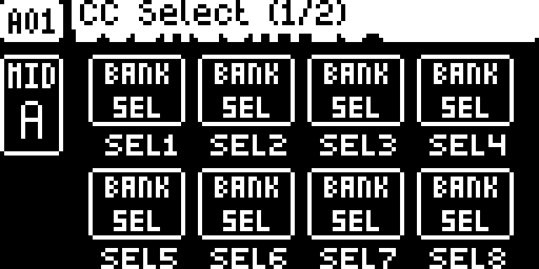
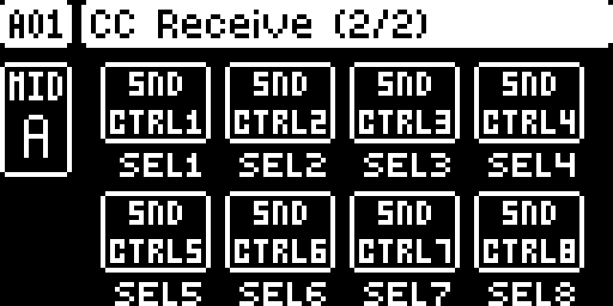
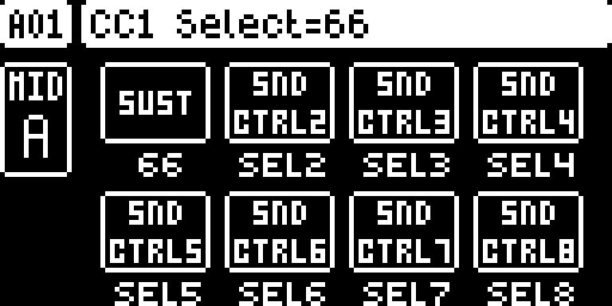

# CC Remap

## Overview

Stock, a MIDI track’s eight CC VAL knobs follow incoming CC 70–77 on that track’s own channel (SETTINGS > MIDI CONFIG > CHANNELS > TRACK A–H CHANNEL, 9–16 by default). A controller whose knobs send other, fixed numbers cannot drive them.

CC Remap gives each MIDI track a table of eight receive numbers, one per CC VAL slot, on a second layer of the track’s AMP page (CC SELECT): press **AMP** again and the page turns into **CC Receive (2/2)**, where knobs A–H set the incoming CC for VAL1–VAL8. A CC on the track’s channel whose number is in the table moves that VAL slot exactly as CC 70–77 does on the stock OS: the value shows on the CC VALUE page and the slot’s own CC SELECT number goes out of MIDI OUT. So a controller that sends, say, CC 8–15 drives VAL1–VAL8, and the track turns them into whatever CCs your synth expects.

Every slot starts at its stock number (VAL1 70 … VAL8 77), so an untouched table is the stock behaviour.

Version **0.1.0-experimental** for Digitakt I OS **1.54** on Core 2.1.

## Controls

| Control | Action |
| --- | --- |
| AMP, on a MIDI track’s AMP page | Switches between CC Select (1/2), stock, and CC Receive (2/2). The Digitakt shows the page numbers itself. |
| Knobs A–H on CC Receive (2/2) | Set the CC number (0–127) that moves VAL1–VAL8 of this track, shown with the CC’s name like CC SELECT. The table is shared by all patterns. |
| Knobs A–H on CC Select (1/2) | Stock CC SELECT. |
| MIDI CONFIG > CHANNELS > TRACK A–H CHANNEL | Stock: the channel each MIDI track listens on, and so the channel the controller must send on. |
| MIDI CONFIG > PORTS > RECEIVE CC/NRPN | Stock: with it off, no CC reaches the tracks, remapped or not. |

### Message map

| Message in, on a MIDI track’s TRACK CHANNEL | Result |
| --- | --- |
| CC n, where n is in that track’s table at slot k | Read by the stock code as CC 69+k: sets VALk (0–127) and sends VALk’s CC SELECT number with that value, on the track’s CHAN, as when the knob is turned. The original CC n is consumed for that track. |
| CC 70–77 not in the table | Stock: sets VAL1–VAL8. |
| Any other CC | Stock. |
| CC on the auto channel, an audio track’s channel or no track’s channel | Stock; the tables are not used. |
| Notes and all other messages | Stock. |

## Usage

The second layer is on the stock AMP page of a MIDI track, which shows CC SELECT. The track’s CHAN is on its SRC page and CC VALUE on its FLTR page.

### Where to find it

MIDI track > AMP page > press AMP again

1. Use a build containing CC Remap for the original Digitakt on OS 1.54.
2. Select a MIDI track with TRK + trig 9–16 and press AMP for CC Select (1/2).
3. Press AMP again for CC Receive (2/2), and again to go back.

### Quick tutorial: play a MIDI track’s VAL knobs from a fixed-CC controller

1. Set the controller to send on MIDI track A’s receive channel, 9 by default (SETTINGS > MIDI CONFIG > CHANNELS > TRACK A CHANNEL), and connect it to MIDI IN.
2. Select MIDI track A (TRK + trig 9), switch CHAN on (SRC page, FUNC + knob A) and set the CC SELECT numbers your synth expects on the AMP page.
3. Press AMP again for CC Receive (2/2). Turn knob A to the number the controller’s first knob sends (CC 8, say), knob B to the second, and so on.
4. Turn the controller’s first knob: VAL1 follows on the FLTR page and the synth receives VAL1’s CC SELECT number.

## Compatibility and limitations

Requires Core 2.1. Built for OS 1.54 only.

- **Not saved.** The tables start at 70–77 (stock) at every power-on; projects and patterns store nothing for them.
- **One table per MIDI track, for all patterns.** It does not change with the pattern, unlike CC SELECT, and copying a MIDI track does not copy it.
- **The track’s own channel only.** A CC on the auto channel reaches the active track as stock, without the table.
- **Consumed numbers.** A CC whose number is in a track’s table no longer reaches that track as itself; MIDI THRU and other tracks are unaffected.
- **Two slots with the same number.** The first slot wins.
- **The popup while turning** still reads "CC1 Select=…": it shows the receive number on CC Receive.
- **What it patches.** Four 6-byte `jsr` sites on OS 1.54: the entry of the per-track incoming-CC handler (0x400d6c80), which renames a remapped CC; the parameter read (0x4000fe10) and write (0x40010b62) a page uses, which use the table for SEL1–8 while CC Receive is on screen; and the title copy of the parameter pages (0x40030954), which shows the CC Receive title and, the first time the AMP page opens, gives that page its second sub-page. They overlap no other Modwerk module’s bytes. CC Assignment Names replaces the page key handler; CC Remap leaves it alone and uses the stock sub-page stepping.
- **Stock flows.** It takes `ui:MIDI track AMP page:AMP twice` and changes no saved data. With every slot at 70–77 the MIDI input is stock.

## Tests and measurements

See [TESTING.md](TESTING.md) for the exact evidence and the checks still open. The author tested it on a Digitakt I with an Allen & Heath Xone:1D, alone, with FX Track and with CC Assignment Names. The emulator results add the message map and the load figures; nothing here proves behaviour beside every other module on hardware.

## Authorship and licences

draadpiraat: design and code, with Claude Code assistance. Core 2.1, the hook bus and the memory map: irpina (elekloader) and Em D (digikit).
Code: [GPL-3.0-or-later](LICENSE). Screens show Elektron’s interface solely to document the modification. No Elektron firmware is included.

## Screens and audio

These captures show the **OS 1.54 build with Core 2.1 and this module alone**, booted in the pinned digiemu with firmware-native drawing. See [capture provenance](media/capture.json) for hashes and panel inputs. No audio demonstration is supplied yet.

Select a MIDI track and press AMP: CC Select (1/2), stock.

Press AMP again: CC Receive (2/2) shows the receive number of each VAL slot, 70–77 until you change them.

Turn a knob to set the number your controller sends for that slot.
