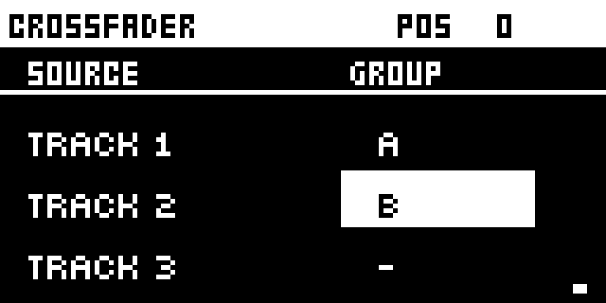
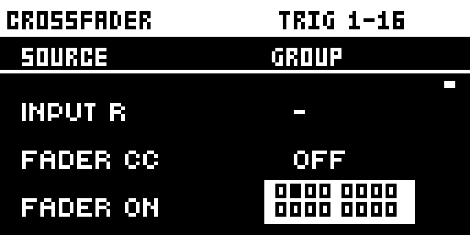
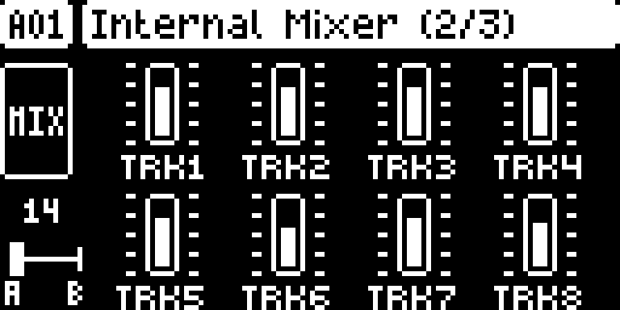
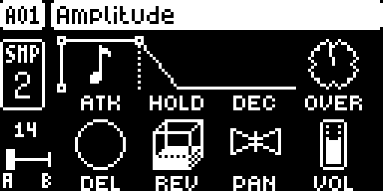

# Crossfader

## Overview

A crossfader for the Digitakt I. Every audio track and both inputs (IN L, IN R) can go in group A, group B or neither. One fader fades between the two groups with an equal-power curve: at one end group A plays at its own level and group B is silent, at the other end the reverse, and in the middle both play at −3 dB. The fader is the LEVEL knob on the Internal Mixer page, LEVEL on the pages of the tracks you choose, or a CC of your choice on FX CONTROL CH.

It sits on top of the mixer: track levels and the External Mixer still apply, and the delay and reverb sends follow the fade. With the Live Looper, put the loop's track in one group and the new pattern in the other to fade between them.

Version **0.1.0-experimental** for Digitakt I OS **1.54** on Core 2.1.

## Controls

| Control | Action |
| --- | --- |
| SETTINGS > CROSSFADER | Each track (TRACK 1–8) and input (INPUT L, INPUT R): A, B or – (neither), with LEFT and RIGHT. FADER CC: the CC number, or OFF. FADER ON: the tracks whose pages make LEVEL the fader; toggle a track with its trig key (1–8 the audio tracks, 9–16 the MIDI tracks). NO leaves. |
| LEVEL on the Internal Mixer page (FUNC + LFO, then FUNC + LFO again: 2/3) | Moves the fader. The box at the lower left shows its position, 0–127. |
| LEVEL on a FADER ON track's pages (TRIG, SRC, FLTR, AMP, LFO) | Moves the fader instead of the track's level; the box over the level bar shows its position. |
| The fader CC on FX CONTROL CH | Moves the fader, 0–127. The channel is the Digitakt's FX CONTROL CH (SETTINGS > MIDI CONFIG > CHANNELS). |

LEVEL turns as a stock knob: faster when turned quickly, in big steps while pushed, and FUNC + LEVEL jumps to the middle and then to the end you turn towards. Where LEVEL is the fader, pushing it alone does nothing, so a fade never opens the sound browser.

## Usage

Set the groups once; they are kept on the +Drive for the whole unit.

### Quick tutorial: fade between two groups

1. Press SETTINGS, go down to CROSSFADER (the last row) and press YES.
2. Put some tracks in group A and others in group B with LEFT and RIGHT; press NO to leave.
3. Press FUNC + LFO twice for the Internal Mixer and turn LEVEL: group A fades out as group B fades in.
4. FUNC + LEVEL jumps to the middle, where both groups play at -3 dB.

## Compatibility and limitations

- Built for OS 1.54 only, on Core 2.1.
- The groups, the fader CC and FADER ON are kept for the whole unit on the +Drive (`/cfw/xfade.a`, `.b`), not per project or pattern. The fader's position is not saved: after power-on it is at A.
- The position line in the fader box is a pixel off centre: at A it runs past the box's edge line, at B it stops short of it.
- It is the last layer on each channel's level: track levels, the External Mixer and its global setting still apply, and the delay and reverb sends follow the fade.

### Changes to stock flows

- **LEVEL on the Internal Mixer page** moves the fader; stock it does nothing there.
- **LEVEL on FADER ON tracks' pages** moves the fader instead of the track's level, only for the tracks you tick. Untick them for stock LEVEL.
- **Pushing LEVEL** does nothing on those pages, so a fade never opens the sound browser; on every other page it is stock.

What it patches on OS 1.54: four 6-byte `jsr` sites: 0x40030930 (the parameter pages' title, to know the Internal Mixer page), 0x400d4cec (the CC handler's FX CONTROL CH test), 0x40071d86 (where the mixer makes each channel's gain) and 0x400c9ce4 (View::show, to know which page is on screen).

## Tests and measurements

See [TESTING.md](TESTING.md).

## Authorship and licences

draadpiraat: design and code, with Claude Code. Code: [GPL-3.0-or-later](LICENSE). Screens show Elektron's interface solely to document the modification. No Elektron firmware is included.

## Screens and audio

These captures show the **OS 1.54 build with Core 2.1 and this module alone**, booted in the pinned digiemu with firmware-native drawing. See [capture provenance](media/capture.json) for hashes and panel inputs. No audio demonstration is supplied yet.

SETTINGS > CROSSFADER, the last row. LEFT and RIGHT put the selected track or input in group A, B or neither; POS shows the fader.

Further down, FADER ON: press a track's trig key to make LEVEL the fader on its pages. Track 2 is ticked here.

FUNC + LFO twice opens the Internal Mixer. Turn LEVEL to fade from group A to group B; the box at the lower left shows the position, 0-127.

On a FADER ON track's pages LEVEL is the fader too, so a track can be faded without leaving its pages. FUNC + LEVEL jumps to the middle.
