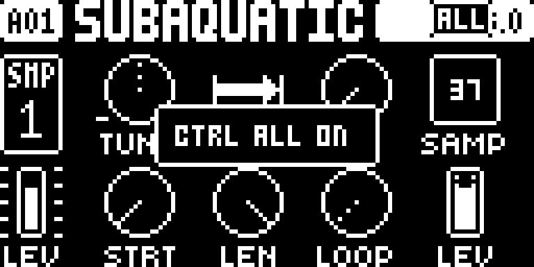

# Ctrl All — Digitakt

Modwerk version: `0.2.0`, the author's released 0.2 file, unchanged.

## Overview

Ctrl All, by ceredmeat, copies a parameter lock across tracks. Hold TRK and press YES to turn it on: ALL shows in the top-right corner. Then hold a trig and turn a knob: the lock goes on that step as usual, and on the same step of every other track that has a trig there, audio tracks from an audio track and MIDI tracks from a MIDI track. Only knob turns are copied, so copy, paste, clearing locks and random locks stay on one track. Live-recorded knob moves are copied too. It is off at every power-on.

- Hold TRK and press YES to turn it on or off; ALL shows in the top-right corner while it is on.
- A lock set on one track lands on the same step of every other track with a trig there.
- Audio tracks copy to audio tracks, MIDI tracks to MIDI tracks; steps without a trig are skipped.
- Only knob turns are copied; copy, paste, clearing and random locks are not.

## Controls

| Control | What it does |
| --- | --- |
| TRK + YES | Turn Ctrl All on or off. ALL shows in the top-right corner while it is on, and it is off at every power-on. |
| Trig + knob | While it is on: sets the lock on this step for every other track of the same kind (audio or MIDI) with a trig there. |

## Usage

Use the access steps below after installing a compatible build. The tutorial gives a first practical pass through the module.

### Where to find it

Location: Any page: hold TRK, press YES.

1. Use a build containing Ctrl All for the original Digitakt on OS 1.54.
2. Hold TRK and press YES; ALL shows in the top-right corner.
3. Hold a trig and turn a knob to lock that step on every track with a trig there.

These instructions assume the module is already installed in a compatible build. For selecting and building it in Modwerk, see the [Digitakt guide](../../../machines/digitakt/README.md).

### Quick tutorial: lock three tracks at once

1. Add trigs on step 1 of tracks 1, 2 and 3.
2. Hold TRK and press YES: ALL shows in the top-right corner.
3. Hold the trig on step 1 of track 1 and turn FLTR FREQ: the lock lands on step 1 of tracks 2 and 3 too.
4. Hold TRK and press YES again to turn Ctrl All off.

## Compatibility and limitations

- Original Digitakt (Mk1), OS 1.54. Digitakt II is not declared compatible.
- Needs core 4.1 or newer, so it does not build beside Digi EQ 1.0.2, which builds only on core 2.1.
- Steps without a trig are skipped. When lock memory is full the stock "Lock mem full!" message shows.
- It shows CTRL ALL: NO PATTERN and copies nothing if it cannot match the pattern the sequencer is playing.

## Tests and measurements

The evidence tier is `author-hardware`: the author tested Ctrl All, Kit A/B and Real Units 0.2 on a Digitakt MKI on OS 1.54, together with seven other FLEXMODS mods, elekloader's core and seq-events (FLEXMODS 1.0, 16 November 2026; the same files ship unchanged through FLEXMODS 1.5). This module pins that released file. Modwerk builds it with core 4.4, which has not run on a unit here. [TESTING.md](TESTING.md) records the identities, what was linked and captured, and what was not tested.

Ctrl All holds **1,049 B** (code, data and state) in the mods' RAM, excluding the core and linker alignment. Runs on the UI side only, nothing in the audio render; no CPU figure was measured.

## Authorship and licences

- ceredmeat (Cere), made with Claude — Ctrl All design and code

The module is licensed under [GPL-2.0-or-later](LICENSE). Imported source: [ceredmeat/FLEXMODS at `e6a2aab`](https://github.com/ceredmeat/FLEXMODS/tree/e6a2aabf8a94118a7b761dbfeac3e325ce4cd4db/mods/ctrlall). The library builds the author's released `.elemod` file. The header `src/digitakt-mk1/core3.h` is irpina's, from elekloader, under GPL-2.0-or-later. The author's README is in [upstream/](upstream/README.md).

## Screens and audio

Real firmware-rendered emulator captures on OS 1.54. The [capture record](media/capture.json) includes source and build identities, panel inputs, timestamps and PNG hashes. [Capture rights](media/LICENSE.md) preserve the underlying interface rights. The [thumbnail](media/thumbnail.svg) is an illustration. No audio demonstration is claimed.

