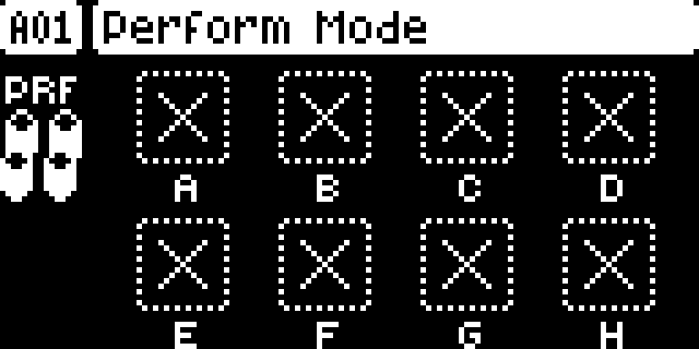
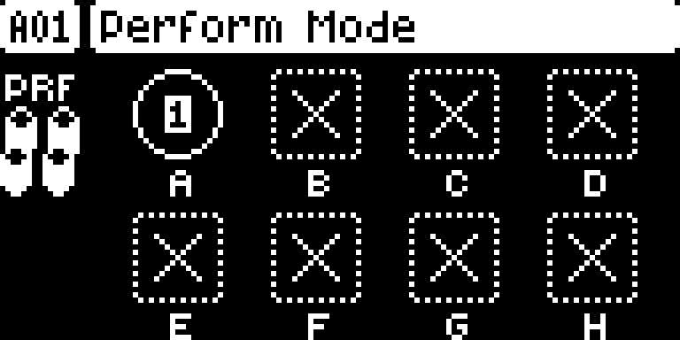
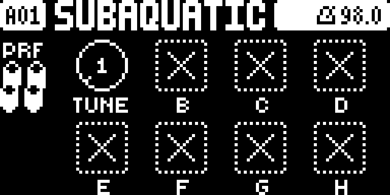
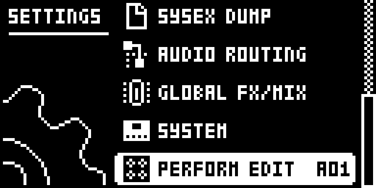
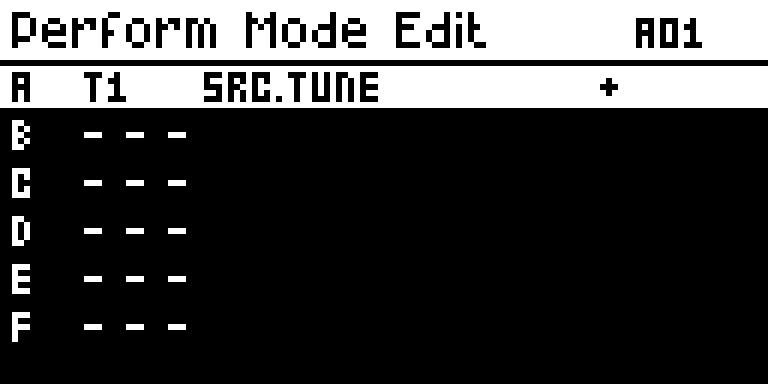

# Digi Perform

Modwerk metadata version: `0.1.0-experimental`.

## Overview

Digi Perform adds a Perform page to the original Digitakt, modelled on the Analog Four’s performance macros. It is the second page of the TRIG page: press TRIG again. Knobs A–H each move one parameter of one track, or the same parameter of all eight audio tracks, as an offset added on top of the sound. The knobs feel like the stock parameter knobs: the same acceleration, push and turn for larger steps, and FUNC and turn to jump between the parameter’s own snap values. A knob picks up the parameter’s current value when the page opens, so nothing jumps.

The eight assignments live in the pattern, so each pattern has its own and they are saved with the project (save the project to keep them; see Saved projects). They are made on the page itself with Perform Quick Assign (FUNC and a knob’s push), or in SETTINGS > PERFORM EDIT (Perform Edit).

The change is added after the engine has smoothed and modulated the parameter. It is never a parameter lock and never changes the stored value: leaving the page, opening Perform Edit or reloading the pattern puts every parameter back to what the sound stores. With the sequencer playing, selecting another pattern leaves the offsets in place until that pattern starts; then they let go and the knobs show the new pattern’s values.

## Controls

| Control | What it does |
| --- | --- |
| TRIG, pressed again on the TRIG page | Opens the Perform page when you tap it; holding TRIG there is still the stock page’s (its values, copy, paste and clear). Tap TRIG again, or press SRC, FLTR, AMP, LFO or a menu key, to leave. The trig keys and the transport keep working under it. |
| Knobs A–H | Move the knob’s parameter over its range with the stock encoder acceleration; push and turn for larger steps. The value shows under the knob for a second after it moves. |
| FUNC + turn a knob | Snaps the parameter to its own stock snap values, with the stock lock after each snap. |
| FUNC + a knob’s push (Perform Quick Assign) | On an empty knob: turn to choose the track (1–8 or ALL) and push, then turn to choose the parameter and push. NO cancels. On an assigned knob: removes the assignment. |
| FUNC + NO | Reloads the pattern as stock does; the offsets go and the knobs pick up the reloaded values again. |
| Hold TRIG + REC / STOP / PLAY | Copy the page (all eight assignments), paste it over the page, or clear every assignment. The same key again undoes a paste or clear. Holding TRIG shows the values instead of the labels after a moment, as on the stock pages, and letting go with no other key brings the labels back and keeps the page. Plain REC, STOP and PLAY work as usual. |
| NO | Puts any moved knob back to its stored value and stays on the page. TRIG or another page key leaves. |
| FUNC + TRK, FUNC + PTN, FUNC + PAGE, a held step with LEFT/RIGHT or UP/DOWN | Leave the Perform page and open the stock chord setup, metronome, scale, microtiming or retrig screens, which behave exactly as stock. Press TRIG twice to come back. |

Perform Edit (SETTINGS > PERFORM EDIT) lists all eight knobs.

| Control | What it does |
| --- | --- |
| UP / DOWN or LEVEL | Choose a row; the one under the cursor is shown inverted. |
| YES, or a knob’s second push | Make an assignment (track 1, SRC.TUNE, +) when the row is empty, or remove it. A first push on a knob only selects its row. |
| Knob A | The track whose parameter moves, 1–8, then ALL: the same offset on every audio track. |
| Knob B | The parameter: L1.\* and L2.\*, SRC.\*, FLT.\* or AMP.\* of that track (or of every track). |
| Knob C | Direction: right for + (the knob raises the parameter), left for − (it lowers it). |
| NO | Back to the Perform page, or to the SETTINGS list when Perform Edit was opened from there; a second NO leaves SETTINGS. |

## Usage

Use the access steps below after installing a compatible build. The tutorial gives a first practical pass through the module.

### Where to find it

TRIG page, press TRIG again; Perform Edit in SETTINGS > PERFORM EDIT

1. On the TRIG page press TRIG again to open the Perform page. Hold FUNC and push an empty knob (Perform Quick Assign): turn to choose the track (1–8 or ALL) and push, then turn to choose the parameter and push. NO cancels.
2. Turn a knob to move its parameter; hold FUNC while turning to snap. FUNC and a push on an assigned knob removes it.
3. SETTINGS > PERFORM EDIT lists all eight knobs and sets each one’s direction.
4. A tap of TRIG leaves the page, as does any other page key.

### Quick tutorial: move a track’s pitch from the Perform page

1. Use a build containing Digi Perform and a pattern with a sounding sample on track 1. On the TRIG page press TRIG again to open the Perform page.
2. Perform Quick Assign: hold FUNC and push knob A, push to accept track 1, then push again to accept TUNE. Knob A now shows TUNE and the track’s number.
3. Play the pattern and turn knob A: track 1’s pitch moves and the value shows under the knob. Hold FUNC while turning to jump between the parameter’s own snap values.
4. Tap TRIG to leave: the pitch goes back to what the sound stores. The assignment stays in the pattern and is saved with the project, and SETTINGS > PERFORM EDIT lists it.

## Compatibility and limitations

Digi Perform needs core 2.1 and is built for OS 1.53 and 1.54.

- It cannot be installed with Digi Matrix: both patch the render site after the LFOs (0x40077eb2), so the configurator never offers them together.
- Parameters are the sound’s slots 1–45, named as the Digitakt’s own pages name them (a mod that renames a page’s knobs for its machines, Digi Mono for example, is not followed yet); ranges come from the firmware’s own table. FLT.DEL to FLT.ROUT are the filter’s second page.
- One assignment for each knob A–H, and a track’s parameter can belong to one knob only. The assignments are kept in bits of tracks 5 to 8’s spare sound bytes that no other mod here uses.
- Selecting another pattern while the sequencer is stopped reloads the offsets at once; while it plays, the new pattern’s knobs take over when it starts. This is detected from the audio engine’s own pattern bytes; the author has seen it work on a unit.
- After the stock chord, metronome, scale, microtiming or retrig screens, press TRIG twice to open the Perform page again.
- The Perform page opens from the audio tracks’ TRIG page; on a MIDI track TRIG keeps its stock job. SETTINGS > PERFORM EDIT works from any track.
- The assignments are kept in bytes of each sound record that the firmware saves and loads but does not use itself. Like any other sound edit they are kept only when you save the project: a power cycle without a save brings back the last saved state. The author reported the save and power-cycle check as a whole (TESTING.md).

### Changes to stock behaviour

With Digi Perform installed every stock flow works as before, except for these listed changes. Nothing changes until you press TRIG a second time or add an assignment, and no assignment exists in a new project.

- **A tap of TRIG on the TRIG page** (stock: nothing happens; holding it keeps its stock job, the values and copy, paste and clear) opens the Perform page. This is needed because the page replaces no stock screen; a new key or an own top-level page would have taken a key the Digitakt already uses. TRIG again, or any other page key, leaves it. It is hooked on the TRIG page of the audio tracks only; on a MIDI track TRIG keeps its stock job.
- **A PERFORM EDIT row in SETTINGS**, after the stock rows. YES opens Perform Edit; NO goes back to the SETTINGS list.
- **Inside the Perform page** the knobs A–H, FUNC and a knob’s push, and hold TRIG + REC / STOP / PLAY work as described above. FUNC + TRK, FUNC + PTN, FUNC + PAGE and a held step with an arrow leave the page, so the stock chord setup, metronome, scale, microtiming and retrig screens are the stock ones, unchanged.
- **Saved projects:** save the project to keep your assignments. They are stored with the pattern's sounds, so a power cycle without a save brings back the last saved state, the same as for other sound edits. The assignments are kept in spare bits of the sounds on tracks 5 to 8 (byte 3 bits 0–6, bytes 4 and 5), which the firmware saves and loads but does not use itself. These bytes travel with the sound: a sound saved from track 5–8 to the pool, or copied onto another track, carries the bits along. Loading a sound onto tracks 5–8 puts the pattern’s assignments back, and the module checks its own marker before it trusts the bits; on tracks 1–4 Digi EQ and Digi Poly guard their own bytes the same way. A project saved with assignments and loaded on a build without Digi Perform should ignore them. Neither the copy case nor the build change is tested yet.

The effect on a parameter is never stored: removing the module or leaving the page puts every parameter back to what the sound stores.

## Tests and measurements

See [TESTING.md](TESTING.md) for the build checks, the documentation capture run and the author’s own hardware observations. UI captures do not qualify audio, timing, stress behaviour, persistence or hardware. The memory figure is the object’s size, not a measured runtime cost.

## Authorship and licences

- ROMsets: Digi Perform design and code.
- Adapted in part from Digi Matrix by the digi1_mods authors (kitstore.h, the page and key handling, the render hook and the SETTINGS row glue), MIT licence; the notice is in [NOTICE](NOTICE).

The module is under GPL-3.0-or-later ([LICENSE](LICENSE)). Capture rights are declared separately in [media/LICENSE.md](media/LICENSE.md).

## Screens and audio

Real firmware-rendered emulator captures on OS 1.54. The [capture record](media/capture.json) includes source and build identities, panel inputs, timestamps and PNG hashes. [Capture rights](media/LICENSE.md) preserve the underlying interface rights. The [thumbnail](media/thumbnail.svg) is an illustration. No audio demonstration is claimed. The capture runs without the audio engine, so the knobs show their assignment but not live values.

The Perform page: TRIG pressed again on the TRIG page.

Perform Quick Assign: FUNC and a knob’s push, then turn to choose the track.

Knob A assigned to track 1’s TUNE.

SETTINGS > PERFORM EDIT is the last row of the SETTINGS list.

Perform Edit lists all eight knobs: A moves SRC.TUNE of track 1, direction +.
