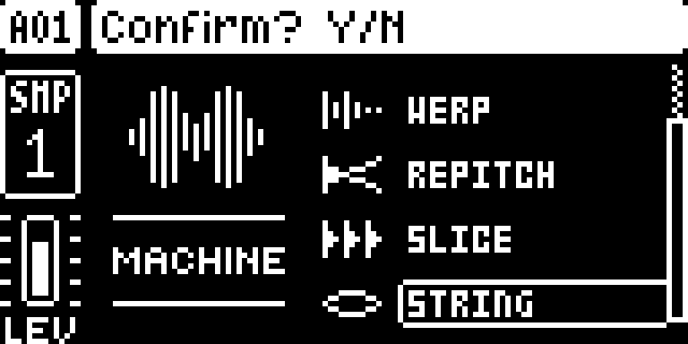
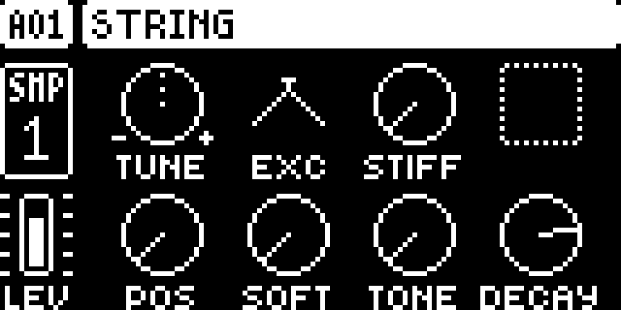
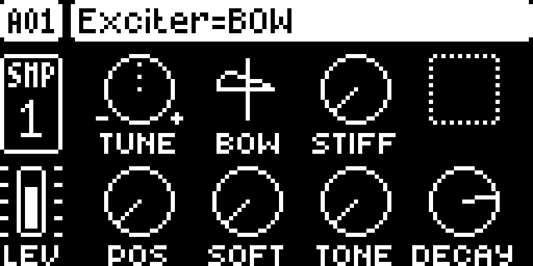

# STRING

## Overview

STRING is a Karplus-Strong plucked string SRC machine for the original Digitakt, OS 1.53 and 1.54, on Core 2.1 with Machine Pages. It appears in the SRC machine list next to the stock machines, and its audio goes through the Digitakt's regular AMP, filter, mixer and effects path, like any stock machine.

Choose an exciter (BOW, HIT, NOISE or PLUCK), then shape the string with stiffness, pluck position, softness, damping and a decay time. Machine Pages draws its SRC page with STRING's own names, ranges and defaults. STRING stores its values in SLICE's eight parameter slots, so they are saved with the project, can be locked per step, are LFO destinations and are reachable by MIDI CC and NRPN like any stock parameter.

Version **0.9.0**, imported unchanged from [Alez22/digistring](https://github.com/Alez22/digistring) at commit `69ab748`. A demo you can listen to is on the [project website](https://alez22.github.io/digistring/).

## Controls

Each control has STRING's own range and default, applied when a track switches to STRING.

| SRC knob | Control | Range | Default | What it does |
| --- | --- | --- | --- | --- |
| A | TUNE | stock | 0 | Pitch |
| B | EXC | 4 icons | PLUCK | Exciter: BOW, HIT (mallet), NOISE, PLUCK |
| C | STIFF | 0–127 | 0 | Stiffness: from an ideal string to a bell-like, inharmonic tone |
| D | – | – | – | Blank: STRING plays no sample |
| E | POS | OFF, 1–64 | OFF | Pluck position, from the bridge to the middle of the string |
| F | SOFT | 0–127 | 0 | Darker, softer attack |
| G | TONE | 0–4 | 0 | Damping inside the string: 0 warm, 3 bright, 4 open and metallic |
| H | DECAY | 0–127 | 100 | How long the string itself rings: 0.07 s to about 17 s, endless at the top |

- **EXC** is drawn as an icon instead of a knob. BOW keeps exciting the string for as long as the note is held; the other three are one-shot.
- **The AMP page** controls the note envelope as usual. DECAY sets how long the string resonates; the AMP decides how long you hear it.
- **DECAY is a time** (T60, the time to fall by 60 dB): the same setting rings as long on a low note as on a high one.
- **TONE** is a lowpass inside the string whose cutoff follows the note, so a setting sounds alike across the keyboard. The cutoff also rises with DECAY: long notes stay bright, and darker TONE settings shorten high notes somewhat.
- **Retriggering** a ringing string plucks it again: the new excitation adds to the vibration, as on a real string.
- **Pitch:** an untransposed note plays C4 at 261.6 Hz, and the keyboard follows equal temperament up to about 12 kHz.
- **LFO** destinations show STRING's names, grouped as `STRG`.

## Usage

STRING is chosen per audio track, like any stock SRC machine, and played from the trig keys, the sequencer or MIDI.

### Where to find it

SRC machine list (FUNC + SRC), as STRING.

1. Use a build containing STRING for the original Digitakt on OS 1.53 or 1.54.
2. Select an audio track, press FUNC + SRC, choose STRING in the machine list and confirm with YES.
3. The SRC page then shows TUNE, EXC, STIFF, POS, SOFT, TONE and DECAY; knob D is blank.

### Quick tutorial: a plucked and a bowed string

1. Select an audio track, press FUNC + SRC, choose STRING in the machine list and confirm with YES.
2. Play a trig key: the default sound is a plucked string at the track's pitch. Turn knob B (EXC) to choose BOW, HIT, NOISE or PLUCK, drawn as icons.
3. Turn knob H (DECAY) to set how long the string rings, and knob G (TONE) from 0 (warm) to 4 (open and metallic). The AMP page still shapes what you hear.
4. Return to a stock machine with FUNC + SRC; the track's SLICE values stay in the project.

## Compatibility and limitations

Requires Core 2.1 and Machine Pages. Built for OS 1.53 and 1.54. It claims SRC machine slot 8 (`machine:8`).

- **Sounds saved with 0.8.0** keep their exciter and values. SOFT now spans 0–127 instead of 0–63, so a saved SOFT value gives about half the softening it gave before.
- **Low notes.** Below F#1 (47 Hz) the string no longer fits its delay line and runs at a lower internal rate instead, down to about 1.5 Hz, without octave jumps.
- **STIFF** keeps the fundamental in tune up to about 880 Hz. Above that, high STIFF values make very high notes slightly sharp (about +8 cents at 1760 Hz).
- **TONE.** On high notes with a long DECAY the filter opens completely, so TONE 3 and 4 can sound the same there.
- **What it patches.** Nothing: STRING has no sites. It renders from Machine Pages' `ev_render_voices` event (order 20), right after the stock source voices and before the buffers reach AMP and filter; each STRING track renders 32 samples per block. Machine Pages draws its SRC page names, value texts, EXC icons, knob scaling and LFO names from STRING's page descriptor.
- **Memory.** About 7 KB of code and data and 16.8 KB of statically allocated state (a 2 KB delay line per track) in the shared mod memory; no fast SRAM.
- **Track count.** Three STRING tracks play cleanly at once on hardware (OS 1.54); from four the UI lags. The DSP load is the same as 0.8.0 within 3 points, and the count depends on the sounds: long DECAY, BOW and low notes cost more.
- **Other mods.** STRING works beside Note Accumulator and RAM Machines. Machine Pages conflicts with DigiChain, so STRING cannot be combined with Digi Mono or Digi Poly.

## Tests and measurements

See [TESTING.md](TESTING.md) for the exact evidence and the checks still open.

## Authorship and licences

Alez22: design and code, with Claude Code assistance. Core 2.1, Machine Pages, the machine table and the SDK: irpina (elekloader). The RAM addresses and pitch lookup follow soejrd's Sophie for Digitakt.
Code: [MIT](LICENSE). The author's own README is kept in [upstream/README.md](upstream/README.md). Screens show Elektron's interface solely to document the modification. No Elektron firmware is included.

## Screens and audio

These captures show the **OS 1.54 build with Core 2.1, Machine Pages and STRING**, booted in the pinned digiemu with firmware-native drawing; the OS 1.53 build gives byte-identical screens. See [capture provenance](media/capture.json) for hashes and panel inputs. A demo recording is on the [project website](https://alez22.github.io/digistring/); it is not part of this module's evidence.

Press FUNC + SRC on an audio track and go down past SLICE to STRING. YES selects it.

The SRC page: TUNE, EXC (drawn as an icon) and STIFF on top, knob D blank; POS, SOFT, TONE and DECAY below.

Turning knob B changes the exciter; the title bar names it while the knob moves.
