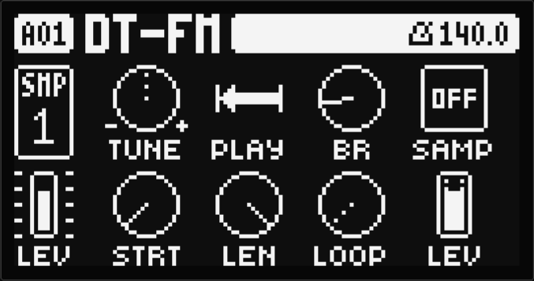
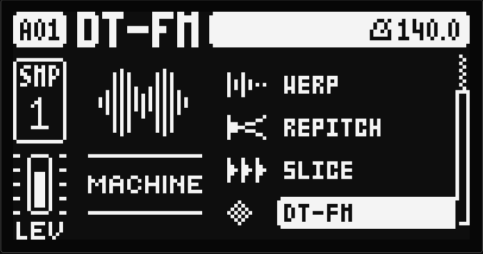
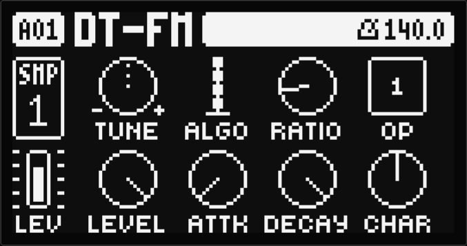

# DT-FM

## Overview

DT-FM is a four-operator FM synth machine for the original Digitakt Mk1. It keeps the stock AMP, filter, mixer and send path intact while adding its own `FUNC + SRC` machine page and operator-driven FM voice.

This folder is the Modwerk wrapper around the upstream DT-FM project at <https://github.com/mtalikka/DT-FM>. The module is pinned to the upstream `2255df788470638c867e24e83290f9e95e91e5ec` revision and keeps the original source under `src/`.

## Controls

- `SRC A — TUNE`: select the operator tuning target.
- `SRC B — ALGO`: switch the FM routing algorithm.
- `SRC C — RATIO`: set frequency ratio for the selected operator.
- `SRC D — OP`: choose which of the four operators to edit.
- `SRC E — LEVEL`: tune output or modulation depth.
- `SRC F — ATTK`: adjust envelope attack.
- `SRC G — DECAY`: adjust decay or hold behaviour.
- `SRC H — CHAR`: adjust feedback and brightness.

## Usage

1. On an audio track using the default single-shot machine, press `FUNC + SRC` to open machine assignment.
2. Highlight `DT-FM` and press `YES` to assign it; the track opens DT-FM's SRC controls.
3. Choose an operator with encoder D, then adjust its ratio with C and level with E; shape its envelope with F and G.
4. Play trigs to use the FM voice, and press `STOP` to stop playback. Use the usual AMP page for note shaping.

## Compatibility and limitations

- Compatible with Digitakt OS 1.53 and 1.54.
- Requires the `machine-pages` module to expose the DT-FM SRC page.
- This is a catalog import wrapper around the upstream source. A limited Modwerk hardware performance observation is recorded below; it does not fully qualify the DSP engine on hardware.
- Memory and audio load measurements remain unmeasured in Modwerk.

## Tests and measurements

- Build metadata and browser catalog pinning were verified with the Modwerk toolchain.
- The module manifest and `build.json` were checked against the v3 module contract under Node 24.
- The owner reports six simultaneous DT-FM tracks before CPU usage reached 100% on a Digitakt 1 OS 1.54 with FAST audio enabled and Digi Health, Digi Utils and Machine Pages installed. See [TESTING.md](TESTING.md) for scope and limitations. Worst-case DSP load, memory, persistence, sampling and broader hardware behavior remain unqualified.

## Authorship and licences

- Author: `mtalikka`
- Source repository: <https://github.com/mtalikka/DT-FM>
- Source license: MIT
- Modwerk wrapper license: MIT, matching the upstream project

## Screens and audio

Start on the selected audio track's default single-shot SRC page. Press `FUNC + SRC` to open the machine picker.

`DT-FM` is highlighted in the machine picker. Press `YES` to assign it and open its SRC controls.

DT-FM exposes operator, ratio, level and envelope controls on SRC. This capture was made in `digiemu` 0.4.1 with custom Elekloader firmware, not the Modwerk-built firmware; it documents the UI, not audio behavior.

## Quick tutorial: assign and edit DT-FM

1. On an audio track using the default single-shot machine, press FUNC + SRC to open machine assignment.
2. Highlight DT-FM and press YES to assign it; the track opens DT-FM's SRC controls.
3. Choose an operator with encoder D, then adjust its ratio with C and level with E; shape its envelope with F and G.
4. Play trigs to use the FM voice, and press STOP to stop playback. Use the usual AMP page for note shaping.

### Source note

The upstream project supplies the actual DSP code and runtime patch sites. This Modwerk module adapts that existing Elekloader build into the Modwerk catalog structure without changing the upstream implementation.
