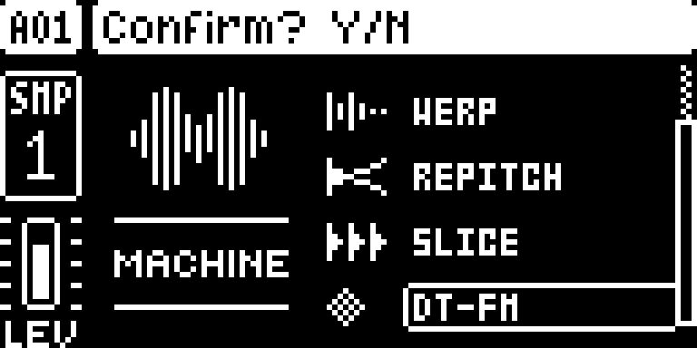
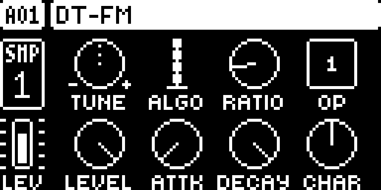

# DT-FM — Digitakt

Modwerk version: `1.2.1`, the author's released files, unchanged.

## Overview

DT-FM is a four-operator FM synth SRC machine for the original Digitakt on OS 1.53 and 1.54, by mtalikka. ALGO picks how the four operators feed each other, and its knob draws the routing. OP chooses the operator that RATIO, LEVEL, ATTK and DECAY edit; CHAR sets operator 4's feedback and the overall brightness. The voice then goes through the Digitakt's own AMP, filter, mixer and sends, and every SRC control takes parameter locks. All four operators are saved with the pattern's kit. Start with one or two tracks: the author measured about 95 % CPU with four DT-FM tracks, 85 % with digihealth's FAST AUDIO on.

- Eight algorithms, from one stack of four operators to four carriers side by side; ALGO's knob draws the routing.
- Each operator has its own RATIO (0.25 to 16), LEVEL and attack/decay envelope; DECAY INF holds.
- CHAR sets operator 4's feedback and the overall brightness.
- Every SRC control can be parameter-locked; the Digitakt's AMP, filter, mixer and sends shape the result.

## Controls

| Control | What it does |
| --- | --- |
| TUNE | SRC knob A: pitch, combined with the trig's note. |
| ALGO | SRC knob B: operator routing 1–8. The knob draws it: modulation flows down, and the operators on the bottom bar are the ones you hear. |
| RATIO | SRC knob C: the selected operator's frequency ratio, 0.25 to 16. |
| OP | SRC knob D: which operator (1–4) RATIO, LEVEL, ATTK and DECAY edit. A trig's locks on those four change the operator OP selects on that trig. |
| LEVEL | SRC knob E: the selected operator's level: its volume as a carrier, its modulation depth as a modulator. |
| ATTK | SRC knob F: the selected operator's envelope attack. |
| DECAY | SRC knob G: the selected operator's envelope decay; INF holds. |
| CHAR | SRC knob H: operator 4's feedback and the overall brightness. |

The manifest leaves numeric defaults unspecified. A track switched to DT-FM starts with every operator at the author's defaults.

## Usage

Use the access steps below after installing a compatible build. The tutorial gives a first practical pass through the module.

### Where to find it

Location: SRC machine list.

1. Use a build containing DT-FM for the original Digitakt on OS 1.53 or 1.54.
2. Select an audio track, press FUNC + SRC and choose DT-FM from the machine list.
3. Shape the sound on the SRC page: ALGO for the routing, OP for the operator that RATIO, LEVEL, ATTK and DECAY edit.

These instructions assume the module is already installed in a compatible build. For selecting and building it in Modwerk, see the [Digitakt guide](../../../machines/digitakt/README.md).

### Quick tutorial: build an FM tone

1. On one audio track choose DT-FM with FUNC + SRC. No sample is needed.
2. Turn ALGO to 1, so the four operators form one stack, and set OP to 4. Raise its LEVEL a little and listen to the tone brighten.
3. Play a few trigs. Turn OP to 2 and set its RATIO to 2, then shorten its DECAY for a plucked attack.
4. Parameter-lock ALGO on one trig to hear another routing, then remove the lock. On AMP set HOLD to NOTE and a finite DEC, so notes end.

The normal AMP page shapes the note: HOLD = NOTE lets TRIG LEN decide when the release begins, and a finite DEC lets it release. Retriggering chokes the previous voice on that track with a brief transition. A trig's RATIO, LEVEL, ATTK and DECAY locks change the operator OP selects on that trig: lock OP as well to pick it.

### Algorithms

`>` means "modulates"; the carriers are the operators you hear.

| ALGO | Routing |
| --- | --- |
| 1 | 4 > 3 > 2 > 1 |
| 2 | (3 + 4) > 2 > 1 |
| 3 | (2 + (4 > 3)) > 1 |
| 4 | (2 + 3 + 4) > 1 |
| 5 | 2 > 1, 4 > 3 |
| 6 | 4 > (1, 2, 3) |
| 7 | 1, 2, and 4 > 3 |
| 8 | 1, 2, 3, 4: four carriers |

Operator 4 also has feedback, set by CHAR. The table follows the author's [algorithm diagrams](upstream/README.md#algorithms).

## Compatibility and limitations

- Original Digitakt (Mk1), OS 1.53 and 1.54, with core 3.0 or newer and Machine Pages, which draws DT-FM's SRC page. Digitakt II is not declared compatible.
- Its author warns that several DT-FM tracks can freeze the Digitakt without FAST AUDIO, which the library no longer offers: keep to one or two tracks. Four tracks used about 95 % CPU without it and about 85 % with it; on a Modwerk build with FAST AUDIO, six tracks played before CPU reached 100 %. Eight tracks are not claimed.
- Not with SOPHIE: DT-FM is a fork of it and uses the same names.
- Needs core 3.0 or newer, so it does not build beside Digi EQ 1.0.2, which builds only on core 2.1.
- Machine Pages conflicts with DigiChain, so DT-FM cannot be combined with Digi Mono or Digi Poly. NEIGHBOR 0.6 and DIGISLICER 2.1 draw their own SRC pages and stay incompatible.
- The sound pool keeps only the operator OP shows; a pool sound's other three operators start at their defaults.
- Tracks saved as DT-FM by 1.1.0 or earlier load as another machine: select DT-FM on them again.

## Tests and measurements

The evidence tier is `author-hardware`: the author tested 1.2.1 on a Digitakt mk1 on OS 1.54 with elekloader's core 3.0 and Machine Pages 1.1. Modwerk builds it with core 4.4 and its own Machine Pages 1.2, which has not run on a unit. [TESTING.md](TESTING.md) records the identities, what was linked and captured, and what was not tested.

DT-FM holds **11,939 B** (code, data and state) in the mods' RAM, excluding the core, Machine Pages and linker alignment. The CPU figures above are the author's.

## Authorship and licences

- mtalikka — DT-FM design, FM engine and hardware testing
- Matt Estela (@mestela) — the Sophie for Schwung code DT-FM grew from
- Sjoerd (Soejrd) — DigiSophie, which DT-FM forks

The module is licensed under [MIT](LICENSE). Imported source: [mtalikka/DT-FM at `9ac1802`](https://github.com/mtalikka/DT-FM/tree/9ac1802b82b455c0567136032ef0df646a7fc074) (v1.2.1). The library builds the author's released `.elemod` files. Machine Pages' header `src/digitakt-mk1/core3.h` is irpina's, under GPL-2.0-or-later. The author's README, DSP notes and third-party notices are in [upstream/](upstream/README.md).

## Screens and audio

Real firmware-rendered emulator captures on OS 1.54. The [capture record](media/capture.json) includes source and build identities, panel inputs, timestamps and PNG hashes. [Capture rights](media/LICENSE.md) preserve the underlying interface rights. The [thumbnail](media/thumbnail.svg) is an illustration. No audio demonstration is claimed.

