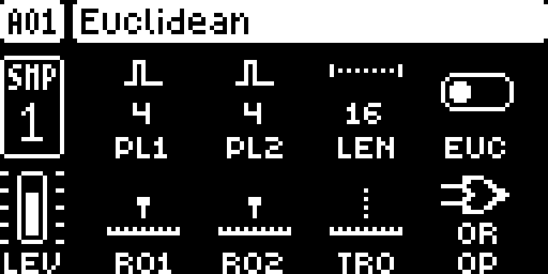

# Euclidean Sequencing

## Overview

Generate rhythms from two pulse generators on each audio or MIDI track. Rotate either generator, rotate the whole result and combine them with OR, XOR, AND or SUB.

Version **1.1.4** for Digitakt I OS **1.53 and 1.54**, with separate packages
for each OS. Do not use a 1.53 package on 1.54. Hardware testing is recorded in the
[hardware report](evidence/hardware-testing.json) and [TESTING.md](TESTING.md).

## Controls

| Control | Action |
| --- | --- |
| A — PL1 / B — PL2 | Pulse counts for generators 1 and 2. |
| C — LEN | Track length; editable in PER TRACK scale mode, up to 64 steps. |
| D — EUC | Turn to enable/disable; press to toggle immediately. |
| E — RO1 / F — RO2 | Rotate each generator. |
| G — TRO | Rotate the combined track rhythm. |
| H — OP | Choose OR, XOR, AND or SUB. |
| FUNC + turn D off | Convert the generated sequence into ordinary trigs. |
| TRK + trig / NO | Select an audio or MIDI track / close the page. |

## Usage

Follow these steps on either supported OS release.

### Quick tutorial

1. Create a few source trigs on an audio track with a loaded sample. Hold FUNC + AMP to open Euclidean.
2. Set PL1 to 5, PL2 to 0 and enable EUC with D. With a 16-step track this distributes five hits across the loop.
3. Press PLAY. Turn RO1 to move those hits, then add PL2 pulses and try the OP combinations.
4. Turn D off to restore the ordinary sequence and press NO to close. Use FUNC while turning D off only when you want to replace the ordinary trigs with the generated result.

## Compatibility and limitations

Requires Core 2.1, dt-support.
Use original stock firmware in Elekloader. Install each dependency once.

- Generated hits use successive source steps and their locks.
- Four panel counts move A–H by one value in 1.1.3; D’s press toggle remains immediate.
- In common scale mode, change length through the normal scale menu.
- Conversion replaces ordinary trigs; ordinary EUC-off is nondestructive.
- Stock firmware can discard the Euclidean project extension on save.

The earlier whole-build format-1 packages cannot be combined with these format-2
modules. Compatibility with the wider Modwerk catalogue still needs checking.

## Tests and measurements

See [TESTING.md](TESTING.md) for exact evidence and remaining checks. Screenshots
show a real booted combined build; they do not prove standalone behavior, MIDI
output, audio quality, worst-case timing or hardware operation.

## Authorship and licences

sumedho: module design/development with Codex assistance; author identity confirmed. irpina: Elekloader, Core 2.1, the Core 3.0 header and Machine Pages (1.2 is adapted by sumedho to run on Core 2.1).
Code: [GPL-2.0-or-later](LICENSE). Screens show Elektron's interface solely to
document the modification. No Elektron firmware is included.

## Screens and audio

The following OS 1.53 gallery documents the **OS 1.53 all-mods build on Core 2.1**. See
[capture provenance](media/capture.json) for hashes, inputs and any retained
regression frames, which explicitly identify their fixture setup.
No audio demonstration is supplied yet.

Hold FUNC + AMP to open Euclidean for the selected track; D enables its generated rhythm.

Turn A/B to change pulses and E/F/G to rotate. H chooses how the generators combine.

## OS 1.54 screenshots

These captures use the actual **OS 1.54 all-mods SysEx on Core 2.1**. See [1.54 provenance](media/1.54/capture.json).

Hold FUNC + AMP to open Euclidean for the selected track; D enables its generated rhythm.

Turn A/B to change pulses and E/F/G to rotate. H chooses how the generators combine.
