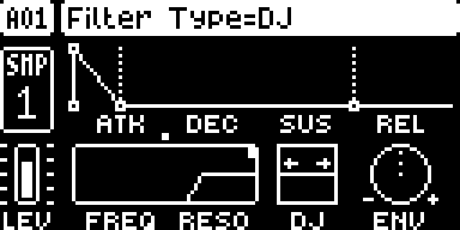
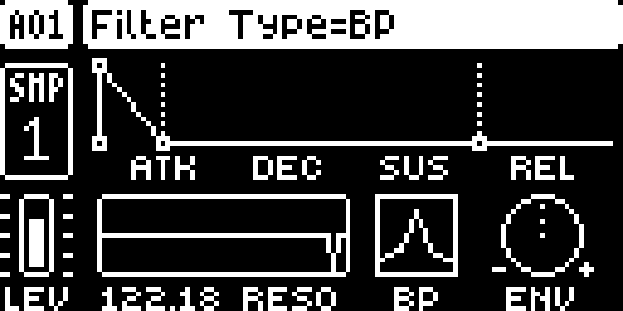

# Filters

## Overview

Two more filter types on the Digitakt I's own FLTR page. TYPE (knob G) goes on past EQ:5:

| TYPE | What it is |
| --- | --- |
| DJ | A one-knob DJ filter. FREQ left of the middle is a low-pass that sweeps down as you turn left, right of the middle a high-pass that sweeps up; the middle is open. RESO gives a gentle DJ-mixer peak. |
| BP | Band-pass, 12 dB/octave, unity gain at the centre. RESO narrows it. |

FREQ, RESO and ENV act as on the stock types and, like them, are saved with the sound, can be p-locked and modulated by the LFOs. The filter envelope (ATK, DEC, SUS, REL, started by the trig) moves the cutoff exactly as on the stock types.

Version **0.1.0-experimental** for Digitakt I OS **1.54** on Core 2.1.

## Controls

The new types live on the stock FLTR page; only what changes on them is listed.

| Control | On DJ and BP |
| --- | --- |
| TYPE (G) | DJ and BP after EQ:5. The knob draws each type's shape and the title names it, as for the stock types. |
| FREQ (E) | The cutoff. On DJ: below 64 low-pass, above 64 high-pass, 64 open. Turned quickly across the middle, DJ stops at 64 for about a quarter second, so you can land on "open"; a slow turn sweeps through. FUNC + FREQ jumps to the middle, then to the end you turn towards. A tick over the response box marks the middle. |
| RESO (F) | Resonance. (The stock EQ types call this knob GAIN; the new types keep RESO.) |
| ENV (H), ATK–REL (A–D) | The filter envelope and its depth, as stock. |

## Usage

Put DJ on any track you want to sweep live, for example a loop or a drum track.

### Quick tutorial: a DJ filter on a track

1. Select the track and press FLTR.
2. Turn TYPE (knob G) past EQ:5 to DJ.
3. Turn FREQ left of the middle for a low-pass, right of it for a high-pass; the middle is open.
4. Turn RESO up for a peak at the cutoff; FUNC + FREQ takes it back to open.

## Compatibility and limitations

- Built for OS 1.54 only, on Core 2.1.
- **Not beside Digi Health.** Digi Health's FAST AUDIO patches the same filter call in the render (0x400780a4), so the two are listed as conflicts and the configurator offers one or the other.
- A sound saved with DJ or BP loads on a build without Filters as EQ:5 (the stock code limits TYPE to EQ:5).
- The response box above FREQ and RESO borrows the nearest stock shape: DJ shows the stock LP or HP curve (flat when open), BP the narrowest EQ peak.
- Like the stock filter stage, the output is a quarter of the input (−12 dB); the stages after it make that up, so the new types sit at the stock types' level.

What it patches on OS 1.54: the per-voice filter call in the render (the `lea` at 0x400780a4), TYPE's text (0x40065336), the RESO/GAIN choice on the FLTR page (0x40037444), the response box's shape (0x4003799e) and its draw call (0x400378cc), the knob's parameter set (0x4000ff3c, for DJ's catch in the middle) and TYPE's maximum in its parameter descriptor (0x401aa75c). TYPE's knob graphic is swapped in its run-time UI record, not patched.

### Changes to stock flows

- **TYPE goes past EQ:5.** Stock stops at EQ:5; with this module TYPE has two more values. Every stock type behaves as before.
- **FREQ on DJ** stops briefly in the middle when turned quickly, and FUNC + FREQ jumps to the middle. On every other type FREQ is stock.

## Tests and measurements

See [TESTING.md](TESTING.md).

## Authorship and licences

draadpiraat: design and code, with Claude Code. Code: [GPL-3.0-or-later](LICENSE). Screens show Elektron's interface solely to document the modification. No Elektron firmware is included.

## Screens and audio

These captures show the **OS 1.54 build with Core 2.1 and this module alone**, booted in the pinned digiemu with firmware-native drawing. See [capture provenance](media/capture.json) for hashes and panel inputs. No audio demonstration is supplied yet.

Press FLTR and turn TYPE (G) past EQ:5: DJ. FREQ (E) is now one knob for both directions: left of the tick a low-pass, right of it a high-pass.

One more step is BP, a band-pass whose width RESO sets. Turn TYPE back to LP, HP or EQ for the stock filters.
