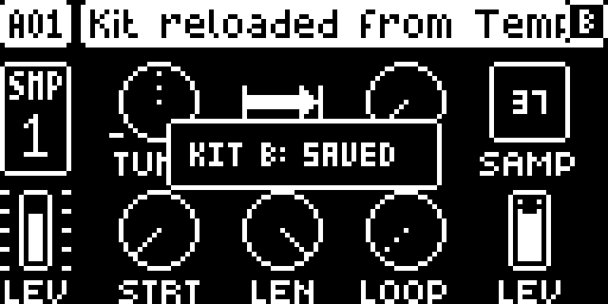

# Kit A/B — Digitakt

Modwerk version: `0.2.0`, the author's released 0.2 file, unchanged.

## Overview

Kit A/B, by ceredmeat, compares the sound you are tweaking with the one you last saved, without losing either. FUNC + YES temp-saves the pattern and its kit as usual: that is B. Your edits since are A. Hold TRK and press NO to hear B, with a small B in the top-right corner; press it again and your edits come back. The temp-saved copy is never overwritten, so FUNC + YES and FUNC + NO work as before. Only the kit switches: trigs and parameter locks stay as they are.

- TRK + NO switches between your edited kit (A) and the temp-saved kit (B).
- A small B shows in the top-right corner while you hear the saved kit.
- FUNC + YES and FUNC + NO work as before; the temp-saved copy is never overwritten.
- Only the kit switches; trigs and parameter locks stay as they are.

## Controls

| Control | What it does |
| --- | --- |
| TRK + NO | Switch between your edited kit (A) and the temp-saved kit (B). A small B shows in the top-right corner while you hear B. |
| FUNC + YES | Stock temp-save: the kit saved here becomes B. |

## Usage

Use the access steps below after installing a compatible build. The tutorial gives a first practical pass through the module.

### Where to find it

Location: Any page: hold TRK, press NO.

1. Use a build containing Kit A/B for the original Digitakt on OS 1.54.
2. Temp-save with FUNC + YES, then edit sounds.
3. Hold TRK and press NO to switch between your edits and the saved kit.

These instructions assume the module is already installed in a compatible build. For selecting and building it in Modwerk, see the [Digitakt guide](../../../machines/digitakt/README.md).

### Quick tutorial: compare your edits with the saved kit

1. Press FUNC + YES to temp-save the pattern and its kit.
2. Change a few sounds, for example FLTR FREQ on track 1.
3. Hold TRK and press NO: you hear the saved kit, and B shows in the top-right corner.
4. Hold TRK and press NO again: your edits come back.

## Compatibility and limitations

- Original Digitakt (Mk1), OS 1.54. Digitakt II is not declared compatible.
- Needs core 4.1 or newer, so it does not build beside Digi EQ 1.0.2, which builds only on core 2.1.
- Anything changed while hearing B is thrown away when you switch back to A.
- Changing pattern while on B puts your edits back into the pattern you left (KIT A KEPT).
- NO TEMP SAVE YET shows when there is no temp-saved copy: press FUNC + YES once first.

## Tests and measurements

The evidence tier is `author-hardware`: the author tested Ctrl All, Kit A/B and Real Units 0.2 on a Digitakt MKI on OS 1.54, together with seven other FLEXMODS mods, elekloader's core and seq-events (FLEXMODS 1.0, 16 November 2026; the same files ship unchanged through FLEXMODS 1.5). This module pins that released file. Modwerk builds it with core 4.4, which has not run on a unit here. [TESTING.md](TESTING.md) records the identities, what was linked and captured, and what was not tested.

Kit A/B holds **3,572 B** (code, data and state) in the mods' RAM, excluding the core and linker alignment. Runs on the UI side only, nothing in the audio render; no CPU figure was measured.

## Authorship and licences

- ceredmeat (Cere), made with Claude — Kit A/B design and code

The module is licensed under [GPL-2.0-or-later](LICENSE). Imported source: [ceredmeat/FLEXMODS at `e6a2aab`](https://github.com/ceredmeat/FLEXMODS/tree/e6a2aabf8a94118a7b761dbfeac3e325ce4cd4db/mods/kitab). The library builds the author's released `.elemod` file. The header `src/digitakt-mk1/core3.h` is irpina's, from elekloader, under GPL-2.0-or-later. The author's README is in [upstream/](upstream/README.md).

## Screens and audio

Real firmware-rendered emulator captures on OS 1.54. The [capture record](media/capture.json) includes source and build identities, panel inputs, timestamps and PNG hashes. [Capture rights](media/LICENSE.md) preserve the underlying interface rights. The [thumbnail](media/thumbnail.svg) is an illustration. No audio demonstration is claimed.

