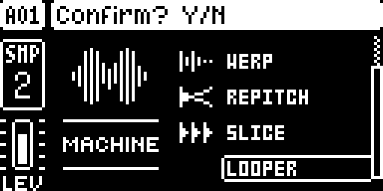
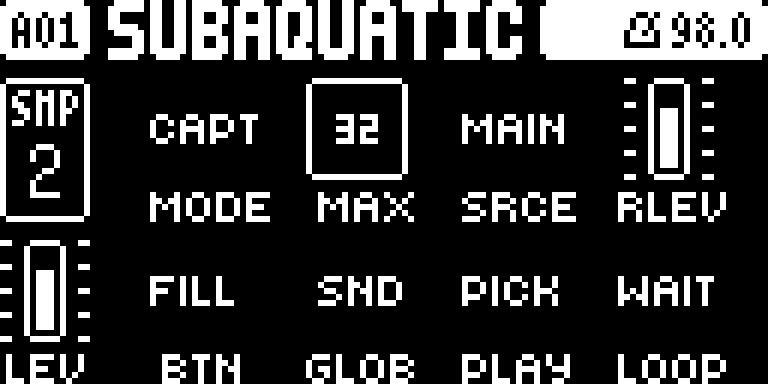

# Live Looper

## Overview

Put the LOOPER machine on one audio track and it becomes a looper that records the master mix (or the inputs) all the time, loop by loop, on the sequencer's step grid. Press a button and the loop playing now is captured and keeps playing on that track: through pattern changes, with or without trigs, following the tempo if you want.

Version **0.1.0-experimental** for Digitakt I OS **1.54** on Core 2.1 with Machine Pages. The looper is based on sumedho's [RAM Machines](../ram-machines/); what differs is listed under [What differs from RAM Machines](#what-differs-from-ram-machines).

## Controls

The looper is one machine in the machine list, LOOPER, with a second SRC page for its settings.

### The looper (one track)

Choose LOOPER on an audio track with FUNC + SRC, confirm with YES. Its SRC page has the stock sample controls (TUNE, PLAY, BR, STRT, LEN, LOOP, LEV) for the loop; pushing knob D there opens the loop in the stock recorder's trim editor, to keep it as a sample. Press **SRC again** for **page 2**, the looper's settings for the whole unit:

| Knob | Setting | Values |
| --- | --- | --- |
| A | MODE | OFF, ONCE, CAPT (below) |
| B | MAX | The loop length in steps: 1, 2, 4 … 128 (64 by default) |
| C | SRCE | What is recorded: MAIN, IN L, IN R, IN LR |
| D | RLEV | Record level (100 = as heard) |
| E | BTN | The capture button: FILL, UP or BOTH |
| F | GLOB | Which of the loop track's parameters stay the same in every pattern: OFF, SND (delay and reverb sends), FLT (also the filter page), AMP (also the amp page), ALL (also the SRC page and the LFO) |
| G | PLAY | How the take plays: TRIG, PICK, PTCH, WARP (below) |
| H | LOOP | Shows the looper's state (OFF, WAIT, ARM, REC, LOCK, RDY, LOOP, CAPT, NRAM) and how far the loop has got |

- **CAPT**: the loop records all the time. Press the button at any moment: the loop being recorded now is handed over when it ends and plays from then on.
- **ONCE**: press the button to arm. The next loop is recorded, handed over and locked; press again for another.
- **The button**: FILL means switching fill mode on (hold PAGE); UP works on the LOOPER SRC pages. While armed, recording, or for a moment after a hand-over, a banner slides over the page title on every page with the loop's progress.
- **PLAY TRIG**: the track's own trigs end each loop and play the take.
- **PLAY PICK**: loops start on the sequencer's step grid every MAX steps, and the module plays the take on the track itself. The track needs no trigs, and its trigs are ignored: the loop plays on through every pattern whose kit has LOOPER on that track.
- **PLAY PTCH**: as PICK, and the loop follows the tempo like a record: faster and higher when the tempo goes up. TUNE shifts it further.
- **PLAY WARP**: as PICK, and the loop follows the tempo at its own pitch.

Page 2's knobs turn as the stock knobs do: faster when turned quickly, in big steps while pushed, and FUNC + a knob jumps to its default. NO does nothing on page 2, as on the stock second pages; press SRC to go back.

## Usage

Play a pattern with something in it; the looper records what you hear.

### Quick tutorial: catch a loop and carry it into the next pattern

1. On an empty audio track, press FUNC + SRC, choose LOOPER and confirm with YES. Press SRC again for page 2. Set MODE to CAPT, PLAY to PICK and leave MAX at 64 (four bars).
2. Press PLAY. The looper records MAIN in the background all the time.
3. At any moment hold PAGE (fill on) or press UP on the SRC page: the banner says CAPTURE, and when the loop ends it says CAPTURED and the loop plays on the LOOPER track.
4. Change pattern. The loop keeps playing on the beat, through every pattern with LOOPER on that track. Set MODE to OFF or press STOP to stop it.

## What differs from RAM Machines

Live Looper starts from RAM Machines 1.3.1 and adds:

- **One-track looping**: one machine loops on its own, set up on its page 2; RAM Machines needs a record track and a play track.
- **ONCE and CAPT**: continuous recording into three buffers, so a capture never waits for a take to record and is handed over at the loop's end with nothing copied or cut.
- **PICK, PTCH and WARP**: the loop plays from the step grid without trigs, and can follow the tempo.
- **GLOB**: the loop track's sends (or more) stay the same through pattern changes.
- **The capture button and banner**: FILL or UP, and the progress banner on every page.
- **Recording MAIN before the master compressor**, so a loop goes through the compressor once, when it plays.
- **The trim editor**: push D on the looper's SRC page to keep the loop as a sample.
- **One machine**: LOOPER (machine id 122) does it all; there is no separate record machine, and it never meets RAM Machines' RAM-R1 and RAM-P1 in a kit.

## Compatibility and limitations

Requires Core 2.1 and Machine Pages. Built for OS 1.54 only.

- **Not beside RAM Machines or Digi Health.** Live Looper replaces RAM Machines, and Digi Health's FAST AUDIO patches the same audio routines. Both are listed as conflicts, so the configurator offers one or the other.
- **Kits from RAM Machines**: a kit with RAM-R1 or RAM-P1 on a track does not turn into LOOPER; choose the machine again.
- **Memory.** The looper takes 4 MB of the sample memory for the take, and 8 MB more for the two loop buffers once MODE is ONCE or CAPT. With a project's samples filling the memory, page 2 shows NRAM and tries again every 3 s. A loop holds up to 33 s (mono).
- **Not saved with the project.** The take and loops are lost at power-off or project load. Page 2's settings are kept for the whole unit on the +Drive (`/cfw/ramloop.a`, `.b`).
- **One loop at a time**, mono: MAIN and IN LR average the two channels.
- **A small click** can be heard at the end of each take, and a little noise on a solo kick.
- **Changing the machine** on the loop track discards the loop; capture it again.
- **Tempo.** In PICK a loop is MAX steps of the step count since PLAY: a tempo change makes the next loop shorter or longer. PTCH and WARP follow the tempo.
- **Overbridge.** With a Digitakt instance open (Overbridge standalone or the plugin), the unit gets slow: knobs, the filter and the rest of the UI lag. Close the instance and it is gone. Seen on draadpiraat's unit with LF03 (this looper and the Crossfader together, before the split); whether stock 1.54 does the same with an instance open is not checked yet.
- **Known bug: changing PLAY mode while the loop plays** restarts the loop mid-way. Change it while stopped, or between loops.

### Changes to stock flows

Each applies only with this module in the build:

- **FILL also captures.** While page 2's MODE is ONCE or CAPT and BTN is FILL or BOTH, switching fill mode on is also the capture button; fills play as stock. It is the one button free on every page while playing, so it was chosen over a new gesture. Set BTN to UP, or MODE to OFF, for stock FILL alone.
- **UP on the LOOPER SRC pages** is the capture button when BTN is UP or BOTH.
- **SRC again on a LOOPER track** opens page 2.
- **GLOB** (SND by default) keeps the loop track's chosen parameters the same in every pattern: a pattern change no longer brings that track's own values for them. Set GLOB to OFF for stock.

What it patches on OS 1.54: the looper's ten sites (RAM Machines' nine at the same addresses, and the mixer's call to the master compressor at 0x4007211c).

## Tests and measurements

See [TESTING.md](TESTING.md). Before the split, draadpiraat ran LF03 (this looper and the Crossfader in one module) on a Digitakt I for over two hours, and every looper check passed; this build, the looper alone, still needs its own hardware run. In the emulator the looper adds about 1.5% of an audio block idle and 5.7% at its heaviest.

## Authorship and licences

draadpiraat: design and code of the looper's live features, with Claude Code. sumedho: RAM Machines, the looper this module is based on ([sumedho/digirequests](https://github.com/sumedho/digirequests) at `8eba613`, as RAM Machines 1.3.1 in Modwerk), and his OK to build on it ([#1053](https://github.com/repeat98/modwerk/issues/1053#issuecomment-6712894195)). irpina: Elekloader, Core 2.1, the Core 3.0 header and Machine Pages.

Code: [GPL-3.0-or-later](LICENSE). The looper's files come from RAM Machines and keep their [GPL-2.0-or-later](LICENSE.GPL-2.0) headers; see [NOTICE](NOTICE). Screens show Elektron's interface solely to document the modification. No Elektron firmware is included.

## Screens and audio

These captures show the **OS 1.54 build with Core 2.1, Machine Pages and this module alone**, booted in the pinned digiemu with firmware-native drawing. See [capture provenance](media/capture.json) for hashes and panel inputs. The capture session runs without audio, so the sequencer does not play and page 2 shows LOOP WAIT. No audio demonstration is supplied yet.

Select an audio track, press FUNC + SRC and scroll down past SLICE to LOOPER. Press YES twice to choose it.

On the LOOPER track's SRC page press SRC again for page 2. Here MODE is CAPT, MAX 32 steps and PLAY PICK; LOOP shows WAIT until the sequencer plays. Press PLAY, then FILL or UP to capture the loop.
