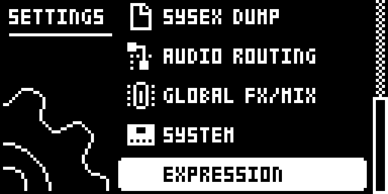
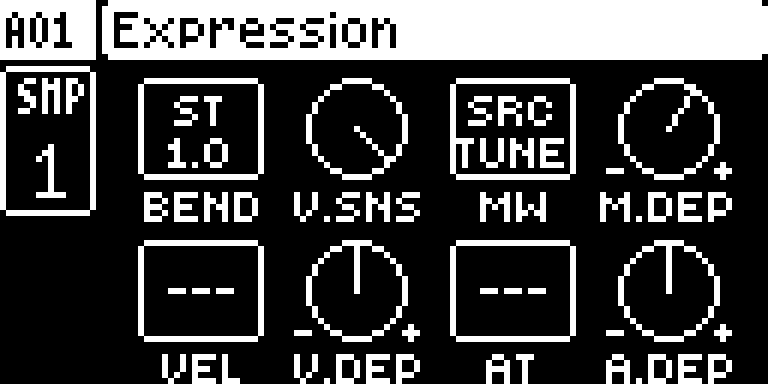
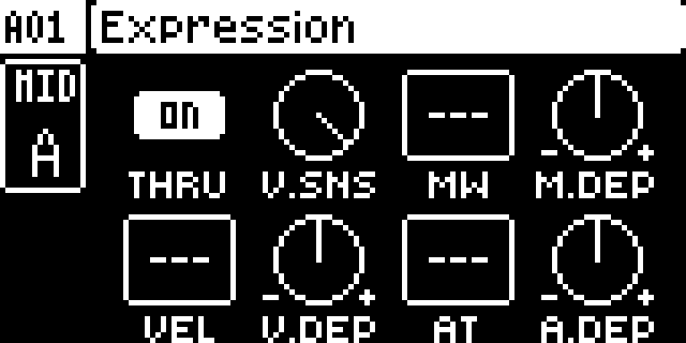
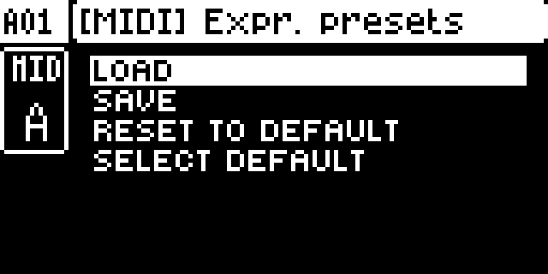

# Digi Expression

Module version `0.13.0-experimental`, for the original Digitakt on OS 1.54, Core 2.1.

## Overview

Stock, the Digitakt passes an external keyboard's notes through a MIDI track to the synth it plays, but drops pitch bend, aftertouch and the mod wheel. With this mod each track can pass them on and route them: a MIDI track **adds them to what it sends itself**, on its CHAN out of MIDI OUT, and an audio track bends its TUNE and moves parameters of its choice. They reach the active track on the AUTO CHANNEL, and a track on its own TRACK CHANNEL. It is for live playing: nothing is recorded into the sequencer.

**Nothing changes until you switch it on.** Out of the box every track has THRU OFF, BEND OFF and no routes, so a fresh install plays exactly as stock. Turn THRU ON on a MIDI track, or set BEND or a route on an audio track, and save a preset as your default with SELECT DEFAULT to start every new project that way.

## Controls

Open **SETTINGS**, go down to **EXPRESSION** (below SYSTEM) and press **YES**: the EXPRESSION page of the active track. It looks like the stock FLTR and LFO pages, with the track box at the left: eight cells on knobs A–H. **TRK + trig** picks another track with the page up, and the page follows it. **NO** goes back to SETTINGS; a page key (TRIG, SRC, FLTR, AMP, LFO) closes it and does its stock job. FUNC, TRK, the trig keys and the transport keep working; the LEVEL knob does nothing here.

The knobs use the firmware's own acceleration, as the stock pages do (pushed, the stock push multiplier). **FUNC + turn** jumps between useful values, as FUNC + TUNE jumps octaves: depths −64, −48 … +48, +64; BEND to whole semitones, OFF, 1, 2 … 12 (turned without FUNC it moves as finely as a depth); V.SNS 0, 25, 50, 75, 100 %; destinations page by page (SRC, FLTR, AMP, LFO1, LFO2); CCs in tens. Turning a destination cell opens a list like the LFO page's DEST; pushing that knob closes it.

| Knob | Audio track | Default | MIDI track | Default |
| --- | --- | --- | --- | --- |
| A | BEND: OFF to 12.00 semitones of TUNE, in fine steps | OFF | THRU: the input's PB, AT, MW and BC added to the track's own | OFF |
| B | V.SNS: velocity sensitivity, 0–100 % | 100 % | V.SNS | 100 % |
| C | MW: the parameter the wheel moves | none | MW: the value the wheel moves | none |
| D | M.DEP: −64.00 to +64.00, as fine as LFO DEP | 0 | M.DEP | 0 |
| E | VEL: the parameter the played velocity moves | none | VEL | none |
| F | V.DEP | 0 | V.DEP | 0 |
| G | AT: the parameter aftertouch moves | none | AT | none |
| H | A.DEP | 0 | A.DEP | 0 |

**Audio destinations:** SRC Tune, Bit Reduction, Start, Length, Level; FLTR Frequency, Resonance, Env Depth, Attack, Decay, Sustain, Release and its second page; AMP Attack, Hold, Decay, Overdrive, Delay, Reverb, Pan, Volume; LFO1 and LFO2 Speed, Multiplier, Fade, Phase, Depth. Each adds to the track's own value, its parameter locks, its LFOs and Digi Matrix's routings, within the parameter's range, in the stock LFO's scale (±64 at full covers the whole range). The LFO ones are added before the LFO stage, everything else after it, which is where the engine reads them (measured).

**Velocity.** V.SNS scales the velocity of what the track plays, live from MIDI IN or from the sequencer: 100 % as played, 50 % plays 0–127 as 64–127, 0 % plays every note at full velocity. The sequencer records the velocity as played, so recorded notes keep their full range and V.SNS can be changed afterwards. As a source, VEL is the velocity of the last note the track played (live or from the sequencer, before V.SNS), held until its next note, so velocity routes play back from the sequencer as they were played live. On a MIDI track, V.SNS scales the velocity of the notes it sends to its synth.

**MIDI destinations** are the MIDI LFO page's: SRC Pitch Bend, Aftertouch, Mod Wheel, BC, and CC VAL 1–8 (FLTR page), each on the CC number its SEL picks (AMP page); the list and the box show that number ("CC:CC1 VAL #74"). After them, the track's own **LFO**: Speed, Multiplier, Fade, Start Phase and Depth (0.9.3), moved for as long as the source is, the LFO page untouched. Every one of these twelve values goes out as **the track's own value** (its knob, parameter locks and LFO) **plus everything live aimed at it** (THRU, and any route), capped to the MIDI range, as one message. Routes and THRU add up: the wheel routed to PB bends on top of the bend wheel; the wheel routed to MW with THRU on counts twice (M.DEP −64.00 cancels it).

**Two values on one CC number are merged.** The mod wheel is CC 1 and BC is CC 2; a CC VAL slot whose SEL is 1 or 2, or two slots with the same SEL, send on the same number, which on a stock Digitakt makes the synth jump between two values. While anything live is aimed at any of them, they go out as one CC: the track's own value is whichever of them changed last (what the synth heard last, as on a stock Digitakt), plus everything live aimed at any of them. With an LFO on one of them, that one keeps being "the last".

Changing a MIDI track's settings takes effect at once; values nothing is aimed at any more get the track's own value back, and are stock again.

## Usage

PORT CONFIG > RECEIVE NOTES and, for the mod wheel and breath, RECEIVE CC/NRPN must be ticked. Then switch on what you want, track by track, on the EXPRESSION page.

### Quick tutorial: bend a synth through a MIDI track

1. Connect a keyboard to MIDI IN on the Digitakt's AUTO CHANNEL, and a synth to MIDI OUT.
2. Select MIDI track A (TRK + trig 9), switch its CHAN on (SRC page, FUNC + knob A) and set the synth's channel.
3. Open SETTINGS, go down to EXPRESSION and press YES, then turn knob A to set THRU ON.
4. Play: pitch bend, aftertouch, the mod wheel and breath reach the synth with the notes.
5. For an audio track: press TRK + its trig with the page up, then set BEND and the routes.

### Saved with the project

The settings are text files of the mod's own on the +Drive, in `/cfw/expression` (no byte of a saved sound or pattern is free for them: see docs/RESEARCH-OS154.md in the source repository):

| File | What |
| --- | --- |
| `projects/003.txt` | project slot 003: all 16 tracks' settings, the project's name inside |
| `audio/01.txt` … `audio/64.txt` | the audio-track presets |
| `midi/01.txt` … `midi/64.txt` | the MIDI-track presets |
| `config.txt` | which preset is the default for each kind of track |
| `current.txt` | the settings as they are now, for power-on |
| `_temp/…` | the same names: every file is written there first, then in its place |

- **Save a project** (SAVE PROJECT AS, every save): `projects/NNN.txt` gets the settings as they are at that moment.
- **Load a project:** its file's settings come back. A project saved without the mod gets each track's default preset.
- **Power-on:** the settings come back as they were when the unit was switched off, as the Digitakt brings back its working project. `current.txt` is written about a second after a change, only while the sequencer is stopped and nothing has been played for 2 seconds, so a write never lands in a performance, a sparse pattern or a clock sent to other gear.
- **Projects are known by their slot number**, not their name: renaming a project, or deleting another one, changes nothing. A project put into a slot from outside (with Transfer) takes that slot's old file, if one is left.
- **Safe against a power cut:** each file is written to `_temp` first. A file that is cut short (it must end with an `END` line) or broken is skipped for its copy in `_temp`, then for the defaults: a bad file is never applied.
- **Plain text,** one setting a line, with the destination's name as a comment. A value out of range is held to the nearest valid one, an unknown line is skipped, and a missing value is the factory default:

```
MIDI EXPRESSION PRESET AUDIO 1
NAME=Lead
BEND=5.00   ; semitones
V.SNS=100   ; %
MW=26   ; FLTR:Frequency
M.DEP=+32.00
VEL=45   ; AMP:Volume
V.DEP=+24.00
AT=0   ; None
A.DEP=+0.00
END
```

Copying a sound or a track does not copy its EXPRESSION settings: they belong to the track's place (track 1–8, A–H) in the project. Use a preset to carry them.

### Presets

Hold **knob A pushed for a second** on the EXPRESSION page: the preset menu, titled [SND] or [MIDI] for the kind of track. It works like the stock menus: UP/DOWN or the LEVEL knob move, YES or a push of a knob chooses, NO goes back, and a page or menu key (SRC, FLTR, AMP, LFO, SETTINGS…) leaves it and does its own job.

| Item | What it does |
| --- | --- |
| LOAD | the 64 presets of this kind of track (audio or MIDI): YES puts one on this track |
| SAVE | pick a slot, then name it as SAVE PROJECT AS names a project: UP/DOWN the character, LEFT/RIGHT the cursor, hold FUNC for the letter grid (FUNC + arrows pick, letting go writes it and moves on to the next place), FUNC + YES inserts, FUNC + NO deletes, YES saves (asking first over a used slot), NO aborts |
| RESET TO DEFAULT | this track back to the default preset (asks first) |
| SELECT DEFAULT | the preset new projects and RESET TO DEFAULT start from: FACTORY (the mod's own defaults) or one of yours, marked `*` |

A preset is copied into the project, never linked: changing a preset later does not change a project that used it.

### Message map

| In at MIDI IN | Taken when | Out of MIDI OUT | Stock handling |
| --- | --- | --- | --- |
| Pitch bend (Ex), any channel | THRU ON | Ex on each routed MIDI track's CHAN: track's PB + (input − 8192), within 0–16383 | none (stock drops it) |
| Channel aftertouch (Dx) | THRU ON, or AT routed | Dx on each routed track's CHAN: track's AT + input, within 0–127 | none (stock drops it) |
| CC 1 (Bx 01) | THRU ON or MW routed, RECEIVE CC/NRPN ticked | Bx 01 on each routed track's CHAN: track's MW + input, within 0–127 | unchanged: the stock handler runs first, always |
| CC 2 (Bx 02) | THRU ON, RECEIVE CC/NRPN ticked | Bx 02: track's BC + input | unchanged: stock first |
| Note on | the track's VEL routed, or V.SNS below 100 % | the route's value just before the note; the note with V.SNS applied | the note as stock; recorded as played |
| Every other message | never | as stock | unchanged |

**Routing** is the stock note router's: a message on the AUTO CHANNEL goes to the active track only; otherwise to every track whose TRACK CHANNEL matches. Of those, only MIDI tracks A–H with CHAN on send anything. A message on the AUTO CHANNEL with an audio track selected is dropped, as stock.

**The track's own values.** A MIDI track sends its twelve values (knob, parameter locks, LFO, and the forced send at its first trig after a pattern change) as stock. While nothing live is aimed at a value, it goes out untouched. Once something is, the mod sends the sum instead of the track's value, so the two never fight.

**Leaving a track.** When the active track changes, what came in on the AUTO CHANNEL stops counting and the synth gets the track's own values back. A track reached through its own TRACK CHANNEL keeps the live value, as stock routing keeps its notes. A note's velocity stays (the sequencer's notes keep setting it).

**Everything else passes through.** Clock, start, stop, continue, SysEx, program changes, notes and every message type in the table's last row go to stock handling unchanged and in order. The mod claims no SysEx id and sends no SysEx.

**Bounded output.** One input value produces at most one message on each routed MIDI track's channel (eight at most), and two values on one CC number are merged into one. The mod fills the MIDI tracks' output buffers to 128 bytes at most; what does not fit waits for the task's next pass, so nothing is dropped. Nothing is generated: no notes, no echoes, no repeats.

**No loops.** If the synth or an interface echoes MIDI OUT back into MIDI IN on a channel that reaches a track, the mod's output comes back as input and is added again, running up to the maximum (as notes double on a stock Digitakt). Nothing in the mod can tell its own messages from a keyboard's: keep the synth's MIDI thru or echo off, put it on another channel, or set that track's THRU OFF.

**Latency.** On the author's unit (0.12.4, `scripts/hwqual.py`), a pitch bend in and out took 0.9 ms USB to USB and 2.9 ms DIN to DIN, round trip, through the interface. The mod sends in the MIDI tracks' next output pass; it adds no fixed delay and does not move notes.

### How it hooks in

- **Input:** the MIDI task hands each incoming message to one of sixteen handlers from a table, by type. Stock's pitch bend and channel aftertouch entries are an empty function. The mod points them at its own handlers and the control-change entry at a wrapper that calls the stock handler first. Three 4-byte pointer sites.
- **The track's own values:** an 8-byte site at the entry of the MIDI tracks' `send(track, channel, id, value, force)` lets the mod see and, while live input is active, take over the track's twelve LFO-page values (ids 21–32: PB, AT, MW, BC, CC VAL 1–8). Every other parameter passes untouched. The SEL numbers are read from the MIDI tracks' parameters in use (0x421c9188, as CC Recall documents).
- **Sending (0.9):** the mod never calls a MIDI driver. Each output channel keeps one pending flag per message type, and the value is worked out when it goes out. A change posts one wake record to the MIDI tracks' task; after its per-track pass, a 6-byte site at 0x400e1dbe (task.s) appends what is pending to the task's CC buffer, which the task then sends with its own midi_out, after the sequencer's notes. A velocity route goes into the notes buffer just before its note. Each buffer counts its bytes in one byte, so the mod fills it only to 128 bytes; the rest goes in the next pass. (0.8 called the DIN driver from the MIDI input and UI tasks, which froze a unit.)

- **Velocity:** an 8-byte site at 0x40077a60, right after the render stores a note's velocity for its voice, and a 6-byte site at the entry of the MIDI tracks' notes_append (0x400e1002) apply V.SNS to what plays (vel.s). The note router and recording are untouched.
- **The LFO slots:** an 8-byte site at the LFO stage's entry, 0x400ed766 (lfo.s).
- **A MIDI track's LFO:** an 8-byte site at the entry of the MIDI tracks' LFO function, 0x400ed438 (midilfo.s): the routes go into the LFO's words just before it runs and come out right after.
- **Saving:** a 6-byte site over each of the two sprintf calls that format the project jobs' "SAVING '%s'" (0x4004da62) and "LOADING '%s'" (0x4004fe28) messages tells the mod the project's name and its slot, and a 6-byte site at the CREATE NEW branch of the load job (0x4004fcbc) applies the default presets to a new project (store.s); the files are read and written in the UI tick with the firmware's own ekFS calls, as Digi Slicer does, only while the filesystem is free. No memory is allocated: one 5 KB text buffer.
- **The page:** the core's settings, key, encoder, draw and tick hooks only: an EXPRESSION row in SETTINGS (ev_settings, settings.s), and the page drawn over the menu while it is open.
- **The sequencer's state:** the byte at 0x4199ebb3 (1 while the sequencer runs; measured in digiemu on OS 1.54) is only read, so the power-on file waits while it plays.
- **Audio tracks:** a 6-byte site at 0x40077eea, the first call after the render's LFO stage that takes the parameter words (after Digi Matrix's and Digi Poly's sites), adds the live values to them.

All thirteen sites are claimed in `build.json`; no other Modwerk Digitakt module patches them.

**With other mods** (`scripts/compat-pairs.sh`, `results/compat/pairs.txt`): it links with every other Modwerk Digitakt module: CC Names, CC Recall, Digichain, Digi EQ, Digi Health, Digi Matrix, Digi Mono, Digi Neighbor, Digi Perform, Digi Poly, Digi Slicer, Digi Sophie, Digi String, Digi Utils, Euclidean, FX Track, Input Prefader, MIDI Retrig, Note Accumulator, RAM Machines and Sample Tools. With Digi Slicer about 1.0 KB of RAM is left, so the two fit only on their own. Its CCs go through the task's own CC append, so FX Track sees them (a velocity route's CC goes straight in front of its note and does not). CC Recall's sends pass through it like the track's own. Digi Matrix's routings and its own add up on an audio track.

## Compatibility and limitations

- Built for OS 1.54 only.
- Builds with every other Modwerk Digitakt module, Digi Perform included. With Digi Slicer about 1.0 KB of RAM is left, so the two fit only on their own.
- Saved per project slot in files of its own, not inside the project: copying a sound or track does not copy its settings (a preset does).
- Writing a settings file holds the UI for a moment (about 0.1 s a file in the emulator). The power-on file is written only while the sequencer is stopped; a project's file is written when you save the project, as stock saves it.
- Sends where OUTPUT TO says (MIDI, USB or both), with the track's own values.
- Not recorded: the sequencer never sees the live values.
- A bend can reach the synth a few milliseconds before the note played with it: live notes go through the MIDI tracks' task (about 6 ms in the emulator), pass-through goes out in the same task's next pass (about 1 ms in the emulator).
- The track's PB, AT and MW knobs on screen show the track's own value, not the sum.
- Machines other than the sample ones take TUNE from their own SRC knob A.
- The EXPRESSION page has no LEV meter; the track's level stays on its stock pages.

## Tests and measurements

See [TESTING.md](TESTING.md), which names the version of every result. Host unit tests (about 2.44 million checks, also under AddressSanitizer and UBSan) and the digiemu emulator for everything. On the author's unit: every feature over DIN MIDI and USB MIDI on 0.10–0.12, and on 0.12.4 the full `hwqual.py` run over DIN and USB at once (all eight MIDI tracks exact against a model, the sequencer, external clock, a 20-second flood). Memory: about 36 KB of the shared RAM; CPU: about 1.2 % of the emulated CPU idle and 1.9 % under a MIDI flood with every route live (emulator).

## Authorship and licences

Design and code: tekomelu. The page's knob feel, the firmware's knob graphic and name calls follow what Digi Perform documents (GPL-3.0-or-later); the SETTINGS row follows the row record Digi Matrix and FX Track use; CC Recall (draadpiraat) documented the MIDI tracks' task. Code: GPL-3.0-or-later ([LICENSE](LICENSE)). Screenshots: see [media/LICENSE.md](media/LICENSE.md).

## Screens and audio

Captured in the pinned emulator through panel input only ([capture-plan.txt](media/capture-plan.txt), [capture.json](media/capture.json)). No audio recordings.








