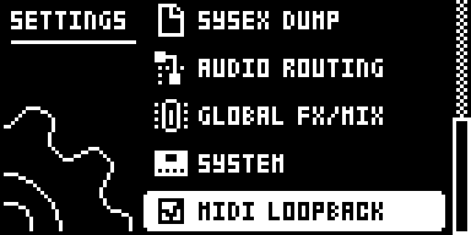
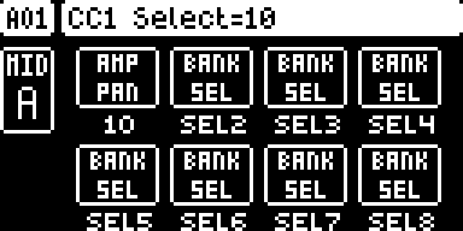

# MIDI Loopback — Digitakt

Modwerk version: `1.6.0`, the author's released 1.6 files, unchanged.

## Overview

MIDI Loopback, by ntrrptr, is a MIDI cable inside the Digitakt. Turn it on in SETTINGS > MIDI LOOPBACK, set a MIDI track's channel to an audio track's channel, and that MIDI track's CC knobs, parameter locks, notes and LFO control the audio track: filter, tune, sample start and length, overdrive, envelope and sends, with notes playing it chromatically. A MIDI track on the FX control channel reaches the delay, reverb, compressor and external mixer, and one on the auto channel reaches whichever track is active. Messages on channels no internal track uses still go out of MIDI OUT and USB. It is off until you turn it on, and it names the Digitakt's parameters on the MIDI tracks' CC Select page.

- A MIDI track on an audio track's channel modulates it with CCs, locks and its LFO, a third LFO for that track.
- Notes on that MIDI track play the audio track chromatically, chords included.
- The FX control channel reaches the delay, reverb, compressor and external mixer.
- Off by default; channels no internal track uses still go out of MIDI OUT and USB.

## Controls

| Control | What it does |
| --- | --- |
| SETTINGS > MIDI LOOPBACK | YES toggles it, RIGHT turns it on, LEFT off. Off is the stock behaviour: messages go to MIDI OUT and USB. |
| SETTINGS > MIDI CONFIG > CHANNELS | The channels of audio tracks 1–8, the auto channel and the FX control channel, which a MIDI track's CHAN can name. |
| MIDI track SRC > CHAN | An internal channel routes that MIDI track into the Digitakt; any other channel goes out as usual. |

## Usage

Use the access steps below after installing a compatible build. The tutorial gives a first practical pass through the module.

### Where to find it

Location: SETTINGS > MIDI LOOPBACK, then any MIDI track.

1. Use a build containing MIDI Loopback for the original Digitakt on OS 1.53 or 1.54.
2. In SETTINGS > MIDI LOOPBACK press YES to turn it on.
3. Set a MIDI track's channel to an audio track's channel, then use its CC page, locks and LFO.

These instructions assume the module is already installed in a compatible build. For selecting and building it in Modwerk, see the [Digitakt guide](../../../machines/digitakt/README.md).

### Quick tutorial: drive an audio track's filter from a MIDI track

1. In SETTINGS > MIDI LOOPBACK press YES to turn it on.
2. On MIDI track 9 set CHAN on the SRC page to audio track 1's channel (SETTINGS > MIDI CONFIG > CHANNELS).
3. On that MIDI track's AMP page (CC Select) set SEL1 to 74, shown as FLT FREQ, then turn VAL1 on the FLTR page (CC Value): track 1's filter moves.
4. Lock VAL1 on a few steps and play the pattern; turn MIDI LOOPBACK off again to send everything out of MIDI OUT as before.

## Compatibility and limitations

- Original Digitakt (Mk1), OS 1.53 and 1.54. Digitakt II is not declared compatible.
- Off by default. While it is on, messages on channels assigned to internal tracks stay inside and do not leave by MIDI OUT or USB.
- Not with FX Track or MIDI Expression: they patch the same MIDI code.
- Needs core 4.1 or newer, so it does not build beside Digi EQ 1.0.2, which builds only on core 2.1.

## Tests and measurements

The evidence tier is `author-hardware`: the author reports testing MIDI Loopback 1.6 on their Digitakt mk1, the version they use (release v1.6, 18 November 2026). This module pins those released files for OS 1.53 and 1.54. Modwerk builds it with core 4.4, which has not run on a unit here. [TESTING.md](TESTING.md) records the identities, what was linked and captured, and what was not tested.

MIDI Loopback holds **3,396 B** (code, data and state) in the mods' RAM, excluding the core and linker alignment. A short flush at the end of each audio render; empty while MIDI LOOPBACK is off; no CPU figure was measured.

## Authorship and licences

- ntrrptr — MIDI Loopback design and code

The module is licensed under [GPL-3.0-or-later](LICENSE). Imported source: [ntrrptr/midi-loopback-dt at `02c1638`](https://github.com/ntrrptr/midi-loopback-dt/tree/02c16386ab99351f0239494aaf1e22aa186dc832). The library builds the author's released `.elemod` files. The header `src/digitakt-mk1/core3.h` is irpina's, from elekloader, under GPL-2.0-or-later. The author's README is in [upstream/](upstream/README.md).

## Screens and audio

Real firmware-rendered emulator captures on OS 1.54. The [capture record](media/capture.json) includes source and build identities, panel inputs, timestamps and PNG hashes. [Capture rights](media/LICENSE.md) preserve the underlying interface rights. The [thumbnail](media/thumbnail.svg) is an illustration. No audio demonstration is claimed.

