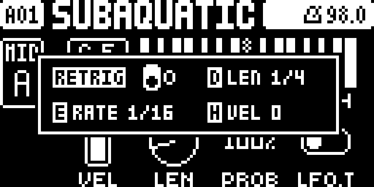
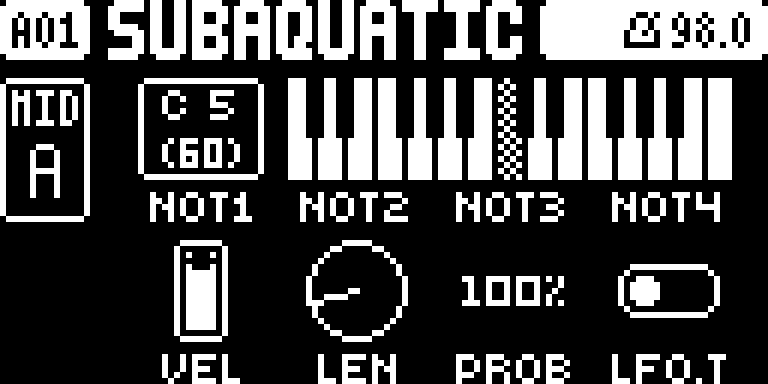

# MIDI Retrig

## Overview

Use the native retrig menu on MIDI tracks A–H. Repeated notes follow the Digitakt sequencer, including chords, retrig rate, finite length and velocity changes.

Version **2.0.1** for Digitakt I OS **1.53 and 1.54**, with separate packages
for each OS. Do not use a 1.53 package on 1.54. Hardware testing is recorded in the
[hardware report](evidence/hardware-testing.json) and [TESTING.md](TESTING.md).

## Controls

| Control | Action |
| --- | --- |
| Hold trig + UP/DOWN | Open the native retrig menu on a MIDI step. |
| A — RETRIG | Enable or disable retrig for the held step. |
| E — RATE / UP/DOWN | Set repeat spacing. |
| D — LEN | Set the retrig length. |
| H — VEL | Set the velocity change across the retrig burst. |

## Usage

Follow these steps on either supported OS release.

### Quick tutorial

1. Select MIDI track A with TRK + trig 9. Configure its MIDI channel for a connected synth and enter grid recording with RECORD.
2. Place a note trig. Hold that trig and press UP or DOWN to open RETRIG; turn A to enable it.
3. Choose RATE 1/32, a finite LEN and VEL 0. Release the trig and press PLAY to hear repeated MIDI notes.
4. Press STOP. To bypass this step, reopen its retrig menu and turn A to OFF.

## Compatibility and limitations

Requires Core 2.1.
Use original stock firmware in Elekloader. Install each dependency once.

- Requires an external MIDI destination to hear the result.
- Dense chords at fast retrig rates increase MIDI traffic; hardware timing and downstream synth behavior need checking.

The earlier whole-build format-1 packages cannot be combined with these format-2
modules. Compatibility with the wider Modwerk catalogue still needs checking.

## Tests and measurements

See [TESTING.md](TESTING.md) for exact evidence and remaining checks. Screenshots
show a real booted combined build; they do not prove standalone behavior, MIDI
output, audio quality, worst-case timing or hardware operation.

## Authorship and licences

sumedho: module design/development with Codex assistance; author identity confirmed. irpina: Elekloader, Core 2.1, the Core 3.0 header and Machine Pages (1.2 is adapted by sumedho to run on Core 2.1).
Code: [GPL-2.0-or-later](LICENSE). Screens show Elektron's interface solely to
document the modification. No Elektron firmware is included.

## Screens and audio

The following OS 1.53 gallery documents the **OS 1.53 all-mods build on Core 2.1**. See
[capture provenance](media/capture.json) for hashes, inputs and any retained
regression frames, which explicitly identify their fixture setup.
No audio demonstration is supplied yet.

In grid recording on MIDI A, hold a note trig and press UP. Enable RETRIG with A and set RATE with E or UP/DOWN.

Release the trig to return to TRIG. Press PLAY to hear the burst, then STOP.

## OS 1.54 screenshots

These captures use the actual **OS 1.54 all-mods SysEx on Core 2.1**. See [1.54 provenance](media/1.54/capture.json).

In grid recording on MIDI A, hold a note trig and press UP. Enable RETRIG with A and set RATE with E or UP/DOWN.

Release the trig to return to TRIG. Press PLAY to hear the burst, then STOP.
