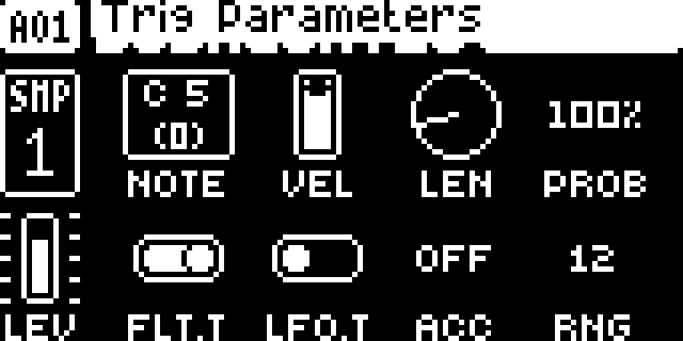

# Per-step Note Accumulator

## Overview

Each enabled audio step remembers its own pitch increment between visits. Positive values climb, negative values descend, and the pitch wraps to the original note at the chosen range.

Version **1.1.1** for Digitakt I OS **1.53 and 1.54**, with separate packages
for each OS. Do not use a 1.53 package on 1.54. Hardware testing is recorded in the
[hardware report](evidence/hardware-testing.json) and [TESTING.md](TESTING.md).

## Controls

| Control | Action |
| --- | --- |
| G — ACC | OFF or −63 to +63 semitones added on each subsequent visit. |
| H — RNG | 1–72 semitones of accumulated distance; default 12. |
| Hold trig + G/H | Lock the increment and range for that step. |
| Hold G/H + NO | Reset the corresponding track default. |

## Usage

Follow these steps on either supported OS release.

### Quick tutorial

1. Load a sample on an audio track, place one note trig and open TRIG.
2. Set ACC to +1 with G and RNG to 3 with H. Press PLAY: successive visits play the original pitch, +1, +2, +3, then the original again.
3. For selected steps only, set the track’s ACC to OFF. Hold the desired trig and turn G to a nonzero value; lock RNG with H if needed.
4. STOP and restart to reset the counters. Set ACC to OFF to bypass accumulation; remove any ACC locks that should also stop accumulating.

## Compatibility and limitations

Requires Core 2.1.
Use original stock firmware in Elekloader. Install each dependency once.

- Audio tracks only; every enabled step has an independent counter.
- The first accepted play uses the original note. Retrigs retain that visit’s pitch.
- Pattern changes and STOP reset temporary counters; ordinary pattern repeats retain them.
- Saved settings and locks persist; counters do not. Native pitch limits can cause an early wrap.
- RAM-R1 is excluded. Euclidean counters follow source note slots.

The earlier whole-build format-1 packages cannot be combined with these format-2
modules. Compatibility with the wider Modwerk catalogue still needs checking.

## Tests and measurements

See [TESTING.md](TESTING.md) for exact evidence and remaining checks. Screenshots
show a real booted combined build; they do not prove standalone behavior, MIDI
output, audio quality, worst-case timing or hardware operation.

## Authorship and licences

sumedho: module design/development with Codex assistance; author identity confirmed. irpina: Elekloader, Core 2.1, the Core 3.0 header and Machine Pages (1.2 is adapted by sumedho to run on Core 2.1).
Code: [GPL-2.0-or-later](LICENSE). Screens show Elektron's interface solely to
document the modification. No Elektron firmware is included.

## Screens and audio

The following OS 1.53 gallery documents the **OS 1.53 all-mods build on Core 2.1**. See
[capture provenance](media/capture.json) for hashes, inputs and any retained
regression frames, which explicitly identify their fixture setup.
No audio demonstration is supplied yet.

On an audio track, press TRIG. Turn G for the pitch increment and H for the wrap range; hold a trig to set locks.

## OS 1.54 screenshots

These captures use the actual **OS 1.54 all-mods SysEx on Core 2.1**. See [1.54 provenance](media/1.54/capture.json).

On an audio track, press TRIG. Turn G for the pitch increment and H for the wrap range; hold a trig to set locks.
