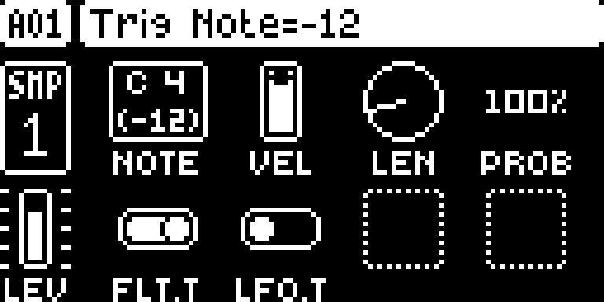
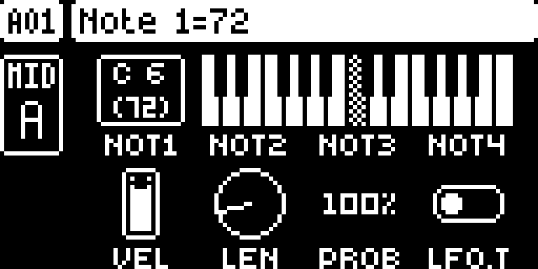

# Note Octave

A Digitakt I mod by @draadpiraat. Version 0.1.0-experimental, OS 1.54.

## Overview

On the TRIG page, **FUNC + turn** on a note moves it by an octave: twelve semitones for every three detents, up or down as you turn, the pace stock's FUNC + LEN steps at. Stock jumps the value instead (the MIDI note to 0, 60 and 127, the audio note to its default), so until now an octave meant twelve careful detents.

It adds no page, knob or setting, and it changes nothing that is saved: the notes it sets are stock's own values.

## Controls

- **Audio tracks:** FUNC + A on NOTE, -48 to +24.
- **MIDI tracks:** FUNC + A on NOT1, and FUNC + B to D on the chord notes NOT2, NOT3 and NOT4.

Every other knob keeps stock's FUNC + turn jump.

- **No trig held:** the track's note moves, as a plain turn would.
- **A trig held:** the step's note lock moves, as a plain turn while holding the trig would.
- **At the edge:** an octave that would leave the note's range is not made. Stock would clamp the value, and the note would change, not only its octave.
- **Speed:** three detents an octave. Turning back starts the count again.

## Usage

Nothing to set up: once installed, FUNC + turn on a note knob moves by octaves.

### Quick tutorial: move a note an octave

1. Select an audio track and press TRIG.
2. Hold FUNC and turn A three detents to the left: NOTE goes to -12.
3. Hold a trig key as well to move that step's note lock instead.
4. On a MIDI track, do the same on NOT1, or B to D for the chord notes.

From 0, three detents at a time to the right: +12, +24, then it stays at +24. To the left: -12, -24, -36, -48. On a MIDI track (TRK + trig 9), NOT1 goes from 60 to 72, 84 and back.

## Compatibility and limitations

It patches two places in stock's parameter-page knob handler (0x40032bc8 and 0x40032be0 on OS 1.54), inside the routine every parameter page shares; only the note parameters' ids change course. Other modules on the TRIG page (Note Accumulator's ACC and RNG, DigiPoly's LEVEL) go through the same handler unchanged. It claims FUNC + turn on the TRIG page's note knobs.

- OS 1.54 only.
- At most one octave an encoder message, so a very fast spin moves a little less.

## Tests and measurements

Tried on the author's Digitakt I, OS 1.54 (this build, NO08), and in the emulator. It uses 284 bytes of the shared mod area and adds nothing to the audio path. See [TESTING.md](TESTING.md).

## Authorship and licences

draadpiraat: idea, design and code, with Claude Code. Code: [GPL-3.0-or-later](LICENSE). Screens show Elektron's interface solely to document the modification. No Elektron firmware is included.

## Screens and audio

These captures show the **OS 1.54 build with Core 2.1 and this module alone** (NO08), booted in the pinned digiemu with firmware-native drawing. See [capture provenance](media/capture.json) for hashes and panel inputs. No audio demonstration is supplied.

An audio track's TRIG page after FUNC + three detents to the left: NOTE moved from 0 to -12.

A MIDI track's TRIG page after FUNC + three detents to the right: NOT1 moved from 60 to 72.
