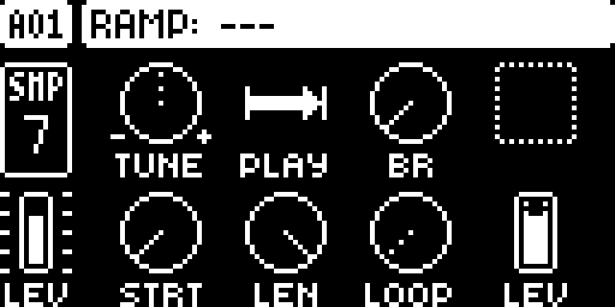
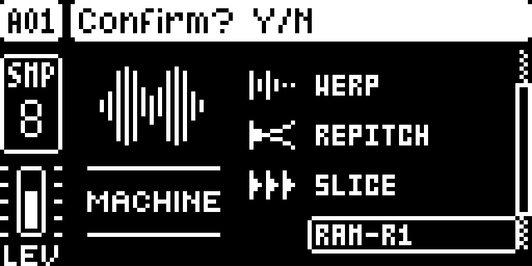
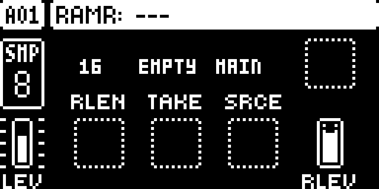
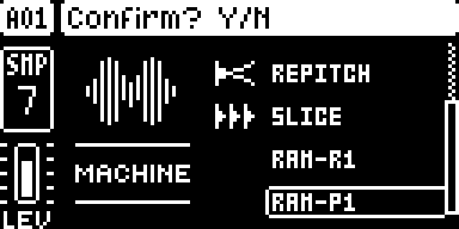

# RAM Record and Playback

## Overview

RAM-R1 records a temporary mono take from the master mix or inputs when triggered. RAM-P1 plays that shared take using the native sample controls.

Version **1.3.1** for Digitakt I OS **1.53 and 1.54**, with separate packages
for each OS. Do not use a 1.53 package on 1.54. Hardware testing is recorded in the
[hardware report](evidence/hardware-testing.json) and [TESTING.md](TESTING.md).

### Playback level

RAM-P1 plays a take at the level it was recorded at with LEV, AMP VOL and the
track level at their defaults and trig velocity 100. Velocity scales linearly,
so 127 is about 2 dB louder. When a take ends it is normalized to full scale,
so BR, the bit reduction control, acts on it as it does on a normal sample.

## Controls

| Control | Action |
| --- | --- |
| FUNC + SRC | Select RAM-R1 or RAM-P1 and confirm with YES. |
| RAM-R1 A — RLEN | Set the recording length in sequencer steps; capture is capped at 33 seconds. |
| RAM-R1 B — TAKE | Read the shared take’s status. |
| RAM-R1 C — SRCE | Choose MAIN, IN L, IN R or IN LR. |
| RAM-R1 H — RLEV | Set recording gain. |
| RAM-P1 SRC controls | Tune, playback direction, bit reduction, start, length, loop and level. |

## Usage

Follow these steps on either supported OS release.

### Quick tutorial

1. Select an audio track, press FUNC + SRC, choose RAM-R1 and confirm with YES. Set RLEN with A and SRCE with C.
2. Use MAIN to capture other playing tracks, or select an input and feed it audio. Place a trig on RAM-R1 and start the pattern.
3. After the take finishes, select another audio track and choose RAM-P1 through FUNC + SRC. Place a trig after recording ends, or trigger it manually.
4. Use RAM-P1’s TUNE, PLAY, STRT, LEN and LOOP controls to manipulate the take. STOP finalizes a partial recording; select ONESHOT to return either track to normal sample use.

## Compatibility and limitations

Requires Core 2.1, machine-pages.
Use original stock firmware in Elekloader. Install each dependency once.

- There is one shared mono take; MAIN and IN LR average the two channels.
- A new capture replaces the old take. A record trig received while recording is ignored.
- Capture is capped at 33 seconds. RAM playback is suppressed during recording and resumes on a new playback trig.
- A finished take is normalized in place over about one second after a long take. A RAM-P1 trig with STRT inside a long take in that second can briefly play quieter.
- Since 1.3.0, RAM-P1 plays a take about 17 dB louder than 1.1.1 did.
- The take is discarded on power-off or project load; machine assignments and settings are saved.
- This release has no public panel command to save the RAM take as a sample.
- Machine Pages conflicts with DigiChain; combinations using that framework need compatibility review.

The earlier whole-build format-1 packages cannot be combined with these format-2
modules. Compatibility with the wider Modwerk catalogue still needs checking.

## Tests and measurements

See [TESTING.md](TESTING.md) for exact evidence and remaining checks. Screenshots
show a real booted combined build; they do not prove standalone behavior, MIDI
output, audio quality, worst-case timing or hardware operation.

## Authorship and licences

sumedho: module design/development with Codex assistance; author identity confirmed. irpina: Elekloader, Core 2.1, the Core 3.0 header and Machine Pages (1.2 is adapted by sumedho to run on Core 2.1).
Code: [GPL-2.0-or-later](LICENSE). Screens show Elektron's interface solely to
document the modification. No Elektron firmware is included.

## Screens and audio

The following OS 1.53 gallery documents the **OS 1.53 all-mods build on Core 2.1**. See
[capture provenance](media/capture.json) for hashes, inputs and any retained
regression frames, which explicitly identify their fixture setup.
No audio demonstration is supplied yet.

On an audio track, press FUNC + SRC, scroll to RAM-R1 and confirm with YES.

Set RLEN with A and watch TAKE. C selects MAIN or an input; H sets recording gain.

Choose RAM-P1 on another audio track to play the shared take after recording finishes.

Trigger RAM-P1 and shape the take with the native SRC controls. Select ONESHOT to restore file-sample playback.

## OS 1.54 screenshots

These captures use the actual **OS 1.54 all-mods SysEx on Core 2.1**. See [1.54 provenance](media/1.54/capture.json).

On an audio track, press FUNC + SRC, scroll to RAM-R1 and confirm with YES.

Set RLEN with A and watch TAKE. C selects MAIN or an input; H sets recording gain.

Choose RAM-P1 on another audio track to play the shared take after recording finishes.

Trigger RAM-P1 and shape the take with the native SRC controls. Select ONESHOT to restore file-sample playback.
