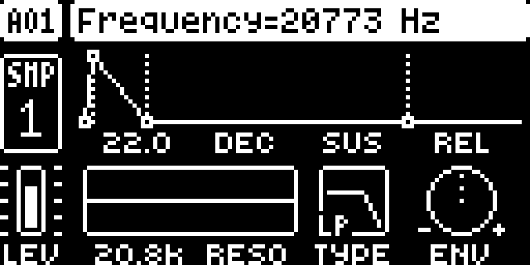
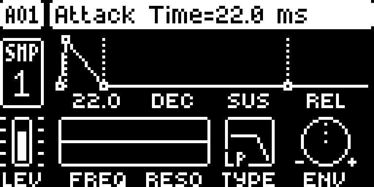

# Real Units — Digitakt

Modwerk version: `0.2.0`, the author's released 0.2 file, unchanged.

## Overview

Real Units, by ceredmeat, shows knob values in real units. FLTR FREQ shows the cutoff in hertz, the filter and amp envelopes show their times in milliseconds or seconds (INF at 127 where the stage holds), and the LFO pop-up adds the cycle length as bars or note values when it follows the tempo, or hertz when it runs free. Each number comes from the table the sound engine itself uses. Only the text changes: sounds, locks and saving are untouched. With a Machine Pages machine loaded, that machine keeps its own knob text.

- FLTR FREQ in hertz, from 5.0 to 20.8k.
- Filter and amp envelope times in milliseconds or seconds; INF where a stage holds.
- The LFO pop-up adds the cycle length: bars, note values, or hertz when free-running.
- Only the text changes; sounds, locks and saving are untouched.

## Controls

It adds no control of its own: turn the stock knobs as usual and read their values in real units.

## Usage

Use the access steps below after installing a compatible build. The tutorial gives a first practical pass through the module.

### Where to find it

Location: FLTR, AMP and LFO pages.

1. Use a build containing Real Units for the original Digitakt on OS 1.54.
2. Open the FLTR, AMP or LFO page of an audio track.
3. Turn a knob: its value shows in hertz, milliseconds or note lengths.

These instructions assume the module is already installed in a compatible build. For selecting and building it in Modwerk, see the [Digitakt guide](../../../machines/digitakt/README.md).

### Quick tutorial: read the filter in hertz

1. On an audio track open the FLTR page.
2. Turn FREQ: the value shows in hertz.
3. Turn the filter envelope ATK or DEC: the time shows in milliseconds or seconds.
4. On the LFO page turn SPD: the pop-up adds the cycle length as a note value.

## Compatibility and limitations

- Original Digitakt (Mk1), OS 1.54. Digitakt II is not declared compatible.
- Needs core 4.1 or newer, so it does not build beside Digi EQ 1.0.2, which builds only on core 2.1.
- Not with Note Accumulator: both patch the same value text code.
- Decay times are the time to fall to a tenth: the fade is a curve with no hard end.
- Delay TIME is unchanged: the stock pop-up already names its note values.

## Tests and measurements

The evidence tier is `author-hardware`: the author tested Ctrl All, Kit A/B and Real Units 0.2 on a Digitakt MKI on OS 1.54, together with seven other FLEXMODS mods, elekloader's core and seq-events (FLEXMODS 1.0, 16 November 2026; the same files ship unchanged through FLEXMODS 1.5). This module pins that released file. Modwerk builds it with core 4.4, which has not run on a unit here. [TESTING.md](TESTING.md) records the identities, what was linked and captured, and what was not tested.

Real Units holds **4,188 B** (code, data and state) in the mods' RAM, excluding the core and linker alignment. Runs on the UI side only, nothing in the audio render; no CPU figure was measured.

## Authorship and licences

- ceredmeat (Cere), made with Claude — Real Units design and code

The module is licensed under [GPL-2.0-or-later](LICENSE). Imported source: [ceredmeat/FLEXMODS at `e6a2aab`](https://github.com/ceredmeat/FLEXMODS/tree/e6a2aabf8a94118a7b761dbfeac3e325ce4cd4db/mods/realunits). The library builds the author's released `.elemod` file. The header `src/digitakt-mk1/core3.h` is irpina's, from elekloader, under GPL-2.0-or-later. The author's README is in [upstream/](upstream/README.md).

## Screens and audio

Real firmware-rendered emulator captures on OS 1.54. The [capture record](media/capture.json) includes source and build identities, panel inputs, timestamps and PNG hashes. [Capture rights](media/LICENSE.md) preserve the underlying interface rights. The [thumbnail](media/thumbnail.svg) is an illustration. No audio demonstration is claimed.

