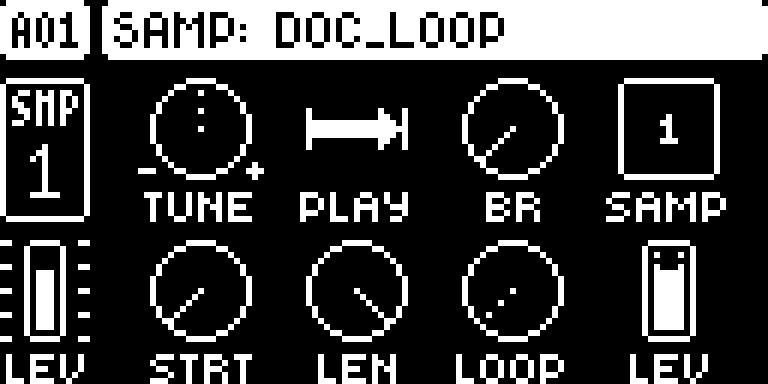
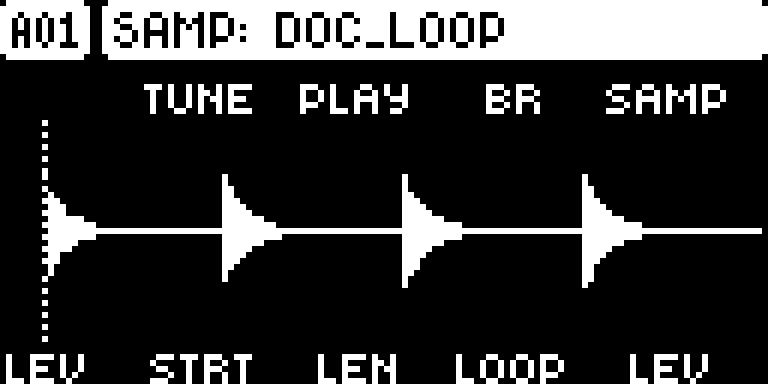
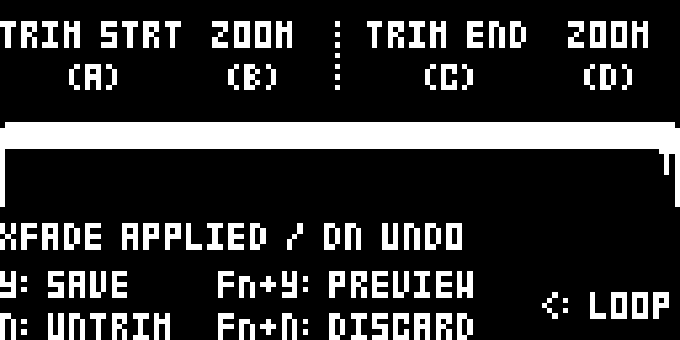

# Sample Snap and Crossfade

## Overview

Snap native SRC start, end and loop markers to nearby zero crossings. In the normal recording editor, apply an adjustable loop crossfade with one-level undo.

Version **0.2.2** for Digitakt I OS **1.53 and 1.54**, with separate packages
for each OS. Do not use a 1.53 package on 1.54. Hardware testing is recorded in the
[hardware report](evidence/hardware-testing.json) and [TESTING.md](TESTING.md).

## Controls

| Control | Action |
| --- | --- |
| SRC: FUNC + E — STRT | Seek the previous/next zero crossing for start. |
| SRC: FUNC + F — LEN | Seek a crossing for the actual end, STRT + LEN. |
| SRC: FUNC + G — LOOP | Seek a crossing for the loop return point. |
| Recorder: FUNC + E | Turn automatic marker snapping off/on. |
| Recorder: FUNC + A/C | Seek a crossing for the start/end marker. |
| Recorder: FUNC + F | Set loop crossfade length from 0 to 200 ms. |
| Recorder: FUNC + UP / DOWN | Apply the crossfade / undo it. |
| Recorder: YES | Use the native trim/save workflow. |

## Usage

Follow these steps on either supported OS release.

### Quick tutorial

1. Load a sample on an ONESHOT track and open SRC. Press SRC again if you want the native waveform view.
2. Release held trigs and TRK. Hold FUNC and turn STRT, LEN or LOOP: left seeks an earlier crossing, right a later crossing. Ordinary turns still work normally.
3. For a crossfade, make a normal recording and finish it to reach the trim editor. Choose a region, then hold FUNC and turn F to set a short crossfade.
4. Press FUNC + UP to apply. Audition with the native recorder controls; FUNC + DOWN undoes the edit. Press YES for the normal trim/save workflow.

## Compatibility and limitations

Requires Core 2.1.
Use original stock firmware in Elekloader. Install each dependency once.

- SRC snapping works on ONESHOT and RAM-P1. RAM-P1 does not gain a file-backed waveform page.
- Exact snapped offsets last for the session; normal quantized parameter values are saved.
- No per-step exact snap locks or control-all snap operation. Search is bounded to 4,096 nearby samples.
- Crossfades shorten the selected loop by the overlap length. Only the last crossfade can be undone.
- Loaded samples and RAM takes have no panel entry into the crossfade editor in 0.2.1. The tutorial uses the normal recorder.
- SRC retains its two-page toggle; FUNC + YES remains Save Ptn on SRC.
- Conflicts with DIGISLICER, which owns the same SRC key hook.

The earlier whole-build format-1 packages cannot be combined with these format-2
modules. Compatibility with the wider Modwerk catalogue still needs checking.

## Tests and measurements

See [TESTING.md](TESTING.md) for exact evidence and remaining checks. Screenshots
show a real booted combined build; they do not prove standalone behavior, MIDI
output, audio quality, worst-case timing or hardware operation.

## Authorship and licences

sumedho: module design/development with Codex assistance; author identity confirmed. irpina: Elekloader, Core 2.1, the Core 3.0 header and Machine Pages (1.2 is adapted by sumedho to run on Core 2.1).
Code: [GPL-2.0-or-later](LICENSE). Screens show Elektron's interface solely to
document the modification. No Elektron firmware is included.

## Screens and audio

The following OS 1.53 gallery documents the **OS 1.53 all-mods build on Core 2.1**. See
[capture provenance](media/capture.json) for hashes, inputs and any retained
regression frames, which explicitly identify their fixture setup.
No audio demonstration is supplied yet.

Load an ONESHOT sample and open SRC. STRT, LEN and LOOP retain their normal positions.

Press SRC to switch to the native waveform view. Hold FUNC and turn E/STRT, F/LEN or G/LOOP to seek a nearby crossing; release FUNC for ordinary movement.

In the recording trim editor, FUNC + F sets the crossfade and FUNC + UP applies it; FUNC + DOWN undoes it. This retained emulator regression frame uses a synthetic PCM fixture.

## OS 1.54 screenshots

These captures use the actual **OS 1.54 all-mods SysEx on Core 2.1**. See [1.54 provenance](media/1.54/capture.json).

Load an ONESHOT sample and open SRC. STRT, LEN and LOOP retain their normal positions.

Press SRC to switch to the native waveform view. Hold FUNC and turn E/STRT, F/LEN or G/LOOP to seek a nearby crossing; release FUNC for ordinary movement.

In the recording trim editor, FUNC + F sets the crossfade and FUNC + UP applies it; FUNC + DOWN undoes it. This retained emulator regression frame uses a synthetic PCM fixture.
