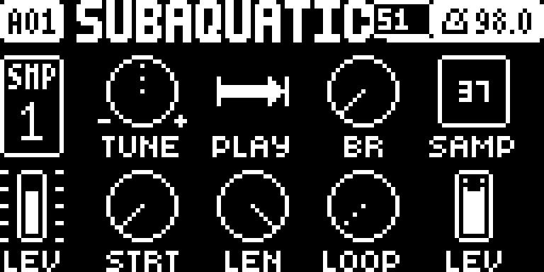

# Track Solo — Digitakt

Modwerk version: `0.2.0`, the author's released 0.2 file, unchanged.

## Overview

Track Solo, by ceredmeat, lets you hear one track on its own and snap back to the full pattern. Hold TRK, then hold UP: the active track plays alone for as long as you hold UP, and you can let go of TRK. Hold TRK and press DOWN to latch the solo; TRK + DOWN again unlatches it, and on another track moves the solo there. While a solo is on, S and the track number (S3) show in the top-right corner. The other tracks' notes just don't start: notes already sounding ring out, delay and reverb tails keep going, lock trigs still apply, and the stock mutes are never touched. It works on audio and MIDI tracks.

- Hold TRK + UP: the active track plays alone while UP is held.
- TRK + DOWN latches the solo; again unlatches it, or moves it to another track.
- S and the track number show in the top-right corner while a solo is on.
- The stock mutes are never touched; tails ring out and lock trigs still apply.

## Controls

| Control | What it does |
| --- | --- |
| TRK + UP (hold) | Solo the active track while UP is held; you can let go of TRK. |
| TRK + DOWN | Latch the solo on the active track; again to unlatch, or on another track to move it. S and the track number show in the top-right corner while a solo is on. |

## Usage

Use the access steps below after installing a compatible build. The tutorial gives a first practical pass through the module.

### Where to find it

Location: Any page: TRK + UP, TRK + DOWN.

1. Use a build containing Track Solo for the original Digitakt on OS 1.54; seq-events comes with it.
2. Select a track, hold TRK and hold UP to solo it while UP is held.
3. Hold TRK and press DOWN to latch the solo.

These instructions assume the module is already installed in a compatible build. For selecting and building it in Modwerk, see the [Digitakt guide](../../../machines/digitakt/README.md).

### Quick tutorial: solo a track while the pattern plays

1. Play a pattern with several tracks.
2. Select a track, hold TRK, then hold UP: only that track plays, and S with its number shows in the top-right corner.
3. Let go of UP: every track plays again.
4. Hold TRK and press DOWN to latch the solo; press TRK + DOWN again to unlatch it.

## Compatibility and limitations

- Original Digitakt (Mk1), OS 1.54. Digitakt II is not declared compatible.
- Needs core 4.1 or newer, so it does not build beside Digi EQ 1.0.2, which builds only on core 2.1.
- Not with Euclidean: seq-events, which Track Solo builds on, patches the same step-fire sites.
- Only note trigs are held back: notes already sounding and effect tails ring out.

## Tests and measurements

The evidence tier is `author-hardware`: the author tested Track Solo 0.2 on a Digitakt MKI on OS 1.54 together with nine other FLEXMODS mods, elekloader's core and seq-events (FLEXMODS 1.0, 16 November 2026). Modwerk builds seq-events from Dracyr's source in elekloader 0.11.0, the same interface as the seq-events 0.1 it was tested with; this module pins the author's released Track Solo file. Modwerk builds it with core 4.4, which has not run on a unit here. [TESTING.md](TESTING.md) records the identities, what was linked and captured, and what was not tested.

Track Solo holds **684 B** (code, data and state) in the mods' RAM, excluding the core and linker alignment. Answers one question per step in the sequencer, nothing in the audio render; no CPU figure was measured.

## Authorship and licences

- ceredmeat (Cere), made with Claude — Track Solo design and code
- Dracyr — seq-events, which it builds on

The module is licensed under [GPL-2.0-or-later](LICENSE). Imported source: [ceredmeat/FLEXMODS at `e6a2aab`](https://github.com/ceredmeat/FLEXMODS/tree/e6a2aabf8a94118a7b761dbfeac3e325ce4cd4db/mods/tracksolo). The library builds the author's released `.elemod` file. The header `src/digitakt-mk1/core3.h` is irpina's, from elekloader, under GPL-2.0-or-later. The author's README is in [upstream/](upstream/README.md).

## Screens and audio

Real firmware-rendered emulator captures on OS 1.54. The [capture record](media/capture.json) includes source and build identities, panel inputs, timestamps and PNG hashes. [Capture rights](media/LICENSE.md) preserve the underlying interface rights. The [thumbnail](media/thumbnail.svg) is an illustration. No audio demonstration is claimed.

