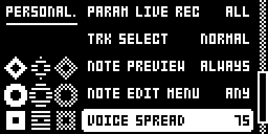

# Voice Spread — Digitone II

A Digitone II mod by @prodbysmolec. Version 0.1.0-experimental, for OS 1.12 on Modwerk's Digitone II base (core 1.1). It ran on a Digitone II from RAM; see [TESTING.md](TESTING.md) for what was run and what was not. The screenshot is from the unit's screen, read over the base's USB link.

## Overview

The Digitone II plays each note on a voice of its own, and a chord takes several. Voice Spread gives every voice a fixed place in the stereo field: neighbouring voices go to opposite sides, and the first voices a chord takes land far apart, so two or three notes already sound wide. FILTER SPREAD also moves each voice's filter frequency a few steps up or down, so the notes of a chord differ slightly in brightness.

- Acts on the live voices only: kits, sounds and saved patterns stay exactly as they are.
- OFF gives the stock sound back at once.
- One setting for the whole project, saved with it.
- Uses two base hooks (`ev_personalize`, `ev_frame_params`) and patches no stock site.

## Controls

Two rows at the end of SETTINGS > PERSONALIZE. LEFT and RIGHT change the value, as on the stock rows there.

| Row | Values | What it does |
| --- | --- | --- |
| VOICE SPREAD | OFF, 25, 50, 75, 100 | How far the voices are spread, in percent of the full width. At 100 the outermost voices sit hard left and right. |
| FILTER SPREAD | OFF, LOW, MID, HIGH | How far each voice's filter frequency moves: at most 4, 10 or 20 of the 127 steps, by a different amount and direction for each voice. |

## Usage

- Pads and chords on a polyphonic track: VOICE SPREAD 50 or more.
- Chords that sound too static: FILTER SPREAD LOW.
- A mono check of the mix: both OFF, and the stock sound is back.

### Quick tutorial

1. Install a build of the Digitone II base that contains Voice Spread.
2. Press SETTINGS, open PERSONALIZE and move down to VOICE SPREAD.
3. Press RIGHT until it shows 75, then play a chord on a polyphonic track: its notes spread from left to right.
4. Move down to FILTER SPREAD and choose LOW: the notes differ slightly in brightness.
5. Save the project to keep the setting.

## Compatibility and limitations

- Digitone II, OS 1.12, on Modwerk's Digitone II base 1.1. It patches no stock site and claims only its project data (`projdata:VSPR`).
- The spread follows the voices, not the tracks: every track's notes are spread, and a mono track's notes can land on different voices and so on different sides from note to note.
- The offset is added to the track's own pan and held in the pan's range. A track panned hard to one side therefore spreads to one side only.
- The default filter frequency is the top of the range, so there FILTER SPREAD can only close voices, never open them.
- The setting is per project, not per track or per kit. A project saved without the module loads with both rows OFF.
- Parameter locks and the stock LFOs still move pan and filter; Voice Spread adds its offset before the stock modulators add theirs.

### Stock flows this module touches

None. It adds two rows to the end of SETTINGS > PERSONALIZE, which the base shares between modules, and changes no stock row, page or gesture.

## How it works

The base calls `ev_frame_params` once a frame (1,500 times a second) in the frame interrupt, with the parameter values of the 16 voices, 101 to a voice, after the stock smoother and before the stock modulators. On the Digitone II these values belong to the voices, not the tracks. Voice Spread adds a fixed offset of its own to each voice's pan (Sound parameter 89) and filter frequency (Sound parameter 67) and holds the result between 0 and 127. The places, in eighths of the full width, are −8, +8, −4, +4, −6, +6, −2, +2 and then the odd eighths, so neighbouring voices are on opposite sides and the offsets of all 16 voices add up to zero. The filter uses the same places in another order, so a voice's side and its brightness do not follow each other.

The two rows are value rows from the base (`core_addvalue`). The setting is four bytes in the project file's header (`core_projdata`, tag `VSPR`): a version and the two levels.

## Tests and measurements

The evidence tier is `author-hardware`. [TESTING.md](TESTING.md) lists what was run on the unit and what was not. Memory: 852 bytes of the base's shared area, measured from the linked image. Load: read from the code; at most 16 voices × two additions and two range checks per frame.

## Authorship and licences

Original work by @prodbysmolec, GPL-3.0-or-later ([LICENSE](LICENSE)). The Sound parameter indices and the voice layout were read from the unit's memory over Modwerk's Digitone II link; no firmware bytes are in this folder.

## Screens and audio

The two rows at the end of SETTINGS > PERSONALIZE, read from a Digitone II's screen over Modwerk's USB link. No audio recording is published: the module only moves each voice's pan and filter frequency, which the screen and the parameter readings in [TESTING.md](TESTING.md) show.
