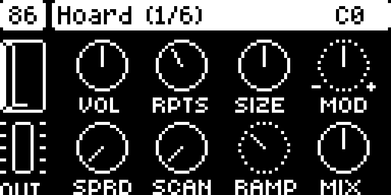

# DigiHoard — Digitone

Modwerk version: `0.2.0`, the author's released 0.2 files, unchanged.

## Overview

DigiHoard, by irpina, is an echo collector for the Digitone mk1's audio inputs: a delay with a memory. Everything you play goes into a 3-minute memory, always, and the echo plays from it. SCAN reaches back into the memory (by itself, now and then, or where you put it), SPREAD adds a second echo further back, six modifiers bend the echoes after the delay, inside its feedback or round the whole memory, and COLLECT turns the memory into an overdubbing sketchpad. LOOP, CLEAR and RAMP play it live, and SIZE can follow the Digitone's tempo.

- A 3-minute memory of everything you play; the echo reads from it.
- SCAN reaches back into the memory, SPREAD adds a second echo further back.
- Six modifiers in the echo, its feedback or round the whole memory.
- COLLECT overdubs the memory into a sketch; LOOP, CLEAR and RAMP play it live.

## Controls

| Control | What it does |
| --- | --- |
| Mod Menu (hold a track key) | Open DigiHoard: it takes the audio engine and its page shows. Its Mod Menu entry also brings the page back after MIDI. |
| SYN1, SYN2, FLTR | Its three pages: page 1 Hoard (VOL, RPTS, SIZE, MOD, SPRD, SCAN, RAMP, MIX), page 2 Secondary, page 3 Switches. Pushing a knob sets it back to its default. |
| AMP | The mixer: the inputs' levels and pans, balance, volume and width. |
| LFO | Two LFOs on the stock LFO page; DEST aims them at its controls or the mixer. |
| RECORD | LOCK mode: hold a trig and turn a control to lock it on that step; FUNC + a trig clears the step. |
| MIDI | The stock UI for the MIDI tracks while it keeps playing. |
| NO | Turn it off: the synths and the Digitone's own effects come back. |
| T1 | Tap: tap tempo (SIZE follows it). Hold: scan, as SCAN at its top. |
| T2 | Tap: bypass. Hold: LOOP (with LTCH it stays). |
| T3 | CLEAR the memory and the echoes. |
| T4 | Tap: the modifiers off and back. Hold: WIPE while held. |

## Usage

Use the access steps below after installing a compatible build. The tutorial gives a first practical pass through the module.

### Where to find it

Location: Mod Menu: hold a track key.

1. Use a build containing DigiHoard for the Digitone mk1 on OS 1.43 or 1.44; fxkit comes with it.
2. Hold a track key: the Mod Menu opens. Pick DIGIHOARD and press YES.
3. Play into the inputs; NO turns it off and gives the synths back.

These instructions assume the module is already installed in a compatible build. For selecting and building it in Modwerk, see the [Digitone guide](../../../machines/digitone/README.md).

### Quick tutorial: echoes from further back

1. Hold a track key, pick DIGIHOARD in the Mod Menu and press YES.
2. Play into the inputs and set VOL, RPTS and SIZE on page 1 (SYN1).
3. Turn SCAN up to hear echoes from further back in the memory; hold T1 to scan.
4. Press NO to turn DigiHoard off and get the synths back.

## Compatibility and limitations

- Original Digitone (Mk1, and the Digitone Keys), OS 1.43 and 1.44. Digitone II is not declared compatible.
- While it is the active effect it owns the audio engine: the synths are silent and the Digitone's own effects are off. NO gives them back; the sequencer keeps running.
- Its MIDI CCs follow the Chase Bliss Habit's published CC chart, so a controller set up for that pedal works with it. It is not affiliated with Chase Bliss and uses none of its code.
- A beta from its author; not yet run on a Digitone Keys.
- Its buffers use 17 MB of the Digitone's bulk memory (0x46200000-0x47300000), apart from the other effect pedals'.
- Needs fxkit (it comes with it) and core 4.1 or newer, so on OS 1.44 it does not build beside KitBank 0.2.0, which builds only on the older core.

## Tests and measurements

The evidence tier is `author-hardware`: the author tested DigiHoard 0.2 on a Digitone mk1 (release v0.2, 18 October 2026; built before the effects' rename, which changed only names) and checked it in digikit's emulator on OS 1.43 and 1.44. It is still a beta. This module pins the released files. Modwerk builds it with core 4.4, which has not run on a unit here. [TESTING.md](TESTING.md) records the identities, what was linked and captured, and what was not tested.

DigiHoard holds **27,163 B** (code, data and state) in the mods' RAM, excluding the core and linker alignment. Runs in the audio render while it is the active effect, nothing while it is off; no CPU figure was measured.

## Authorship and licences

- irpina — DigiHoard design and code, fxkit and core-dn1

The module is licensed under [GPL-2.0-or-later](LICENSE). Imported source: [irpina/digihoard at `029a64e`](https://github.com/irpina/digihoard/tree/029a64e354caf1a0da524302b0ec108d5d28710a). The library builds the author's released `.elemod` files. The header `src/digitakt-mk1/core3.h` is irpina's, from elekloader, under GPL-2.0-or-later. The author's README is in [upstream/](upstream/README.md).

## Screens and audio

Real firmware-rendered emulator captures on OS 1.54. The [capture record](media/capture.json) includes source and build identities, panel inputs, timestamps and PNG hashes. [Capture rights](media/LICENSE.md) preserve the underlying interface rights. The [thumbnail](media/thumbnail.svg) is an illustration. No audio demonstration is claimed.

