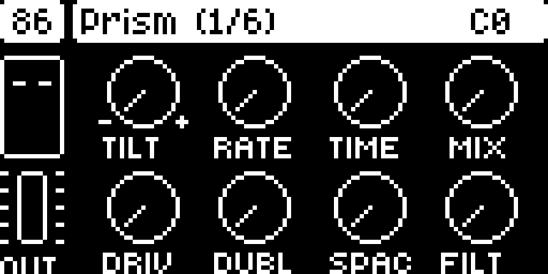

# DigiPrism — Digitone

Modwerk version: `0.2.0`, the author's released 0.2 files, unchanged.

## Overview

DigiPrism, by irpina, is an effects pedal for the Digitone mk1's audio inputs: four modules in a chain you can reorder, each with five effects: Color (DRIVE, WARMTH, FUZZ, WAIL, SWELL), Motion (DOUBLER, VIBRATO, PHASER, TREMOLO, PITCH), Ambience (ECHOES, TAPE, SPACE, SCATTER, REVERSE) and Grit (FILTER, COMP, LO-FI, GLITCH, STATIC). GESTURE records knob movements, and CAPTURE is a 30-second looper and sustainer.

- Four modules, Color, Motion, Ambience and Grit, in an order you set.
- Five effects per module; T1-T4 step through them or bypass a module.
- GESTURE records knob movements.
- CAPTURE: a 30-second looper and sustainer.

## Controls

| Control | What it does |
| --- | --- |
| Mod Menu (hold a track key) | Open DigiPrism: it takes the audio engine and its page shows. Its Mod Menu entry also brings the page back after MIDI. |
| SYN1, SYN2, FLTR | Its three pages: page 1 Prism (TILT, RATE, TIME, MIX and the four AMOUNTs), page 2 Secondary, page 3 Modules (each module's effect, the order, filter style, capture, input level). Pushing a knob sets it back to its default. |
| AMP | The mixer: the inputs' levels and pans, balance, volume and width. |
| LFO | Two LFOs on the stock LFO page; DEST aims them at its controls or the mixer. |
| RECORD | LOCK mode: hold a trig and turn a control to lock it on that step; FUNC + a trig clears the step. |
| MIDI | The stock UI for the MIDI tracks while it keeps playing. |
| NO | Turn it off: the synths and the Digitone's own effects come back. |
| T1-T4 | Tap: the module's next effect. Hold: bypass that module. |
| Trig 15 | Tap: tap tempo. Hold: CAPTURE, release to play; tap to stop. |

## Usage

Use the access steps below after installing a compatible build. The tutorial gives a first practical pass through the module.

### Where to find it

Location: Mod Menu: hold a track key.

1. Use a build containing DigiPrism for the Digitone mk1 on OS 1.43 or 1.44; fxkit comes with it.
2. Hold a track key: the Mod Menu opens. Pick DIGIPRISM and press YES.
3. Play into the inputs; NO turns it off and gives the synths back.

These instructions assume the module is already installed in a compatible build. For selecting and building it in Modwerk, see the [Digitone guide](../../../machines/digitone/README.md).

### Quick tutorial: build a chain of four effects

1. Hold a track key, pick DIGIPRISM in the Mod Menu and press YES.
2. Play into the inputs and raise the four AMOUNT knobs on page 1 (SYN1).
3. Tap T1-T4 to step each module to its next effect; hold one to bypass it.
4. Press NO to turn DigiPrism off and get the synths back.

## Compatibility and limitations

- Original Digitone (Mk1, and the Digitone Keys), OS 1.43 and 1.44. Digitone II is not declared compatible.
- While it is the active effect it owns the audio engine: the synths are silent and the Digitone's own effects are off. NO gives them back; the sequencer keeps running.
- Its MIDI CCs follow the Hologram Electronics Chroma Console's published CC chart, so a controller set up for that pedal works with it. It is not affiliated with Hologram Electronics and uses none of its code.
- A beta from its author; not yet run on a Digitone Keys.
- Its buffers use 7 MB of the Digitone's bulk memory (0x45B00000-0x46200000), apart from the other effect pedals'.
- Needs fxkit (it comes with it) and core 4.1 or newer, so on OS 1.44 it does not build beside KitBank 0.2.0, which builds only on the older core.

## Tests and measurements

The evidence tier is `author-hardware`: the author tested DigiPrism 0.2 on a Digitone mk1 (release v0.2, 18 October 2026; built before the effects' rename, which changed only names) and checked it in digikit's emulator on OS 1.43 and 1.44. It is still a beta. This module pins the released files. Modwerk builds it with core 4.4, which has not run on a unit here. [TESTING.md](TESTING.md) records the identities, what was linked and captured, and what was not tested.

DigiPrism holds **73,426 B** (code, data and state) in the mods' RAM, excluding the core and linker alignment. Runs in the audio render while it is the active effect, nothing while it is off; no CPU figure was measured.

## Authorship and licences

- irpina — DigiPrism design and code, fxkit and core-dn1

The module is licensed under [GPL-2.0-or-later](LICENSE). Imported source: [irpina/digiprism at `0945617`](https://github.com/irpina/digiprism/tree/09456179af986f93b06f5885bbeb16be173bce72). The library builds the author's released `.elemod` files. The header `src/digitakt-mk1/core3.h` is irpina's, from elekloader, under GPL-2.0-or-later. The author's README is in [upstream/](upstream/README.md).

## Screens and audio

Real firmware-rendered emulator captures on OS 1.54. The [capture record](media/capture.json) includes source and build identities, panel inputs, timestamps and PNG hashes. [Capture rights](media/LICENSE.md) preserve the underlying interface rights. The [thumbnail](media/thumbnail.svg) is an illustration. No audio demonstration is claimed.

