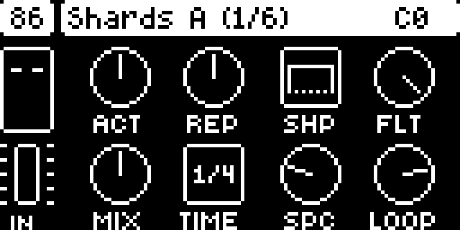

# DigiSwarm — Digitone

Modwerk version: `0.2.0`, the author's released 0.2 files, unchanged.

## Overview

DigiSwarm, by irpina, is an effects engine for the Digitone mk1's two audio inputs: eleven engines with four variations each, a 60-second looper, Hold, Reverse, a resonant filter, pitch modulation and a reverb with four rooms, all in time with the Digitone's tempo.

- Eleven engines with four variations each, picked from the trig keys.
- A 60-second looper with record, overdub, undo and reverse.
- A resonant filter, pitch modulation and a reverb with four rooms.
- Everything follows the Digitone's tempo.

## Controls

| Control | What it does |
| --- | --- |
| Mod Menu (hold a track key) | Open DigiSwarm: it takes the audio engine and its page shows. Its Mod Menu entry also brings the page back after MIDI. |
| SYN1, SYN2, FLTR | Its three pages: page 1 Effect (ACT, REP, SHP, FLT, MIX, TIME, SPC, LOOP), page 2 Shift (input gain, pitch modulation, resonance, effect volume, loop speed, room, fade), page 3 Looper. Pushing a knob sets it back to its default. |
| AMP | The mixer: the inputs' levels and pans, balance, volume and width. |
| LFO | Two LFOs on the stock LFO page; DEST aims them at its controls or the mixer. |
| RECORD | LOCK mode: hold a trig and turn a control to lock it on that step; FUNC + a trig clears the step. |
| MIDI | The stock UI for the MIDI tracks while it keeps playing. |
| NO | Turn it off: the synths and the Digitone's own effects come back. |
| Trig 1-11, 13-16 | Pick the engine (1-11) and its variation A-D (13-16). |
| Trig 12 | HOLD (latching, or momentary in SETUP). |

## Usage

Use the access steps below after installing a compatible build. The tutorial gives a first practical pass through the module.

### Where to find it

Location: Mod Menu: hold a track key.

1. Use a build containing DigiSwarm for the Digitone mk1 on OS 1.43 or 1.44; fxkit comes with it.
2. Hold a track key: the Mod Menu opens. Pick DIGISWARM and press YES.
3. Play into the inputs; NO turns it off and gives the synths back.

These instructions assume the module is already installed in a compatible build. For selecting and building it in Modwerk, see the [Digitone guide](../../../machines/digitone/README.md).

### Quick tutorial: pick an engine and loop it

1. Hold a track key, pick DIGISWARM in the Mod Menu and press YES.
2. Play into the inputs and pick an engine with trig keys 1-11, a variation with 13-16.
3. Turn ACT and MIX on page 1 (SYN1); on page 3 push LOOP to record a loop.
4. Press NO to turn DigiSwarm off and get the synths back.

## Compatibility and limitations

- Original Digitone (Mk1, and the Digitone Keys), OS 1.43 and 1.44. Digitone II is not declared compatible.
- While it is the active effect it owns the audio engine: the synths are silent and the Digitone's own effects are off. NO gives them back; the sequencer keeps running.
- Its MIDI CCs follow the Hologram Electronics Microcosm's published CC chart, so a controller set up for that pedal works with it. It is not affiliated with Hologram Electronics and uses none of its code.
- A beta from its author; not yet run on a Digitone Keys.
- Its buffers use 27 MB of the Digitone's bulk memory (0x44000000-0x45B00000), apart from the other effect pedals'.
- Needs fxkit (it comes with it) and core 4.1 or newer, so on OS 1.44 it does not build beside KitBank 0.2.0, which builds only on the older core.

## Tests and measurements

The evidence tier is `author-hardware`: the author tested DigiSwarm 0.2 on a Digitone mk1 (release v0.2, 18 October 2026; built before the effects' rename, which changed only names) and checked it in digikit's emulator on OS 1.43 and 1.44. It is still a beta. This module pins the released files. Modwerk builds it with core 4.4, which has not run on a unit here. [TESTING.md](TESTING.md) records the identities, what was linked and captured, and what was not tested.

DigiSwarm holds **40,655 B** (code, data and state) in the mods' RAM, excluding the core and linker alignment. Runs in the audio render while it is the active effect, nothing while it is off; no CPU figure was measured.

## Authorship and licences

- irpina — DigiSwarm design and code, fxkit and core-dn1

The module is licensed under [GPL-2.0-or-later](LICENSE). Imported source: [irpina/digiswarm at `a5a2f55`](https://github.com/irpina/digiswarm/tree/a5a2f5595aa5455ecd2d59a4558747b09903adbf). The library builds the author's released `.elemod` files. The header `src/digitakt-mk1/core3.h` is irpina's, from elekloader, under GPL-2.0-or-later. The author's README is in [upstream/](upstream/README.md).

## Screens and audio

Real firmware-rendered emulator captures on OS 1.54. The [capture record](media/capture.json) includes source and build identities, panel inputs, timestamps and PNG hashes. [Capture rights](media/LICENSE.md) preserve the underlying interface rights. The [thumbnail](media/thumbnail.svg) is an illustration. No audio demonstration is claimed.

