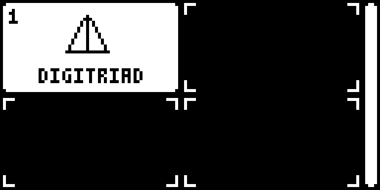
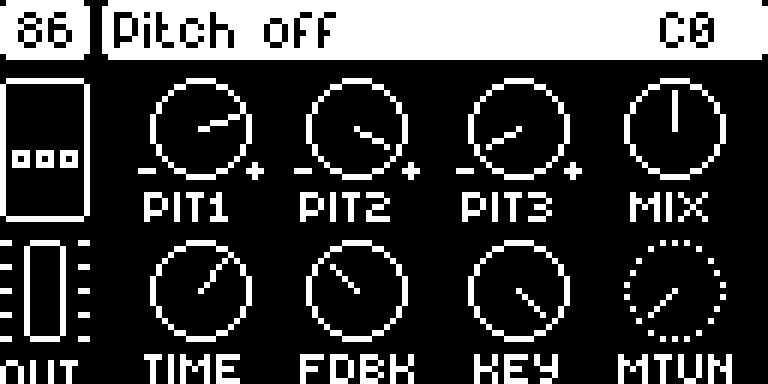

# DigiTriad — Digitone

Modwerk version: `0.2.0`, the author's released 0.2 files, unchanged.

## Overview

DigiTriad, by irpina, is a three-voice rhythmic pitch shifter for the Digitone mk1's audio inputs. Three pitched voices reach from two octaves down to two octaves up, chromatic or in a key and scale from the note a pitch detector hears in what you play, with MICROTUNE, GLIDE and pitch CORRECTION. Each voice sits behind its own division of a delay in time with the Digitone's tempo, in four delay modes (PITCH FEEDBACK, SERIES, DUAL + CROSS, DUAL), with rhythm patterns, HALF SPEED, SWELL and FREEZE.

- Three voices, each -2 to +2 octaves, chromatic or in a key and scale.
- Each voice behind its own tempo-synced delay division.
- Four delay modes, rhythm patterns, HALF SPEED, SWELL and FREEZE.
- MICROTUNE, GLIDE and pitch correction.

## Controls

| Control | What it does |
| --- | --- |
| Mod Menu (hold a track key) | Open DigiTriad: it takes the audio engine and its page shows. Its Mod Menu entry also brings the page back after MIDI. |
| SYN1, SYN2, FLTR | Its three pages: page 1 Triad (PIT1-3, MIX, TIME, FDBK, KEY, MTUN), page 2 Alt (each voice's time division and level, GLID, OUT), page 3 Settings (mode, scale, rhythm, correction). Pushing a knob sets it back to its default. |
| AMP | The mixer: the inputs' levels and pans, balance, volume and width. |
| LFO | Two LFOs on the stock LFO page; DEST aims them at its controls or the mixer. |
| RECORD | LOCK mode: hold a trig and turn a control to lock it on that step; FUNC + a trig clears the step. |
| MIDI | The stock UI for the MIDI tracks while it keeps playing. |
| NO | Turn it off: the synths and the Digitone's own effects come back. |
| Trig 1-12 | Set the key, C to B; trig 13 chromatic, trig 14 the next scale. |

## Usage

Use the access steps below after installing a compatible build. The tutorial gives a first practical pass through the module.

### Where to find it

Location: Mod Menu: hold a track key.

1. Use a build containing DigiTriad for the Digitone mk1 on OS 1.43 or 1.44; fxkit comes with it.
2. Hold a track key: the Mod Menu opens. Pick DIGITRIAD and press YES.
3. Play into the inputs; NO turns it off and gives the synths back.

These instructions assume the module is already installed in a compatible build. For selecting and building it in Modwerk, see the [Digitone guide](../../../machines/digitone/README.md).

### Quick tutorial: a three-voice chord from one note

1. Hold a track key, pick DIGITRIAD in the Mod Menu and press YES.
2. Play into the inputs and set PIT1, PIT2 and PIT3 on page 1 (SYN1) to three intervals.
3. Set KEY with trig 1-12 (C to B) and turn TIME and FDBK for the delays.
4. Press NO to turn DigiTriad off and get the synths back.

## Compatibility and limitations

- Original Digitone (Mk1, and the Digitone Keys), OS 1.43 and 1.44. Digitone II is not declared compatible.
- While it is the active effect it owns the audio engine: the synths are silent and the Digitone's own effects are off. NO gives them back; the sequencer keeps running.
- Its MIDI CCs follow the Meris Hedra's published CC chart, so a controller set up for that pedal works with it. It is not affiliated with Meris and uses none of its code.
- A beta from its author; not yet run on a Digitone Keys.
- Its buffers use 0.9 MB of the Digitone's bulk memory (0x47B00000-0x47BE0000), apart from the other effect pedals'.
- Needs fxkit (it comes with it) and core 4.1 or newer, so on OS 1.44 it does not build beside KitBank 0.2.0, which builds only on the older core.

## Tests and measurements

The evidence tier is `author-hardware`: the author tested DigiTriad 0.2 on a Digitone mk1 (release v0.2, 18 October 2026; built before the effects' rename, which changed only names) and checked it in digikit's emulator on OS 1.43 and 1.44. It is still a beta. This module pins the released files. Modwerk builds it with core 4.4, which has not run on a unit here. [TESTING.md](TESTING.md) records the identities, what was linked and captured, and what was not tested.

DigiTriad holds **28,300 B** (code, data and state) in the mods' RAM, excluding the core and linker alignment. Runs in the audio render while it is the active effect, nothing while it is off; no CPU figure was measured.

## Authorship and licences

- irpina — DigiTriad design and code, fxkit and core-dn1

The module is licensed under [GPL-2.0-or-later](LICENSE). Imported source: [irpina/digitriad at `3a75bb0`](https://github.com/irpina/digitriad/tree/3a75bb0b51f9ccdb29f874cf22a1060f2e82cab1). The library builds the author's released `.elemod` files. The header `src/digitakt-mk1/core3.h` is irpina's, from elekloader, under GPL-2.0-or-later. The author's README is in [upstream/](upstream/README.md).

## Screens and audio

Real firmware-rendered emulator captures on OS 1.54. The [capture record](media/capture.json) includes source and build identities, panel inputs, timestamps and PNG hashes. [Capture rights](media/LICENSE.md) preserve the underlying interface rights. The [thumbnail](media/thumbnail.svg) is an illustration. No audio demonstration is claimed.

