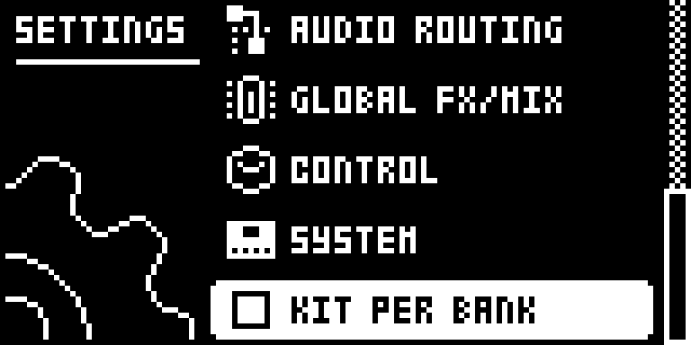
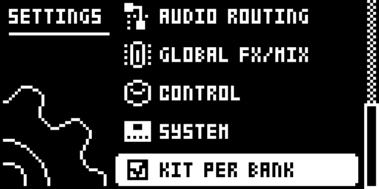
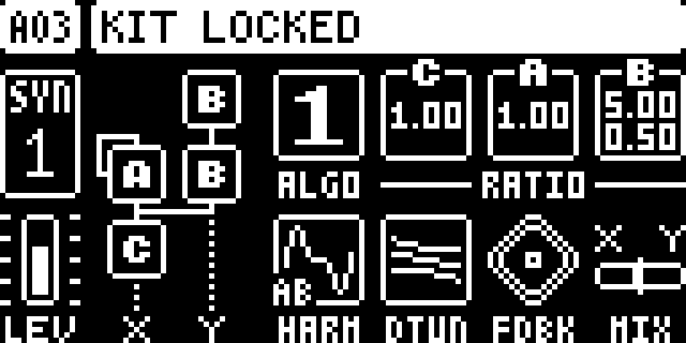

# kitbank — Digitone

Modwerk module version: `0.2.0-experimental`.

## Overview

kitbank gives the original Digitone and Digitone Keys (OS 1.44) one kit per bank, like the Octatrack's parts, with per-pattern locks. With **KIT PER BANK** ticked in SETTINGS, the 16 patterns of a bank play the kit of the bank's first pattern: A01 to A16 play A01's kit, B01 to B16 play B01's kit, and so on up to H.

- Change pattern inside a bank: the sounds stay, only the notes change. This holds for queued changes during playback, chains and song mode.
- A sound edit on any pattern of the bank goes to the bank's kit and is heard on all its patterns.
- **Hold PTN and press YES** to lock the active pattern: it takes a copy of the bank's sound and keeps its own from then on (KIT LOCKED). PTN+YES again shares the bank's kit again (KIT SHARED).
- FUNC+YES / FUNC+NO, SAVE TO PROJ / RELOAD FROM PROJ and [T1–4]+[NO] act on the kit the pattern plays.
- A pasted pattern never overwrites its bank's sound: if the pasted sound differs, the pattern becomes locked with it.
- The switch and the locks are saved with the project. Existing projects, and any project saved without kitbank, open with the switch off and play exactly as on the stock OS.
- Nothing is rewritten in the project: every pattern keeps its own kit, so unticking gives each pattern its own sound again, and a project saved with kitbank still opens on the stock OS.

## Controls

| Control | What it does |
| --- | --- |
| KIT PER BANK | SETTINGS, last row. Ticked: the patterns of each bank share the kit of the bank's first pattern, except locked patterns. Unticked: every pattern plays its own kit, as on the stock OS. Saved with the project; a change applies from the next pattern change. |
| PTN+YES | While KIT PER BANK is ticked: locks the active pattern to its own copy of the sound (KIT LOCKED) or shares it again (KIT SHARED). On a bank's first pattern it only shows BANK KIT. Unticked, it does what the stock OS does: nothing. |

## Usage

Use the access steps below after installing a compatible build. The tutorial gives a first practical pass through the module.

### Where to find it

Location: SETTINGS, last row: KIT PER BANK; lock: hold PTN, press YES.

1. Press SETTINGS and scroll to the last row, KIT PER BANK; press YES to tick it (YES again unticks it).
2. Change pattern, or select the current pattern again: the setting applies from that pattern change.
3. To give the active pattern its own sound, hold PTN and press YES: KIT LOCKED. Hold PTN and press YES again: KIT SHARED.

These instructions assume the module is already installed in a compatible build. For selecting and building it in Modwerk, see the [Digitone guide](../../../machines/digitone/README.md).

### Quick tutorial: one kit for a whole bank, one pattern apart

1. Open SETTINGS, scroll to the bottom and tick KIT PER BANK, then select A01 again.
2. Set up a bass sound on A01, then go to A02 and program different notes: same sound. Turn the filter on A02; A01 changes too.
3. Go to A03, hold PTN and press YES: KIT LOCKED. Change the sound of A03; A01 and A02 keep theirs.
4. Save the project: KIT PER BANK and the lock are saved with it. Hold PTN and press YES on A03 again to share the bank's kit.

A practical layout: one bank per track (intro, verse, break... as 16 patterns sharing one set of sounds), eight tracks per project, and a lock for the odd pattern that needs a different sound.

## Compatibility and limitations

- Original Digitone (Mk1) and Digitone Keys, OS 1.44, with core-dn1 2.0a for 1.44. Not ported to OS 1.43. The Keys runs the same OS file but has not been tried.
- The switch and the locks live in the project header: an elekloader-format `ELKP` block tagged `KBLK`, in the bytes 0x1c..0x200 the stock OS keeps as they are. kitbank writes it with its own project save hook, because core-dn1 2.0a for 1.44 has no project data; it leaves the area alone when another tool's data is already there. It can move to `core_projdata` when a 1.44 core provides it.
- kitbank patches ten stock OS sites itself: immediate pattern change, the kit lookup used by the screen, edits and pastes, two queued-change sites, kit save, kit reload, sound reload (these three only when called from the pattern menus, so the automatic saves after copy, paste and clear keep each pattern's own slot), and project save, load and new. A mod patching the same bytes cannot be combined; if other mods need kit selection or project data, these sites should become core hooks.
- A pattern pasted into a bank's first pattern replaces the bank's kit, as the stock OS replaces that pattern's kit.
- After PTN+YES, kitbank hands the OS the active pattern's trig while PTN is still held, so the OS reselects the same pattern and opens no SELECT PTN popup when PTN is released.
- For under a second after PTN+YES, a knob turn can be ignored while the OS reloads the kit into the tracks (measured in the emulator).
- Undo of a paste was not tried.

## Tests and measurements

The Modwerk evidence tier is `none`. [TESTING.md](TESTING.md) records the emulator runs: stock behaviour when unticked, bank kits for immediate and queued pattern changes and song mode, edits, kit save and reload, PTN+YES locks, pastes, the switch and locks through a project save and load, and a full check against the stock OS. Memory: 1,528 B (1,432 B code, 96 B state), excluding the core. No audio-rate work.

## Authorship and licences

- ZOGV — kitbank design and code
- irpina — the SETTINGS row pattern from digihealth (GPL-2.0-or-later), the elekloader core it links with, and the ELKP project-header format

The module is licensed under [GPL-3.0-or-later](LICENSE).

## Screens and audio

Firmware-rendered emulator captures on OS 1.44. The [capture record](media/capture.json) includes build identities, panel inputs, timestamps and PNG hashes; it also records that they were taken with a digiemu revision other than the reviewed one. [Capture rights](media/LICENSE.md) preserve the underlying interface rights. The [thumbnail](media/thumbnail.svg) is an illustration. No audio demonstration is claimed.

SETTINGS: KIT PER BANK unticked.

SETTINGS: KIT PER BANK ticked.

PTN+YES on A03: KIT LOCKED.
