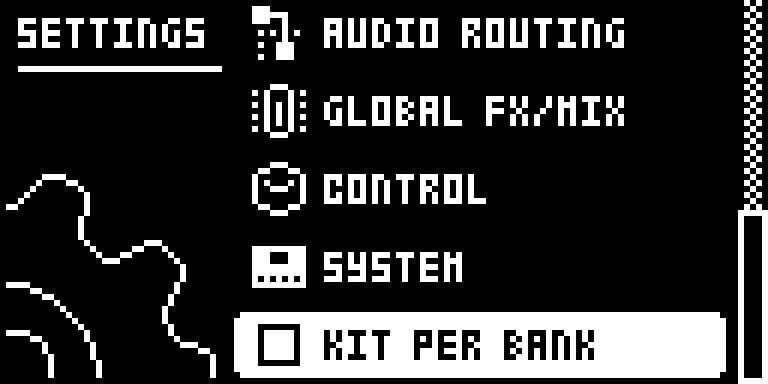
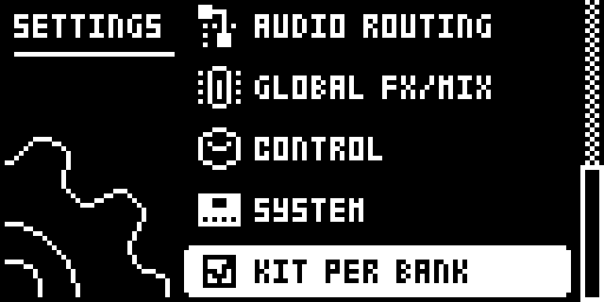
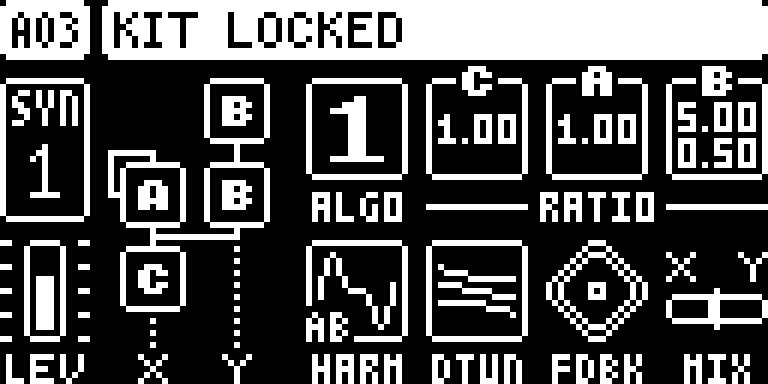

# kitbank — Digitone

Modwerk module version: `0.2.0-experimental`.

## Overview

kitbank gives the original Digitone and Digitone Keys (OS 1.44) one kit per bank, like the Octatrack's parts, with per-pattern locks. With **KIT PER BANK** ticked in SETTINGS, the 16 patterns of a bank play the kit of the bank's first pattern: A01 to A16 play A01's kit, B01 to B16 play B01's kit, and so on up to H.

- Change pattern inside a bank: the sounds stay, only the notes change. This holds for queued changes during playback, chains and song mode.
- A sound edit on any pattern of the bank goes to the bank's kit and is heard on all its patterns.
- **Hold PTN and press YES** to lock the active pattern: it takes a copy of the bank's sound and keeps its own from then on (KIT LOCKED). PTN+YES again shares the bank's kit again (KIT SHARED).
- FUNC+YES / FUNC+NO, SAVE TO PROJ / RELOAD FROM PROJ and [T1–4]+[NO] act on the kit the pattern plays.
- A pasted pattern never overwrites its bank's sound: if the pasted sound differs, the pattern becomes locked with it.
- The switch and the locks are saved with the project. Existing projects, and any project saved without kitbank, open with the switch off and play exactly as on the stock OS.
- Nothing is rewritten in the project: every pattern keeps its own kit, so unticking gives each pattern its own sound again. A project saved with kitbank opens on the stock OS with each pattern's own, older kit (see [Changes to stock flows](#changes-to-stock-flows)).

## Controls

| Control | What it does |
| --- | --- |
| KIT PER BANK | SETTINGS, last row. Ticked: the patterns of each bank share the kit of the bank's first pattern, except locked patterns. Unticked: every pattern plays its own kit, as on the stock OS. Saved with the project; a change applies from the next pattern change. |
| PTN+YES | While KIT PER BANK is ticked: locks the active pattern to its own copy of the sound (KIT LOCKED) or shares it again (KIT SHARED). On a bank's first pattern it only shows BANK KIT. Unticked, it does what the stock OS does: nothing. |

## Usage

Use the access steps below after installing a compatible build. The tutorial gives a first practical pass through the module.

### Where to find it

Location: SETTINGS, last row: KIT PER BANK; lock: hold PTN, press YES.

1. Press SETTINGS and scroll to the last row, KIT PER BANK; press YES to tick it (YES again unticks it).
2. Change pattern, or select the current pattern again: the setting applies from that pattern change.
3. To give the active pattern its own sound, hold PTN and press YES: KIT LOCKED. Hold PTN and press YES again: KIT SHARED.

These instructions assume the module is already installed in a compatible build. For selecting and building it in Modwerk, see the [Digitone guide](../../../machines/digitone/README.md).

### Quick tutorial: one kit for a whole bank, one pattern apart

1. Open SETTINGS, scroll to the bottom and tick KIT PER BANK, then select A01 again.
2. Set up a bass sound on A01, then go to A02 and program different notes: same sound. Turn the filter on A02; A01 changes too.
3. Go to A03, hold PTN and press YES: KIT LOCKED. Change the sound of A03; A01 and A02 keep theirs.
4. Save the project: KIT PER BANK and the lock are saved with it. Hold PTN and press YES on A03 again to share the bank's kit.

A practical layout: one bank per track (intro, verse, break... as 16 patterns sharing one set of sounds), eight tracks per project, and a lock for the odd pattern that needs a different sound.

## Compatibility and limitations

- Original Digitone (Mk1) and Digitone Keys, OS 1.44, with core-dn1 2.0a for 1.44. Not ported to OS 1.43. The Keys runs the same OS file but has not been tried.
- **Project data.** The switch and the locks are one `KBLK` record in the project header's elekloader-format `ELKP` list (bytes 0x1c..0x200, which the stock OS keeps as they are). kitbank rewrites only its own `KBLK` record and keeps every other tool's record where it is; on load it finds `KBLK` anywhere in the list. A header that holds something other than an `ELKP` list is left alone, and the switch and locks are then not saved with that project.
- **The three project save/load sites.** Because core-dn1 2.0a for 1.44 has no project data, kitbank patches these itself: `Project_serialize` at 0x4000eb10 (save: writes the `KBLK` record), `Project_deserialize` at 0x4000e7f4 (load: reads it back; no record means off and no lock) and the new-project routine at 0x4001570e (off, no lock). They become a core hook (`core_projdata`) in a later Digitone core for 1.44, and kitbank will then move to it in an update. Projects saved now stay readable then, because the record format is the core's.
- kitbank patches ten stock OS sites itself: immediate pattern change, the kit lookup used by the screen, edits and pastes, two queued-change sites, kit save, kit reload, sound reload (these three only when called from the pattern menus, so the automatic saves after copy, paste and clear keep each pattern's own slot), and project save, load and new. A mod patching the same bytes cannot be combined; if other mods need kit selection or project data, these sites should become core hooks.
- A pattern pasted into a bank's first pattern replaces the bank's kit, as the stock OS replaces that pattern's kit.
- For under a second after PTN+YES, a knob turn can be ignored while the OS reloads the kit into the tracks (measured in the emulator).
- Undo of a paste was not tried.

### Changes to stock flows

Each change below applies only while KIT PER BANK is ticked, except the SETTINGS row itself. Unticking the row (SETTINGS, last row, YES) turns all of them off at the next pattern change, and a project without kitbank's record opens unticked. The flows compared with and without the module are listed in [TESTING.md](TESTING.md).

- **A per-project row in SETTINGS.** *What changes:* SETTINGS gets a last row, KIT PER BANK, saved with the project rather than with the unit. *Why:* sharing kits is a choice about how a project is laid out, so it belongs to the project; a new page or gesture was not needed for one checkbox. *What you see:* one more row under the stock ones; nothing else moves. *Off:* it is unticked in every new and existing project.
- **FUNC+YES / FUNC+NO and the kit save and reload menus act on the bank's kit.** *What changes:* on a shared pattern, FUNC+YES (save kit), FUNC+NO (reload kit), SAVE TO PROJ / RELOAD FROM PROJ in the pattern menu and [T1–4]+[NO] (reload a sound) save to or reload from the bank's kit, the one the pattern plays. On a locked pattern they act on its own kit, as on the stock OS. *Why:* the stock routines pick the kit by pattern number; left alone, they would save or reload a kit the pattern no longer plays, and the musician would hear nothing change. *What you see:* the stock messages; the result is heard on every shared pattern of the bank. *Off:* untick KIT PER BANK. The automatic saves the OS makes after copy, paste and clear still use each pattern's own slot.
- **A paste can lock a pattern.** *What changes:* pasting a pattern into anything but a bank's first pattern writes its kit into the target's own slot; if that kit differs from the bank's, the target becomes locked (KIT LOCKED behaviour), and if it is the same, the target shares the bank's kit. *Why:* the stock paste writes the kit into the slot the pattern plays, which with sharing would overwrite the whole bank's sound from one pattern. *What you see:* the pasted pattern sounds as the one copied. *Off:* untick KIT PER BANK. Pasting into a bank's first pattern replaces the bank's kit, as on the stock OS.
- **PTN+YES locks or shares the active pattern.** *What changes:* with PTN held, YES locks the active pattern (KIT LOCKED) or shares it again (KIT SHARED); on a bank's first pattern it shows BANK KIT. Then kitbank hands the OS a press of the active pattern's trig while PTN is still held, so the OS reselects the same pattern and does not open the SELECT PTN popup when PTN is released. When a trig was already pressed under the same PTN (a chain being built with PTN+trigs), it hands nothing, so the chain is not changed. *Why:* the lock is per pattern, and PTN is the key a musician holds to act on patterns; on the stock OS, YES does nothing while PTN is held, so no stock gesture moves. *What you see:* the message in the top bar, and the pattern keeps playing. *Off:* untick KIT PER BANK; PTN+YES then does nothing, as on the stock OS. Claimed as `key:PTN+YES`.
- **A project saved with kitbank opens on the stock OS with each pattern's own, older kit.** *What changes:* kitbank never rewrites a pattern's own kit slot; sound edits on a shared pattern go to the bank's first pattern. On the stock OS, or with KIT PER BANK unticked, each pattern plays its own slot again: the kit it had before it started sharing, or when it was last locked. *Why:* keeping each pattern's own slot makes the setting reversible and keeps the project readable by the stock OS. *What you see:* on the stock OS, the patterns of a bank sound as they did before kitbank, and the bank's first pattern has the shared sound. To keep the shared sound on every pattern for the stock OS, copy the bank's first pattern's kit to the others (lock each one with PTN+YES, then save the project) before going back.

## Tests and measurements

[TESTING.md](TESTING.md) describes one build, the one submitted here: core-dn1 2.0a + kitbank 0.2.0-experimental for OS 1.44, linked as `XX08`. It records the author's hardware run and the emulator runs on that build: stock behaviour when unticked, bank kits for immediate and queued pattern changes, chains and song mode, edits, kit save and reload, PTN+YES locks, pastes, the switch and locks through a project save and load, other tools' `ELKP` records kept, and a full check against the stock OS. Memory: see TESTING.md. No audio-rate work.

## Authorship and licences

- ZOGV — kitbank design and code
- irpina — the SETTINGS row pattern from digihealth (GPL-2.0-or-later), the elekloader core it links with, and the ELKP project-header format

The module is licensed under [GPL-3.0-or-later](LICENSE).

## Screens and audio

Firmware-rendered emulator captures of the submitted build (XX08) on OS 1.44, taken with the reviewed digiemu revision `c1b5735` and the unchanged capture script. The [capture record](media/capture.json) includes build identities, panel inputs, timestamps and PNG hashes. [Capture rights](media/LICENSE.md) preserve the underlying interface rights. The [thumbnail](media/thumbnail.svg) is an illustration. No audio demonstration is claimed.

SETTINGS: KIT PER BANK unticked.

SETTINGS: KIT PER BANK ticked.

PTN+YES on A03: KIT LOCKED.
