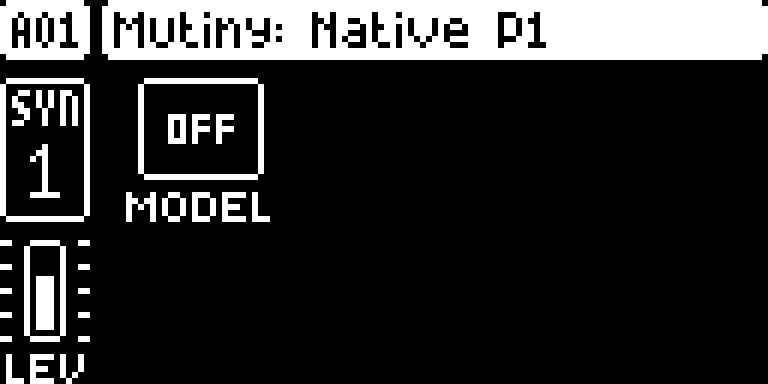
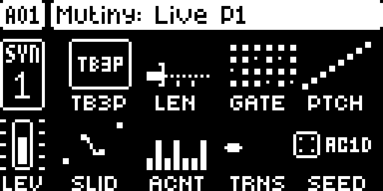

# MUTINY — Digitone

Modwerk version: `0.2.1`, the author's released 0.2.1 file, unchanged.

## Overview

MUTINY, by mbaumannn, puts three generative sequencers from the modular world on the Digitone mk1's synth tracks T1-T4: EUCL, a Euclidean rhythm; TURI, a Turing Machine; and TB3P, an acid line ported from the Phazerville suite's TB-3PO. Each model is a module with seven controls on a track. Press TRIG PARAMETERS on the stock TRIG page to open it: while a model is on, the track plays the generated line and turning a control changes the line, not your pattern. YES commits the page the sequencer keys are on as ordinary trigs, and NO takes the last commit back. Its seeds and controls are saved with the project.

- EUCL, TURI and TB3P generators on synth tracks T1-T4, one per track.
- A preview you play and shape without touching the pattern.
- YES commits a page as ordinary trigs; NO undoes the last commit.
- Seeds and controls are saved with the project.

## Controls

| Control | What it does |
| --- | --- |
| TRIG PARAMETERS | Open the MUTINY page from the stock TRIG page; press again to go back. Opening it writes nothing. |
| Track key 1-4 | Select the track and show it on the page. |
| Encoder A | MODEL: OFF, EUCL, TURI or TB3P. |
| Encoders B-H | The model's seven controls; hold one and press NO to reset it. |
| YES | Commit the page the sequencer keys are on as ordinary trigs. |
| NO | Cancel the preview; after a commit, restore the track as it was. |
| Encoder H | Tap: a new line from the same settings. Hold (TURI): freeze the current pass. |
| Track key, held | Hands the screen back and opens the Mod Menu. |

## Usage

Use the access steps below after installing a compatible build. The tutorial gives a first practical pass through the module.

### Where to find it

Location: TRIG page: TRIG PARAMETERS.

1. Use a build containing MUTINY for the Digitone mk1 on OS 1.44; seq-events comes with it.
2. On a synth track (T1-T4) open the TRIG page and press TRIG PARAMETERS.
3. Turn encoder A to pick a model; press TRIG PARAMETERS again to go back.

These instructions assume the module is already installed in a compatible build. For selecting and building it in Modwerk, see the [Digitone guide](../../../machines/digitone/README.md).

### Quick tutorial: commit a Euclidean rhythm

1. On synth track 1 open the TRIG page and press TRIG PARAMETERS: the MUTINY page opens.
2. Turn encoder A to EUCL and start the transport.
3. Turn C (HITS) and D (ROT) until you like the rhythm.
4. Press YES to commit the page as trigs, or NO to take the last commit back.

## Compatibility and limitations

- Original Digitone (Mk1, and the Digitone Keys), OS 1.44. Digitone II is not declared compatible.
- Digitone mk1 on OS 1.44 only; not the Digitone Keys.
- Synth tracks T1-T4 only; settings are per project, not per pattern.
- Under twelve of the 35 scales MUTINY plays chromatically, because OS 1.44's table has no intervals for them.
- A stored trig condition or probability does not gate a generated note; stored locks and micro timing do apply.
- Needs core 4.1 or newer and seq-events (which comes with it), so it does not build beside KitBank 0.2.0, which builds only on the older core.

## Tests and measurements

The evidence tier is `author-hardware`: the author tested MUTINY for about an hour on their Digitone mk1 on OS 1.44, through every feature: the three models, page commits and undo, project save and reload, pattern switches and four tracks generating at once (release v0.2.1, 8 November 2026). This module pins the released file and the seq-events build it was tested with. Modwerk builds it with core 4.4, which has not run on a unit here. [TESTING.md](TESTING.md) records the identities, what was linked and captured, and what was not tested.

MUTINY holds **0 B** (code, data and state) in the mods' RAM, excluding the core and linker alignment. Runs in the sequencer's step fire and on the UI side, nothing in the audio render; no CPU figure was measured.

## Authorship and licences

- mbaumannn — MUTINY design and code
- Dracyr — seq-events, which it builds on
- Logarhythm and djphazer — TB-3PO (Phazerville suite, MIT), which TB3P ports

The module is licensed under [GPL-2.0-or-later](LICENSE). Imported source: [mbaumannn/mutiny at `1d9f65b`](https://github.com/mbaumannn/mutiny/tree/1d9f65b6e5412fc44689074c1030a146e1ccaae1/mods/mutiny). The library builds the author's released `.elemod` file. The header `src/digitakt-mk1/core3.h` is irpina's, from elekloader, under GPL-2.0-or-later. The author's README is in [upstream/](upstream/README.md).

## Screens and audio

Real firmware-rendered emulator captures on OS 1.54. The [capture record](media/capture.json) includes source and build identities, panel inputs, timestamps and PNG hashes. [Capture rights](media/LICENSE.md) preserve the underlying interface rights. The [thumbnail](media/thumbnail.svg) is an illustration. No audio demonstration is claimed.

