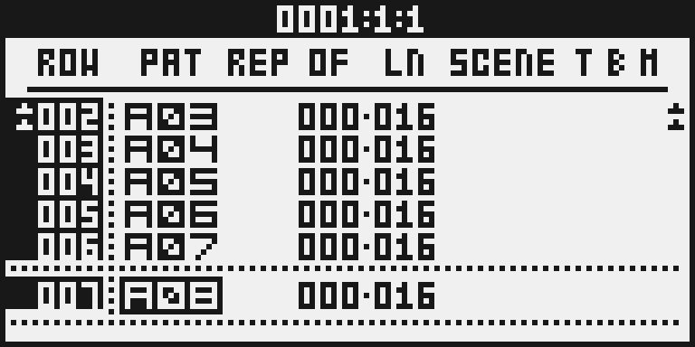
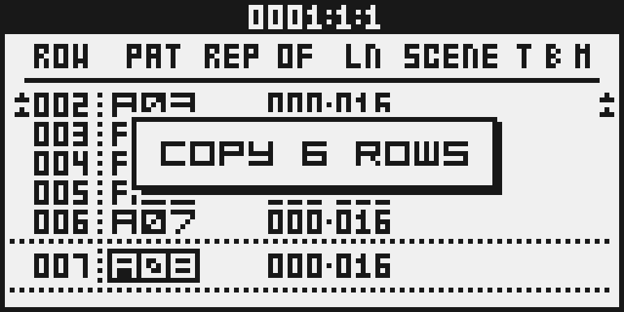
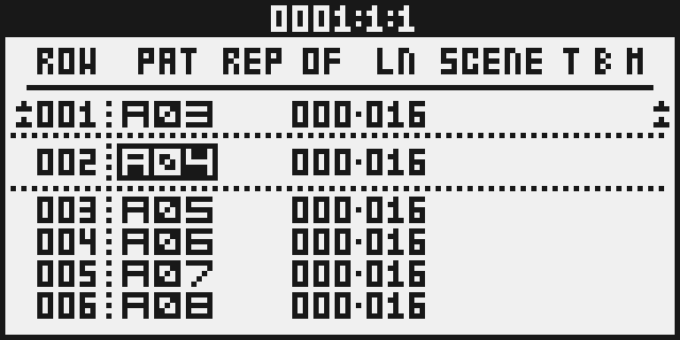

# Arr Rows

Select several rows in the arrangement editor and copy, clear, paste or insert them together, also into another
arrangement. OS 1.40C, MKI and MKII.

## Overview

Stock copies, clears and pastes one arrangement row at a time. Arr Rows adds a selection: hold CUE and press UP or
DOWN to mark rows from the cursor, and the usual FUNC + REC, FUNC + PLAY and FUNC + STOP act on all of them. Pasting
replaces the selected rows, or with no selection the cursor row, with the copied rows; holding CUE as well inserts
them instead, keeping every row. The copied
rows stay until power off, so a section of one arrangement can be pasted into another after ARR CHANGE.

Without a selection, and until rows are copied with it, every key does what it does on stock. The module edits the
arrangement in RAM in stock's own layout, and stock saves it, so a project saved with the module loads unchanged on a
unit without it.

## Controls

In the arrangement editor (MKII: ARR, then EDIT; MKI: FUNC + PATTERN to switch arrangement mode on, then FUNC + BANK
and EDIT):

| Keys | With a selection | Without one |
| --- | --- | --- |
| CUE + UP / DOWN | moves the cursor, as UP/DOWN alone, and extends the selection from where it began; the selected row numbers show inverted | starts a selection on the cursor row and moves |
| FUNC + REC | copies the selected rows: COPY 4 ROWS | stock's one-row copy |
| FUNC + PLAY | clears the selected rows; again on the same rows undoes it | stock's one-row clear |
| FUNC + STOP | replaces the selected rows with the copied rows (the rows below move up or down to fit); again in the same place undoes it | after a copy here: replaces the cursor row with the copied rows; after a stock copy: stock's one-row paste |
| CUE + FUNC + STOP | inserts the copied rows at the cursor; again in the same place undoes it | the same |
| CUE + LEFT / RIGHT | moves the selected rows up / down one place; the row they pass goes to the other side; the marks and the cursor move with them; moving back undoes it | moves the cursor row the same way |

UP or DOWN without CUE, NO, a stock insert or delete (FUNC + DOWN, FUNC + UP) and leaving the editor end the
selection. An undo works only while the rows are as the edit left them: after any other change, the same keys edit
again.

Stock changes, listed as the module guides ask:

- **CUE + UP/DOWN in the arrangement editor** now also mark rows. Stock gives them no function of their own there
  (they move the cursor as UP/DOWN do, measured: RESEARCH.md), and they still do. Considered instead: a new page or a
  FUNC gesture; a FUNC gesture would take stock's insert and delete. Only while the module is installed.
- **CUE + LEFT/RIGHT in the arrangement editor** move rows instead of changing columns. Stock gives them no function of
  their own there (they change columns as LEFT/RIGHT do); LEFT/RIGHT without CUE are unchanged. Chosen by the
  developer over CUE + FUNC + UP/DOWN. Only while the module is installed.
- **FUNC + STOP after a copy made here** pastes those rows instead of stock's one copied row, until the next stock copy
  (FUNC + REC with no selection). Only while the module is installed; the neighbouring flows checked are in TESTING.md.

## Usage

### Quick tutorial

1. Open the arrangement editor (MKII: ARR, then EDIT; MKI: FUNC + PATTERN for arrangement mode, then FUNC + BANK and EDIT).
2. Put the cursor on the first row you want, hold CUE and press DOWN (or UP) until the rows are marked.
3. Press FUNC + REC to copy them, or FUNC + PLAY to clear them.
4. Move the cursor to where they should go and press FUNC + STOP to replace that row with them (or select rows first to replace those), or hold CUE and press FUNC + STOP to insert them.
5. Press the same keys again in the same place to undo the paste, clear or insert.

To move a section to another arrangement: copy it, open ARR CHANGE (or the menu's CHANGE) and pick the other
arrangement, open EDIT and paste or insert.

## Compatibility and limitations

- OS 1.40C. Not yet tested on a unit.
- Takes nothing outside the arrangement editor. UI claims: CUE + UP, CUE + DOWN, CUE + LEFT, CUE + RIGHT, FUNC + REC,
  FUNC + PLAY, FUNC + STOP, CUE + FUNC + STOP and FUNC + DOWN (on a HALT row) in the editor, and the editor's screen
  (the inverted row numbers).
- Patches no stock code; installs beside every other module (`npm run modules:compat`).
- A paste or insert past 256 rows is refused with stock's ROW LIMIT REACHED, changing nothing.
- A paste replaces D rows at row P with the N copied rows (an insert is the same with D = 0). Rows below move by
  N − D, and LOOP and JUMP targets move with the rows they point at, as stock's FUNC + DOWN moves them by one. A
  target on a replaced row points at the first pasted row (for an insert, a target equal to P stays P, as stock
  leaves it). A HALT moves with its row and stays a HALT; stock leaves a HALT sitting at P pointing at the new row,
  an endless LOOP. Pasted rows whose target is inside the copied block keep their place in the block, so a copied
  LOOP or HALT stays one; a LOOP count is kept within stock's 0-64. Every row is mapped from before to after in one
  step, never through a delete, so the case where stock's delete turns a JUMP into a HALT cannot arise.
- A paste or insert never turns a LOOP or JUMP into a HALT. A HALT is a row whose target is itself, so a copied JUMP
  whose target would land on its own new row is refused, changing nothing: `JUMP>HALT ROW 8` (or `LOOP>HALT`) names
  the row. Paste one row further, or change the target first. (Stock's one-row delete does turn a JUMP into a HALT
  this way, silently; the module leaves stock's FUNC + UP as it is.)
- **A change to a stock flow: FUNC + DOWN on a HALT row** (agreed with the owner in
  [#1668](https://github.com/repeat98/modwerk/issues/1668)). Stock's insert duplicates the row and leaves the original,
  moved one row down, pointing at the copy: `HALT: 003` with FUNC + DOWN on it gives `HALT: 003` and `LOOP: 003/∞`
  below it, an endless loop nobody asked for. With the module installed, the moved row stays a HALT: `HALT: 003` and
  `HALT: 004`. Stock still does the insert; the module only points the moved row at itself, on the next frame, and only
  when stock really inserted there. Who notices: anyone inserting on a HALT row; every other FUNC + DOWN, and FUNC + UP
  (delete), are stock's. Considered instead: an own gesture for it, which would leave stock's endless loop in place.
  It applies only while the module is installed. Checked beside it under ot_emu: FUNC + DOWN on a pattern row and
  above a HALT (the HALT follows itself, as on stock), and the module's own paste, insert and move.
- A move (CUE + LEFT/RIGHT) keeps every LOOP/JUMP target on the row it pointed at, so a HALT stays a HALT. A LOOP
  moved past its target becomes a JUMP to it, and a JUMP moved past its target a LOOP with no count shown (stock
  labels a row by its target below or above it). Each press moves one place; holding the key does not repeat. The editor scrolls along, keeping the moved rows and
  the row they move towards on screen (with up to five rows selected).
- The copied rows live in RAM: gone after a power cycle or when the module is removed.
- Editing while the arrangement plays behaves as stock's own edits do; it was not tested separately.

## Tests and measurements

`verify.py` runs the module's C on the host against simulated stock memory (74 checks) and checks the generated
ColdFire unit. The stock behaviour it relies on was read from the 1.40C image and measured under `ot_emu`
(RESEARCH.md). Results, and what is not tested yet, are in TESTING.md.

## Authorship and licences

Original module by Andrey Sidorkin, MIT (LICENSE). Key codes and key layers from Octabam's panel notes
(`docs/firmware/PANEL.md`). No firmware, extracted stock code or built images are included.

## Screens and audio

Emulator captures of the 1.40C editor with the module installed on the beta base (`media/capture.json` records how):

The module makes no sound.
