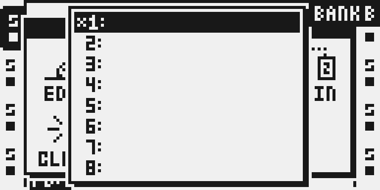

# Arr Setlists

128 arrangements per project, as 16 banks of 8. Setlists of up to 16 songs from any bank follow in a later version.
OS 1.40C, MKI and MKII.

## Overview

Stock keeps 8 arrangements per project. Arr Setlists makes them bank A of 16 banks, A to P, each holding 8. In
ARR > CHANGE, with the transport stopped, LEFT and RIGHT step to the bank before or after, and the bank's letter shows
at the screen's top right. Inside a bank, every stock arrangement function works as usual: edit, ARR SAVE, RELOAD,
COPY, CLEAR, chaining and playback.

Bank A is stock's own: the 8 arrangements in arr01 to arr08, which the module never fills with another bank. Banks B
to P are files of the module's own in the project folder (`arrbankB.work` to `arrbankP.work`, with `.strd` copies
for SAVE PROJECT). A project saved with the module therefore opens on a unit without it, with bank A as it was.

## Controls

| Where | Keys | What it does |
| --- | --- | --- |
| ARR > CHANGE, stopped | RIGHT | Write the current bank to the card, then load the next bank (up to P) |
| ARR > CHANGE, stopped | LEFT | The same, to the bank before (down to A) |
| ARR > CHANGE, playing | LEFT / RIGHT | Nothing changes; it says STOP TO CHANGE BANK |

A bank never used starts as 8 empty arrangements. Switching takes about as long as stock's SYNC TO CARD and ends with
its NOW SAFE TO EJECT! message. Without a project loaded it says NO PROJECT; while the card is busy, CARD BUSY.

## Usage

1. Stop the transport.
2. Open ARR > CHANGE. MKII: ARR, then CHANGE. MKI: FUNC + PATTERN switches arrangement mode on, FUNC + BANK opens the
   arranger menu, then CHANGE.
3. Press RIGHT or LEFT. The label at the top right shows the bank, for example BANK C.
4. Choose one of its 8 arrangements as usual.

### Quick tutorial

1. In ARR > CHANGE, press RIGHT: BANK B, with 8 empty arrangements.
2. Choose arrangement 1, open the editor and add a few rows.
3. Back in ARR > CHANGE, press LEFT: BANK A, your original arrangements.
4. Press RIGHT again: bank B's rows are back.
5. Press LEFT to return to bank A before you finish.

## Compatibility and limitations

- **Takes:** LEFT and RIGHT in ARR > CHANGE (stock does nothing with them there), the top right corner of that list
  for the label, and stock's arrangement writer, which it steps into at its entry: on bank A stock writes arr01 to
  arr08 exactly as always, on another bank the bank's own file is written instead. No other module or base hook uses
  that site (`npm run modules:compat`).
- **Stopped only.** A switch writes and reads the card through stock's own SYNC TO CARD job, which stock runs only
  stopped.
- **A project opens on bank A,** after a project load and a power cycle too: stock reads arr01 to arr08 then.
- **Switch back to bank A before removing the module.** Without the module, stock's next save writes whatever bank
  is in its 8 slots into arr01 to arr08. The module keeps a backup of bank A (`arrbankA.bak`) whenever you leave it,
  and arriving at bank A always loads that backup and writes it back into arr01 to arr08; so if it happens, install
  the module again and step to bank A.
- **Saved with the project.** SAVE PROJECT copies every bank file to its `.strd` copy, RELOAD PROJECT copies them back.
  Copying a project folder copies its banks; stock's own project copy functions copy bank A only.
- **Battery RAM:** 16 bytes at 0x100f8f10 (sdk/machines/octatrack/battery-ram.json) remember which bank the slots hold.

## Tests and measurements

See [TESTING.md](TESTING.md). The OS 1.40C addresses and how they were found are in [RESEARCH.md](RESEARCH.md).

## Authorship and licences

Original module by Andrey Sidorkin, MIT (LICENSE). No firmware, stock code or stock data is included.

## Screens and audio

Emulator capture (ot_emu), not the unit. No audio: the module makes no sound.

## Develop

- Hear it: `npm run module:dev -- arr-setlists` builds it and tries it on your unit over USB; `--watch` does that again on every save.
- Check it: `npm run module:doctor -- --draft arr-setlists`, and `python3 -B sdk/drafts/arr-setlists/verify.py` for the host gate.
- Before you write ColdFire code: the traps in sdk/octabam/AGENTS.md, and docs/OCTATRACK_API.md for the hooks a module can use.
