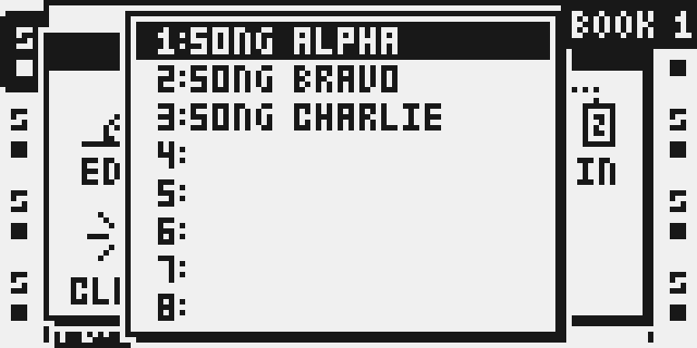

# Arr Setlists

128 arrangements per project, as 16 books of 8, every one an ordinary stock arrangement file. Setlists of up to 16
songs from any book follow in a later version. OS 1.40C, MKI and MKII.

## Overview

Stock keeps 8 arrangements per project, in `arr01.work` to `arr08.work`. Arr Setlists makes them book 1 of 16
books of 8: book 2 is `arr09` to `arr16`, book 3 `arr17` to `arr24`, and so on up to book 16, `arr121` to `arr128`.
In ARR > CHANGE, with the transport stopped, LEFT and RIGHT step to the book before or after, and BOOK 2 (and so on)
shows at the screen's top right; the list shows the new book's names at once. Inside a book, every stock arrangement function works as usual: edit, ARR SAVE,
RELOAD, COPY, CLEAR, chaining and playback.

The Octatrack's own code writes and reads every one of these files, so they are stock arrangement files in every
byte. A project saved with the module opens on a unit without it with book 1 as it was, and an arrangement from a
later book can be moved into book 1 on a computer by renaming its file (`arr37.work` to `arr03.work`, say).

## Controls

| Where | Keys | What it does |
| --- | --- | --- |
| ARR > CHANGE, stopped | RIGHT | Write the current book to the card, then load the next one (up to 16) |
| ARR > CHANGE, stopped | LEFT | The same, to the book before (down to 1) |
| ARR > CHANGE, playing | LEFT / RIGHT | Nothing changes; it says STOP TO CHANGE BOOK |

A book never used starts as 8 empty arrangements. Switching takes about as long as stock's SYNC TO CARD and ends with
its NOW SAFE TO EJECT! message. Without a project loaded it says NO PROJECT; while the card is busy, CARD BUSY. If an
arrangement file does not read, it says BOOK FILE ERROR, that arrangement shows empty, and its file is left as it is
unless you edit that arrangement.

## Usage

1. Stop the transport.
2. Open ARR > CHANGE. MKII: ARR, then CHANGE. MKI: FUNC + PATTERN switches arrangement mode on, FUNC + BANK opens the
   arranger menu, then CHANGE.
3. Press RIGHT or LEFT. The label at the top right shows the book, for example BOOK 3.
4. Choose one of its 8 arrangements as usual.

### Quick tutorial

1. In ARR > CHANGE, press RIGHT: BOOK 2, with 8 empty arrangements.
2. Choose arrangement 1, open the editor and add a few rows.
3. Back in ARR > CHANGE, press LEFT: BOOK 1, your original arrangements.
4. Press RIGHT again: book 2's rows are back.
5. Press LEFT to return to book 1 before you finish.

## Compatibility and limitations

- **Takes:** LEFT and RIGHT in ARR > CHANGE (stock does nothing with them there), the top right corner of that list
  for the label, and stock's arrangement writer, which it steps into at its entry: on book 1 stock writes arr01 to
  arr08 exactly as always, on another book that book's 8 files are written instead. No other module or base hook uses
  that site (`npm run modules:compat`).
- **Stopped only.** A switch writes and reads the card through stock's own SYNC TO CARD job, which stock runs only
  stopped.
- **A project opens on book 1,** after a project load and a power cycle too: stock reads arr01 to arr08 then.
- **Switch back to book 1 before removing the module.** Without the module, stock's next save writes whatever book is
  in its 8 slots into arr01 to arr08. Leaving book 1 always keeps a backup of it (`arr01.bak` to `arr08.bak`, stock
  files too), and arriving at book 1 loads that backup and writes it back into arr01 to arr08; so if it happens,
  install the module again and step to book 1.
- **Saved with the project.** SAVE PROJECT copies arr09 to arr128 to their `.strd` copies as stock does for arr01 to
  arr08, and RELOAD PROJECT copies them back. Stock's own project copy functions copy book 1 only; copying the project
  folder copies every book.
- **Battery RAM:** 16 bytes at 0x100f8f10 (sdk/machines/octatrack/battery-ram.json) remember which book the slots hold.

## Tests and measurements

See [TESTING.md](TESTING.md). The OS 1.40C addresses and how they were found are in [RESEARCH.md](RESEARCH.md).

## Authorship and licences

Original module by Andrey Sidorkin, MIT (LICENSE). No firmware, stock code or stock data is included.

## Screens and audio

Emulator capture (ot_emu), not the unit. No audio: the module makes no sound.

## Develop

- Hear it: `npm run module:dev -- arr-setlists` builds it and tries it on your unit over USB; `--watch` does that again on every save.
- Check it: `npm run module:doctor -- --draft arr-setlists`, and `python3 -B sdk/drafts/arr-setlists/verify.py` for the host gate.
- Before you write ColdFire code: the traps in sdk/octabam/AGENTS.md, and docs/OCTATRACK_API.md for the hooks a module can use.
