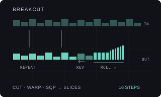

# BREAKCUT

Version: `0.1.0-experimental` · author: [Semi Erendönmez (@semierendonmez-commits)](https://github.com/semierendonmez-commits)

## Overview

BREAKCUT is Livecut's break cutting as a track machine for a sliced break on an Octatrack Flex track. Livecut, by
Remy Muller, is a small part of Nick Collins' BBCut library for automatic jungle and drum & bass cutting: the break is
cut into phrases of one to four bars, each phrase into blocks, each block into cuts that replay the block's start,
and a phrase can end in a roll or fill. BREAKCUT runs Livecut's three cut procedures over the track's length and
writes the result into the track's own sequencer:

- a trig on each step a cut starts or continues on, with a **STRT** lock choosing the slice;
- cuts shorter than a step as **RTRG** and **RTIM** locks (retrigs), cuts starting off the grid as micro-timing;
- rolls pitched up or down as **PTCH** locks (RAMP), reversed blocks as **RATE** locks (REV).

The stock sequencer plays it at the pattern's tempo, track speed, length and swing; BREAKCUT keeps no clock and runs
nothing while the pattern plays ([sequencing.md](../../../docs/module-guides/sequencing.md)). Every control change
redraws the track from the settings, so a turn back restores the cut-up; the trigs and locks are ordinary sequencer
data and stay when BREAKCUT is turned off.

BREAKCUT contributes to the Modwerk base's `ot_machines` table ([HOOKS.md](../../../machines/octatrack/HOOKS.md)) and
patches no stock site; it needs the base loaded over USB and has no card form (as Beat Slicer).

## Controls

SRC SETUP (a double tap on SRC) lists BREAKCUT after the stock machines; YES makes the track BREAKCUT, backed by its
Flex pool. The SRC page holds the six controls; SRC SETUP keeps the sample's own setup (SLIC must be on); a push on
LEVEL shows stock's sample controls, and holding a trig or a scene shows stock's page.

| Encoder | Control | Default | Behaviour |
|---|---|---|---|
| A | ALGO | CUT | CUT (CutProc11), WARP (WarpCut), SQP (SQPusher), MIX (one of the three drawn per phrase). |
| B | SLCS | 16 | 1–64. Slices in the break, one a step. A slice is chosen as the step's place in the break: the break plays straight when nothing cuts. |
| C | ACTV | 64 | 0–127. CUT: the most repeats of a cut (0–4, Livecut's maxrep). WARP: 1 − straight chance (how many blocks become rolls). SQP: activity (how often a quaver becomes two semiquavers). |
| D | ROLL | 100 | 0–127. CUT: the chance a phrase ends in a stutter of 1–8 cuts a step (Livecut's stutter, area 0.5 bar). WARP: the share of rolls that accelerate (or, reversed, slow down) instead of staying even. SQP: the chance the phrase's last bar is one of SQPusher's thirteen fills. |
| E | RAMP | 0 | −12..+12 semitones: a roll's pitch at its end, rising or falling across it (PTCH locks). 0 writes none. |
| F | REV | OFF | OFF, 1–127. The chance a block plays reversed (its slices backwards, each with a RATE lock). |

YES draws a new variation (the seed is kept with the settings and shown in the message, not on a page). The settings
live in the Part's spare NEIGHBOR slots of the track (nine bytes, seven bits each, after the `BC` signature).

Livecut's other defaults are kept where BREAKCUT has no knob: phrases of 1–4 bars, the stutter area of half a bar,
WarpCut's ritardando chance 0.5 and speed 0.9. A unit is one step (Livecut's subdivision 16). Livecut's amplitude, pan,
duty cycle, bit crusher and comb filter are not ported: use the Octatrack's own AMP, LFO and FX for those.

## Usage

Load a one-bar break on a Flex track and slice it into 16 equal slices (AED → SLICE → CREATE SLICE GRID 16, or Beat
Slicer's beat grid at 4 slices a beat); set SLIC to ON in SRC SETUP and LOOP off. Make the track BREAKCUT: with ACTV
and ROLL at 0 it plays the break straight; raise them for cuts. For a two-bar break, slice it into 32 and set SLCS
32. SQP at ACTV 60–90 is the busiest jungle style; WARP with ROLL high gives accelerating rolls; CUT is the classic
"repeat odd lengths, stutter at the end". RAMP +7 on rolls is a typical rising roll.

## Quick tutorial: cut up a break

1. Load a one-bar break on track 1 (Flex), create a 16-slice grid in AED, set SLIC ON in SRC SETUP. Double-tap SRC, scroll to BREAKCUT and press YES.
2. Press SRC. Turn ACTV and ROLL up and choose ALGO SQP; each turn rewrites the track at once, also while playing.
3. Set RAMP to +7 for rising rolls and REV to 30 for reversed blocks; press YES for another variation.
4. Press PLAY to hear the cut-up; press STOP, or choose FLEX in SRC SETUP to leave BREAKCUT; the trigs and locks stay editable.

## Compatibility and limitations

- Octatrack MKI or MKII, OS 1.40C, the Modwerk base loaded over USB (beta) with the machine table. Card firmware cannot include it.
- Needs a sliced Flex sample, one slice a step, SLIC on. Three values are read from the unit and are unverified here
  (TESTING.md): the STRT value of slice n in slice mode (taken as n), RATE's full-speed reverse (taken as 0, stock's
  default 127 being forward) and RTIM's scale (taken as 16 values an octave with stock's default 79 at one step).
- BREAKCUT owns the trigs, trig words and PTCH, STRT, RATE, RTRG and RTIM locks of the steps inside the track's length;
  LEN, AMP, LFO and FX locks, swing and steps past the length stay.
- One trig a step: where a cut continues and another starts in the same step, the new cut wins. An accelerating
  roll becomes even retrigs within each step.
- No conflicts are declared. Not yet run on a unit or in the emulator; nothing below is hardware evidence.

## Implementation

`engine.c` ports Livecut's `CutProc11`, `WarpCutProc` and `SQPusherCutProc` (`BBCutter.cpp`) to integers, drawing from
a seeded xorshift instead of `rand()`, with SQPusher's fill table in ticks (1/24 step). A block's cuts are rendered to
steps: the first cut starting in a step gives the trig and its micro-timing, further starts become retrigs at their
mean spacing, and a step no cut starts in continues the sounding cut with the next slice. `bc_write` puts the line into
the record in place. `machine.c` is the machine glue in the shape of VECTOR's `native.c` over the base: a `struct
modwerk_machine` (`breakcut_machine`, signature `BC`, BACKING, order 70), the SRC page built from stock's FLEX
descriptor with BREAKCUT's names, formatters and stock's dial renderer, an input layer for encoders A–F, YES and the
LEVEL push, and generation into the current pattern's record with only this track's bit of stock's lock index set.

The USB package is built by `sdk/runtime/loader/build.py` from the two sources with
`--subscribe ot_machines:breakcut_machine:70`; `verify.py` rebuilds it and compares it with the published one.

## Tests and measurements

See [TESTING.md](TESTING.md). `test_engine.py` runs the engine under the sanitizers: CutProc11 and WarpCut play the
break straight when nothing cuts (every step its own slice); 22,016 lines over the procedures, seeds, ACTV, ROLL,
lengths, ramps and reverses are deterministic and well formed and include retrigs, micro-timing, reverses and pitched
steps; CutProc11 stutters and SQPusher fills appear; the RTIM scale; the record writer and the settings packing. With
`m68k-elf-gcc` it builds the package and checks the machine record at the registry's index.

## Authorship and licences

The cut procedures follow [Livecut](https://github.com/mdsp/Livecut) by Remy Muller (GPL-2.0-or-later),
`Source/BBCutter.cpp` at `2695d386ebb23b13ceeb1a4aa76b6851ce9ea050`, itself based on Nick Collins' BBCut library for
SuperCollider. The Octatrack glue is original, in the shape of VECTOR's `native.c` by Jannik Aßfalg (MIT, Modwerk).
The module is [GPL-3.0-or-later](LICENSE); the thumbnail is an original illustration
([presentation/LICENSE](presentation/LICENSE)). No Elektron firmware, extracted routines, tables, samples or dumps are
included; underlying Elektron interface rights remain reserved.

## Screens and audio

No screenshots yet: SRC SETUP with BREAKCUT in the machine list and the SRC page are captured in the headless emulator
once the module runs there (`scripts/capture-module-ui.py`). No audio preview.
