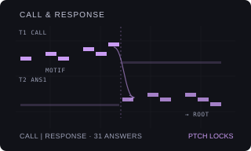

# CALL & RESPONSE

Version: `0.1.0-experimental` · author: [Semi Erendönmez (@semierendonmez-commits)](https://github.com/semierendonmez-commits)

## Overview

CALL & RESPONSE is Nordl3's [Call / Response Generator](https://github.com/Nordl3/Call-Response-Generator) as a track
machine for the Octatrack's audio tracks. The generator writes a short call phrase and a response to it, on one MIDI
output or split over two; here that is one audio track or two. Each phrase becomes the track's own sequencer data:

- a trig on each step that sounds, with a **PTCH** lock for its note in the chosen scale;
- a **VOL** lock on accented notes (the Part's AMP VOL + 18).

The stock sequencer plays them at the pattern's tempo, track speed, length and swing; CALL & RESPONSE keeps no clock
and runs nothing while the pattern plays ([sequencing.md](../../../docs/module-guides/sequencing.md)). Every control
change redraws the track from the settings, so a turn back restores the phrases; the trigs and locks are ordinary
sequencer data and stay when CALL & RESPONSE is turned off.

It contributes to the Modwerk base's `ot_machines` table ([HOOKS.md](../../../machines/octatrack/HOOKS.md)) and
patches no stock site; it needs the base loaded over USB and has no card form (as Beat Slicer).

## One track or two

ROLE says what a track plays:

- **C+R** (the default): calls and responses on this track, with its sample: the generator's same output.
- **CALL**: the calls only. A second CALL & RESPONSE track then answers it with its own sample.
- **ANS1**–**ANS8**: the responses to the call on that track (a CALL or C+R track). It rebuilds the same call from that
  track's settings, so the answer always follows the call it hears.

A new CALL & RESPONSE track answers the first CALL track in the Part that has no answer yet, else it is C+R: set T1 to
CALL, then make T2 CALL & RESPONSE, and T2 answers T1. Turning a C+R or call track's control rewrites that track **and
every track answering it**; turning an answer track's control rewrites only that track. An answer track whose call
track is not a CALL & RESPONSE call says `NO CALL ON Tn` and writes nothing.

PHRS, on the call (or C+R) track, lays the phrases over the track length L (on two tracks, give both the same length).
C is a call, R a response; C′ and C″ are calls varied by VAR, R′ a response mutated by MUT:

| PHRS | Phrases | On one track (C+R) | Call track | Answer track |
|---|---|---|---|---|
| `C\|R` | halves of L | C · R | C · — | — · R (mutated by MUT) |
| `CRCR` | quarters | C · R · C′ · R′ | C · — · C′ · — | — · R · — · R′ |
| `CCCR` | quarters | C · C′ · C″ · R | C · C′ · C″ · — | — · — · — · R (mutated by MUT) |
| `CCRR` | quarters | C · C′ · R · R′ | C · C′ · — · — | — · — · R · R′ |
| `LAYR` | the whole L | as `C\|R` | C over L | R over L, at the same time |

On a 64-step track CCCR gives three 16-step calls and a 16-step answer; on 32 steps, phrases of 8. The quarter layouts
fall back to C|R on tracks shorter than four steps.

## Controls

SRC SETUP (a double tap on SRC) lists CALLRESP after the stock machines; YES makes the track CALL & RESPONSE, backed by
its Flex or Static pool. A push on LEVEL on the SRC page shows stock's sample controls (and their SRC SETUP), and
holding a trig or a scene shows stock's page, so locks stay stock's.

The call, on the SRC page of a C+R or call track:

| Encoder | Control | Default | Behaviour |
|---|---|---|---|
| A | MOTF | ACID | The motif type, its rhythm and contour: ACID, PULS, OFFB, SYNC, SPRS, ROLL, STAB, RPT, RISE, FALL, R>D, D>R, LEAP, PIVT, HOOK, ARP. |
| B | DENS | 16 | 0–31. How many steps of the call sound; 16 is the generator's Medium (0.52). |
| C | REPT | 23 | 0–31. How closely the call repeats its motif; from 22 the motif is also cloned along it (Repetitive, Very repetitive). |
| D | SCAL | MINP | Minor and major pentatonic, minor, Dorian, Phrygian, harmonic minor, major, blues. The response uses the call's scale. |
| E | PHRS | C\|R | `C\|R`, `CRCR`, `CCCR`, `CCRR` or `LAYR`, as above. |
| F | ROLE | C+R | C+R, CALL or ANS1–ANS8 (never the track itself). |

The response, on SRC SETUP of a C+R track (and on the SRC page of an answer track, with ROLE on F):

| Encoder | Control | Default | Behaviour |
|---|---|---|---|
| A | ANSW | SR+R | The answer strategy, 31 of the generator's: SR+R same rhythm and resolve, SR+C same rhythm new contour, SIMP, EXTD, TRNC (motif simplified, extended, truncated), ECHO, DLAY (delayed), UP, DOWN, INVR (inverted contour), RHY= (copy the rhythm, change the notes), NOT= (copy the notes, change the rhythm), TRN+, TRN-, >RT, >5TH, >LOW, HARD (resolves to the root, the fifth, lower, harder), RPBR (repeat then break), SPRS, BUSY, ACNT, HALF (half-phrase), FRAG (fragment), TAIL, OPPO (opposite register), DARK, BRIT, Q>C (question then closure), HOOK (hook then fill), V>I (call dominant, response tonic). |
| B | TGHT | 16 | 0–31. How close the response stays to the call: each note may be pulled into the scale's note pool and halfway to the call's note. |
| C | END | MORE | The response's last note: ROOT, 5TH, RISE, FALL, FADE (no accent), STRG (strong cadence), WEAK, AMBG (ambiguous), MORE (more resolved than the call), SAME (as the strategy leaves it), TENS (more tense). |
| D | MUT | 0 | 0–31. Mutation: up to 70% of a response's steps flipped and moved; of two responses only the second. |
| E | TRNS | 0 | −12..+12 semitones on the response. |
| F | VAR | 0 | 0–31. Variation of the repeated calls (C′, C″), as MUT on the response; the first call stays as it is. On a call track SRC SETUP holds VAR alone. |

An answer track keeps the sample's own SRC SETUP. YES on the SRC page draws a new call (on a C+R track call and
response together, rewriting the tracks answering it) and, on an answer track, a new answer to the same call; the seed
is kept with the settings and shown in the message, not on a page. The settings live in the Part's spare NEIGHBOR
slots of the track (nine bytes, seven bits each, after the `CR` signature); a track keeps every control when ROLE
changes.

## Usage

Give the track a pitched sample (one note, tuned to the scale's root at PTCH 0). Make it CALL & RESPONSE: it plays a
call in the first half and the answer in the second. For three calls and an answer set PHRS to CCCR and raise VAR for
calls that change a little each time. For a call on a bass and the answer on a stab, set ROLE to CALL and make a
second track CALL & RESPONSE; it answers the first.

## Quick tutorial: three calls and an answer

1. Load a bass note on T1 (Flex or Static) and set the pattern to 64 steps. Double-tap SRC, scroll to CALLRESP and press YES. ROLE shows C+R.
2. Press SRC. Set PHRS to CCCR and MOTF to SYNC: three 16-step calls and an answer, rewritten at once, also while playing.
3. Double-tap SRC for SRC SETUP: turn ANSW to UP, END to ROOT and VAR to 8. Press YES on the SRC page for another call.
4. For the answer on another sample, set ROLE to CALL, load a stab on T2 and make T2 CALL & RESPONSE: T2 shows ANS1 and plays the fourth quarter.

## Compatibility and limitations

- Octatrack MKI or MKII, OS 1.40C, the Modwerk base loaded over USB (beta) with the machine table. Card firmware cannot include it.
- Lines are written into the current pattern when a control is turned or YES pressed; another pattern gets its phrases
  the first time it is edited. On two tracks, keep both in one Part at the same length.
- Pitch is a PTCH lock, −12..+12 semitones around the sample's own pitch: notes above an octave fold back into it.
- CALL & RESPONSE owns the trigs and the PTCH and VOL locks of the steps inside the track's length; other locks, trig
  conditions, micro-timing, swing and steps past the length stay.
- The generator's styles, gate, tie and slide, its other phrase modes and note-pool modes are not ported: it runs its
  neutral style, "Medium register", "Pool with spice notes", "Motif accents" and the motif's own contour. Strategies
  that only changed articulation (tighter, staccato, legato, slide) are left out; ACNT and HARD keep their accents.
  DENS, REPT, TGHT, MUT and VAR run 0–31 (the generator's own presets are coarser still).
- YES on SRC SETUP stays stock's (it chooses the machine there), so a C+R track's YES draws call and response together.
- No conflicts are declared. Not yet run on a unit or in the emulator; nothing below is hardware evidence.

## Implementation

`engine.c` ports the generator's `motifTemplate`, `notePool`, `buildCall`, `buildResponse`, `applyEnding` and
`mutatePhrase` to integers, its chances in thousandths, drawing from two seeded xorshifts (the call's from the call
track's settings, the response's from both) instead of `Math.random()`, so the answer track rebuilds the call bit for
bit; `mutate` varies repeated calls (VAR) and responses (MUT). `cr_layout` and `cr_generate` lay the phrases in the
track's slots, `cr_write` puts the line into the record in place.
`machine.c` is the machine glue in the shape of VECTOR's `native.c` over the base: a machine record
(`callresp_machine`, a `struct modwerk_machine_setup`: signature `CR`, BACKING and SETUP_PAGE, order 80), the SRC and
SRC SETUP cells built from stock's FLEX or STATIC descriptor with the role's names, formatters and stock's dial renderer, an input layer for encoders A–F, YES and the LEVEL push, and
generation into the current pattern's record with only this track's bit of stock's lock index set.

The USB package is built by `sdk/runtime/loader/build.py` from the two sources with
`--subscribe ot_machines:callresp_machine:80`; `verify.py` rebuilds it and compares it with the published one.

## Tests and measurements

See [TESTING.md](TESTING.md). `test_engine.py` runs the engine under the sanitizers: the PHRS layouts; 90,000 lines
(C+R, call and answer tracks over settings, lengths and modes) are deterministic, inside their slots and scale and
close each call on a sounding step; a C+R track is exactly its call track's calls and its answer track's responses;
VAR varies only the repeated calls and MUT only the mutated response; the 31 strategies are pairwise distinct; ROOT,
5TH and MORE close as the generator's; TGHT pulls the response toward the call; the writer and packing. Over 20,000
pairs at the defaults its step densities and mean degrees match the original generator's within a few hundredths (run
in Node from `index.html`, not part of the gate). With `m68k-elf-gcc` it builds the package and checks the machine
record at the registry's index.

## Authorship and licences

The phrase rules follow Nordl3's [Call / Response Generator](https://github.com/Nordl3/Call-Response-Generator)
(MIT, Copyright (c) 2026 Nordl3), `index.html` at `dbd1f0c35ecd37dd4d64747808fff7ea3629c1b6`. The Octatrack glue is
original, in the shape of VECTOR's `native.c` by Jannik Aßfalg (MIT, Modwerk). The module is
[GPL-3.0-or-later](LICENSE); the thumbnail is an original illustration ([presentation/LICENSE](presentation/LICENSE)).
No Elektron firmware, extracted routines, tables, samples or dumps are included; underlying Elektron interface rights
remain reserved.

## Screens and audio

No screenshots yet: SRC SETUP with CALLRESP in the machine list, the SRC page and SRC SETUP of a C+R track and an
answer track's SRC page are captured in the headless emulator once the module runs there (`scripts/capture-module-ui.py`). No audio preview.
