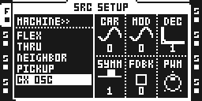
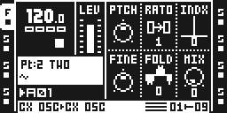

# CX OSC

Version 0.1.0-experimental · by @ilia-murzinov · experimental (author MKII USB trials).

## Overview

CX OSC is a Buchla-flavoured complex oscillator on a FLEX track: two-operator FM,
sine wavefolder, CAR/MOD morph, index decay, SYMM skew, and modulator feedback.
It is mono (stock LFO page, no VOIC/CHRD). Part signature is **CX**, 1.

Upstream engine and pages come from [octabam](https://github.com/sambanks/octabam)
`modules/cxosc` pinned at `256bcf4b` (26 Nov 2026 main). Tim Hastie's FM SYNTH
lineage and Modwerk's FM Synth chooser hooks are in the NOTICE chain; Ilia's CX
knobs and morph path are in the octabam module.

## Controls

See upstream `upstream/cxosc/README.md` for the full PLAYBACK / SETUP map (PTCH,
RATO, INDX, FINE, FOLD, MIX, CAR, MOD, DEC, SYMM, FDBK, PWM).

## Usage

Assign CX OSC on a FLEX track after removing FM Synth from the module set.

## Quick tutorial: CX OSC on a FLEX track

1. Remove FM Synth from the module set. Sync or trial CX OSC alone.
2. FUNC+SRC on a FLEX track, pick CX OSC, press YES. Part signature reads CX.
3. PLAYBACK: PTCH RATO INDX FINE FOLD MIX. SRC SETUP: CAR MOD DEC SYMM FDBK PWM.
4. Trig the track and tune knobs. Only one CX OSC track per Part.

Double-tap the track key for PLAYBACK; the stock LFO page lists CAR/MOD/SYMM/FDBK/PWM as PMTR destinations 30-34.

## Compatibility and limitations

- Declared conflicts with **synth** (FM SYNTH), **SYNTH MACHINE**, and
  **BLACKPYRAMIDS_303**: same machine-list and MIDI hook families as on octabam.
- One CX OSC track per Part (`ml_guard`) is kept from octabam; behaviour on Modwerk
  is not yet exercised.
- Octabam **HOOKS** chaining beside ANALOG BD / OCTA303 is out of scope: each
  Modwerk module stands alone (`ot_machines`).

## Tests and measurements

**Build (26 Nov 2026):** `npm run module:dev -- cx-osc --build-only` produces a
~29 KiB `.mwrm` package from the octabam manifest (detours) plus
`standalone/poly.s` and `standalone/machine.s` (HOOKS macros baked with
`scripts/bake_standalone.py`).

USB package (26 Nov 2026): `runtime.json` contributes `cx_machine` and
`cx_machine_start` (order 45); machine-list detours drop at package build.
`npm run module:dev -- cx-osc --build-only` → ~30 KiB `.mwrm`, 4 hooks.

Open before catalogue release: stock-flow matrix, `perf:audit`, USB package commit,
frame-cost on unit, and migrating shared FM engine hooks to base take events.

## Authorship and licences

- `upstream/cxosc/NOTICE`, `LICENSE-TIM`, and octabam `THIRD_PARTY.md` row.
- Modwerk packaging: MIT, same terms as other octabam ports.

## Screens and audio

MKII panel captures (base 0.8.2 dev twin, 27 Nov 2026):

Listening pass and MIDI chromatic soak remain open; see `TESTING.md`.