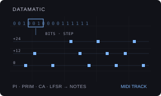

# DATAMATIC

Version: `0.1.0-experimental` · author: [Semi Erendönmez (@semierendonmez-commits)](https://github.com/semierendonmez-commits)

## Overview

DATAMATIC reads a stream of bits as a rhythm on an Octatrack MIDI track. Nine streams are built in:

- **PI**, **E**, **PHI**, **SQR2**: the binary digits of π, e, the golden ratio and √2 after the point;
- **FIBO**: the Fibonacci word (0100101001001…), **PRIM**: bit *n* set when *n* is prime, **THUE**: the Thue–Morse sequence;
- **CA**: an elementary cellular automaton, 32 cells on a ring, row after row (sixteen rules, from one live cell or a seeded row);
- **LFSR**: a 16-bit linear feedback shift register from a seed.

A window BITS wide slides along the stream, STEP bits a step. A step plays when its window's value reaches the DENS
threshold: at DENS 0 with BITS 1 the stream itself is the rhythm, and DENS 127 plays every step. The bits after each
window choose its note, its velocity and a late micro-timing, so the same data shapes pitch and feel as well as the
pattern. DATAMATIC writes ordinary note trigs with NOTE and VEL locks and trig words; the stock MIDI sequencer plays
them at the pattern's tempo, track speed, length and swing ([sequencing.md](../../../docs/module-guides/sequencing.md)).
Every control change redraws the track from the settings, so a turn back restores the line; nothing runs while the
pattern plays.

DATAMATIC contributes to the Modwerk base's `ot_midi_generators` table
([HOOKS.md](../../../machines/octatrack/HOOKS.md)) and patches no stock site; it needs the base loaded over USB and
has no card form (as Beat Slicer).

## Controls

MIDI NOTE SETUP (a double tap on SRC) lists DATAMAT in its left half; YES makes the track DATAMATIC. Its controls take
the SRC and AMP pages (FUNC+AMP: the second AMP page) while no trig or scene is held; holding a trig shows stock's
page and its locks. OCT, ROOT, VEL and LEN are the track's own NOTE, VEL and LEN, so a trig placed by hand plays the
base note.

| Page | Encoder | Control | Default | Behaviour |
|---|---|---|---|---|
| SRC | A | SRCE | PI | The stream: PI, E, PHI, SQR2, FIBO, PRIM, THUE, CA, LFSR. |
| SRC | B | OFFS | 0 | 0–127. Where the window starts, in bytes into the stream. YES moves it one byte on. |
| SRC | C | BITS | 1 | 1–8. The window's width. |
| SRC | D | DENS | 0 | 0–127. The threshold: a step plays when its window's value is at least (127 − DENS) × 2^BITS / 128. |
| SRC | E | OCT | 4 | The octave of the track's NOTE (the base note), shown as the note. |
| SRC | F | ROOT | C | The pitch class of the track's NOTE. |
| AMP | A | SPRD | 1 | 0–4. Octaves the notes may reach above the base note (0: every note the base note). |
| AMP | B | INTV | OCT | The jumps: OCT (octaves), 5TH (fifths and octaves), TRIT (tritones), WHOL (whole tones), CLST (semitones, one octave). |
| AMP | C | VDAT | 64 | OFF, 1–127. How far the data pulls a note's velocity below the track's VEL. |
| AMP | D | JITR | OFF | OFF, 1–23. Micro-timing from the data, at most this many 1/24 of a step late. |
| AMP | E | VEL | 100 | The track's VEL: the loudest note. |
| AMP | F | LEN | track | The track's LEN: every note's length. |
| FUNC+AMP | A | RULE | 30 | The automaton's rule (CA): 30, 45, 54, 60, 73, 90, 105, 110, 122, 126, 150, 169, 182, 184, 225, 250. |
| FUNC+AMP | B | SEED | 0 | 0–127. The automaton's first row (0: one live cell in the middle) and the LFSR's start. |
| FUNC+AMP | C | STEP | 1 | 1–8. Bits the window moves each step; below BITS the windows overlap and neighbouring steps share bits. |

The generator's settings live in the track's arpeggiator note bytes (value − 64, inside the range stock's validator
keeps), which the base gives a generator's track, with a thirteenth byte `D` marking them as DATAMATIC's.

## Usage

Point the MIDI track at a drum machine or a synth with short, bright sounds: a sine blip, a click, a hi-hat. Start from
PI, BITS 1, DENS 0: the binary digits of π play as the rhythm. Raise BITS and DENS to thin or fill it, STEP to make it
leap through the stream. SPRD 3 with INTV OCT gives octave-jumping sine pings; CLST gives clusters. CA with RULE 30
or 110 is a structured noise; FIBO and THUE are quasi-periodic, never quite repeating. For fast data rhythms set the
track's speed to 2x or 4x (the step is then a 1/32 or 1/64).

## Quick tutorial: π as a rhythm

1. Press MIDI and select track 1, set its channel to your sound, double-tap SRC, choose DATAMAT and press YES. The track fills with π's bits.
2. Press PLAY. Press YES a few times: each reads the next byte of π. Turn OFFS to jump further in.
3. Press AMP: set SPRD to 3 and INTV to 5TH for fifths and octaves, JITR to 8 for a late, uneven feel. Turn VDAT up for accents from the data.
4. Back on SRC, choose CA, then FUNC+AMP for RULE 110 and SEED 0: a cellular automaton growing from one cell, row after row.

## Compatibility and limitations

- Octatrack MKI or MKII, OS 1.40C, the Modwerk base loaded over USB (beta) with the MIDI generators. Card firmware cannot include it.
- One trig a step; for denser rhythms raise the track's speed. Micro-timing is late only (0 to 23/24 of a step).
- The streams are each table's first 2048 bits and the automaton's first 64 rows; OFFS reaches 1016 bits in.
- One generator a track; it takes the MIDI track's SRC and AMP pages and keeps the arpeggiator off there (the base's
  rule). Choosing DATAMATIC sets NOTE to C4 (48), VEL to 100 and NOT2–4 off.
- DATAMATIC owns the trigs, the NOTE and VEL locks and the trig words of the steps inside the track's length; LEN and
  every other lock, swing and steps past the length stay.
- No conflicts are declared. The developer reports it runs on their own Octatrack MKI from a card build (31 Oct 2026; the exact revision was not recorded); it has not run in the emulator, and nothing below is measured hardware evidence.

## Implementation

`generate_tables.py` computes the seven tables with integers (Machin's formula for π, the series for e, integer square
roots for φ and √2, the Fibonacci word by substitution, a sieve, popcount parity) and writes `tables.c`.
`engine.c` builds the stream (a table, the automaton or the LFSR), slides the window, applies the threshold and maps
the following bits to an interval, a velocity and a micro-timing; `dm_write` puts the line into the MIDI track record
in place. `generator.c` is the generator glue in the shape of VECTOR 0.3.0's `midi.c` and LOGACID's: a
`struct modwerk_midi_generator` (`datamatic_midi`, id `'D'`, order 45), the SRC and AMP pages built from stock's NOTE
and ARP descriptors with DATAMATIC's names and formatters, and generation into the current pattern's record with only
this track's bit of stock's lock index set.

The USB package is built by `sdk/runtime/loader/build.py` from the three sources with
`--subscribe ot_midi_generators:datamatic_midi:45`; `verify.py` rebuilds it and compares it with the published one.

## Tests and measurements

See [TESTING.md](TESTING.md). `test_engine.py` runs the engine under the sanitizers: the tables hold π, the primes,
Thue–Morse and the Fibonacci word, and `generate_tables.py` writes them again byte for byte; the automaton follows each
of its sixteen rules row by row; the LFSR stays balanced for every seed; DENS 0 plays the stream and DENS 127 every
step; 20,000 random settings give deterministic lines inside their octaves, velocities and micro-timing; the MIDI
record writer. With `m68k-elf-gcc` it builds the package and checks the generator record at the registry's index.

## Authorship and licences

Original work. The data streams are mathematical constants and sequences, computed by `generate_tables.py`. The
generator glue follows the shape of VECTOR 0.3.0's `midi.c` by Jannik Aßfalg (MIT, Modwerk). The module is
[GPL-3.0-or-later](LICENSE); the thumbnail is an original illustration ([presentation/LICENSE](presentation/LICENSE)).
No Elektron firmware, extracted routines, tables, samples or dumps are included; underlying Elektron interface rights
remain reserved.

## Screens and audio

No screenshots yet: MIDI NOTE SETUP with DATAMAT in its list and the SRC, AMP and second AMP pages are captured in
the headless emulator once the module runs there (`scripts/capture-module-ui.py`). No audio preview.
