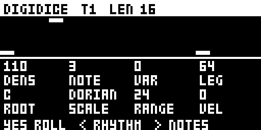
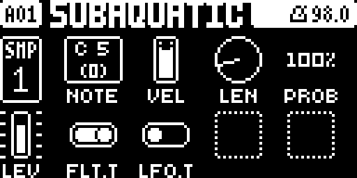
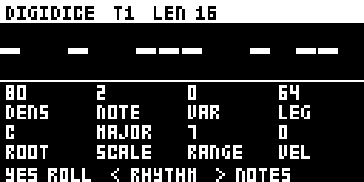

# digidice

A random melody generator for the Digitakt mk1, inspired by Vermona's meloDICEr. A double press on TRIG opens a page that rolls a melody into the active track, audio or MIDI, as ordinary trigs with a note, a velocity and a length each. After that it is a normal pattern: play it, edit it, save it or copy it.

By todd-neale (@todd-neale) · MIT · Digitakt OS 1.54 · version `0.1.0-experimental` · **emulator-tested only, not yet run on a unit**

**Status: draft.** It lives in `sdk/drafts/` until it has run on a unit and has an `.elemod` release that the browser builder can pin. Then it moves to `sdk/digitakt/modules/digidice` (see [TESTING.md](TESTING.md), "Hardware test plan").

## Overview

- **Rhythm:** DENSITY decides how many rhythm slots play, NOTE VALUE the gap between them, VARIATION how often a gap halves or doubles, LEGATO how long each note lasts.
- **Notes:** every note is in the chosen SCALE, from the ROOT up to RANGE scale notes above it. VEL spreads velocities around the track's own VEL.
- **Dice:** YES rolls everything, LEFT rolls only the rhythm and RIGHT only the notes, so a groove can keep its rhythm while its notes change, or the other way round.
- **Reshaping:** a knob turn reshapes the current melody instead of replacing it. Raising DENSITY only adds notes: the notes already there keep their step, pitch, velocity and length.
- **Timing is the Digitakt's own.** digidice writes trigs and keeps no clock, so the melody follows the project tempo, the track's length, speed and swing, like any trigs you enter by hand.

## Controls

The page shows the track (T1–T8 audio, M1–M8 MIDI) and its length, a piano roll of the track as it is now, and the eight controls.

| Knob | Control | Range | What it does |
| --- | --- | --- | --- |
| A | DENSITY | 0–127 | The chance each rhythm slot plays; 0 is silence, 127 every slot |
| B | NOTE VALUE | 1, 2, 3, 4, 6, 8 | The gap between notes in steps: 1 sixteenths, 2 eighths, 4 quarters |
| C | VARIATION | 0–127 | The chance a gap halves or doubles |
| D | LEGATO | 0–127 | Note length as a share of the gap; 127 ties each note to the next |
| E | ROOT | C–B | The key's root note |
| F | SCALE | CHROM, MAJOR, MINOR, DORIAN, MIXO, HARMIN, MAJPEN, MINPEN | The notes allowed |
| G | RANGE | 0–24 | How many scale notes above the root |
| H | VEL | 0–127 | How far velocities spread around the track's VEL |

| Key | On the page |
| --- | --- |
| TRIG, twice | Opens the page (from any page); closes it again |
| YES | Rolls the rhythm and the notes |
| LEFT | Rolls only the rhythm |
| RIGHT | Rolls only the notes |
| NO | Closes the page |
| PLAY, STOP | As usual, so you can listen while you shape the melody |

Knob changes are written about 150 ms after the knob stops, and only the steps that changed. A single press on TRIG while the page is open does nothing, so closing with a double press does not open the page again.

## Usage

### Tutorial

1. **Set it up and select it.** Select an audio track that plays a tonal sample (TRK + trig key 1). Press TRIG twice quickly: the digidice page opens and shows the track's current trigs. Nothing has changed yet.
2. **Roll.** Press YES: the piano roll shows a new melody, written into the track. Press PLAY to hear it.
3. **Use one control.** Turn DENSITY (knob A) left for a sparser line, right for a busier one, then press RIGHT a few times to re-roll the notes over the same rhythm.
4. **Hear the result and stop.** Press NO to close the page; the melody keeps playing as ordinary trigs. Press STOP to stop. Open the TRIG page and hold a trig to see its NOTE, VEL and LEN.

### Ideas

- Roll a bassline, keep the rhythm that locks with the drums, and re-roll only the notes until it fits.
- Use a MIDI track to drive an external synth, then edit single trigs by hand.
- Set NOTE VALUE to 4 and LEGATO to 127 for slow tied pads; set NOTE VALUE to 1 with VARIATION up for broken sixteenths.

## Compatibility and limitations

- **OS 1.54 only.** It calls the OS's own step setters at OS 1.54's addresses ([research](../../digitakt/research/pattern-write.md)).
- **Rolling replaces the track.** A roll or a knob turn rewrites every step of the active track up to its length (at most 64), and clears the parameter locks of steps it turns off. There is no undo: save the pattern first if you want to keep it. Opening the page changes nothing.
- **Settings are not saved.** The controls and seeds return to their defaults when the unit restarts. The melody itself is a normal pattern and saves with the project.
- **Octave.** Notes start from C5 (no transpose on an audio track) plus the root. There is no octave control yet.
- **The page takes the keys.** While it is open, every key but PLAY, STOP and FUNC is digidice's, so tracks cannot be changed from the page.
- **Key combination.** It claims the double press on TRIG (`ui:double TRIG`). Stock OS 1.54 shows the TRIG page for a double press and does nothing else with it.
- **Memory.** 6,611 bytes of core 2.1's 128 KiB shared mod memory, no fast SRAM. It fits beside any two of digihealth, DIGISLICER and NEIGHBOR, but not all three.
- **Timing.** No clock of its own, no render hook: see [sequencing](../../../docs/module-guides/sequencing.md). Swing, track speeds, tempo and pattern changes have not been tested with it yet (TESTING.md).
- **Category.** It is listed with the machines, as VECTOR is on the Octatrack, but it adds no SRC machine and claims no machine slot. The machine checklist items about the machine chooser, SRC SETUP, parameter locks and LFO destinations do not apply.

## Tests and measurements

- **Engine:** host tests, 4,975,802 checks, 0 failures under ASan and UBSan ([TESTING.md](TESTING.md)).
- **Emulator (digiemu v0.4.1, OS 1.54):** opening, rolling, the knobs and closing; the writes read back from the pattern; recorded audio plays the rolled notes at the right steps and pitches; it runs beside digihealth and DIGISLICER. Report: [evidence/emulator.md](evidence/emulator.md).
- **Resources:** 5,935 bytes of code and 676 bytes of variables; no fast SRAM; nothing in the audio render. UI-task CPU time not measured.
- **Hardware:** not tested yet.

## Authorship and licences

Design and code by todd-neale, with Claude Code. MIT: see [LICENSE](LICENSE). The engine and the mod are original work. No Elektron firmware, extracted code or tables, and no Vermona code or material, are included; OS routines are called by their addresses in the owner's own OS. "meloDICEr" is Vermona's product name, used only to describe the inspiration. Built with [elekloader](https://github.com/irpina/elekloader)'s core and SDK and tested in [digiemu](https://github.com/irpina/digiemu), both by irpina.

## Screens and audio

| | |
| --- | --- |
|  | The first press of TRIG shows the stock TRIG page; the second opens digidice. |
|  | The page opened on track 1, showing the track's existing trigs. |
|  | After a roll and knob changes: DENSITY 110, NOTE VALUE 3, DORIAN, RANGE 24. |

Captured from the emulator's framebuffer (digiemu v0.4.1, OS 1.54). No audio is published; the emulator recording is described in the [report](evidence/emulator.md).
