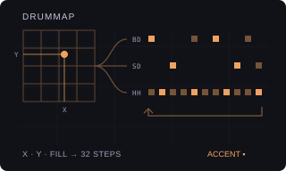

# DRUMMAP

Version: `0.1.0-experimental` · author: [Semi Erendönmez (@semierendonmez-commits)](https://github.com/semierendonmez-commits)

## Overview

DRUMMAP is Mutable Instruments Grids' drum map as a track machine for the Octatrack's Flex and Static tracks. Grids
holds 25 drum patterns on a 5 × 5 map; each has 32 steps of levels for a bass drum, a snare and a hi-hat, and a
position between nodes blends the four around it. DRUMMAP reads the map as the Phazerville Hemisphere Suite's
DrumMap applet does, and writes the result into the track's own sequencer: a trig where a level clears the fill
threshold, a VOL lock on the plain hits so the accents (levels above 192) stand out. The stock sequencer plays the
trigs at the pattern's tempo, track speed, length and swing; DRUMMAP keeps no clock and runs nothing while the pattern
plays ([sequencing.md](../../../docs/module-guides/sequencing.md)).

Every control change redraws the track from the map, so a turn back restores the pattern. The trigs and VOL locks
are ordinary sequencer data: edit single steps as on any track; they stay when DRUMMAP is turned off.

DRUMMAP contributes to the Modwerk base's `ot_machines` table ([HOOKS.md](../../../machines/octatrack/HOOKS.md)) and
patches no stock site; it needs the base loaded over USB and has no card form (as Beat Slicer).

## Controls

SRC SETUP (a double tap on SRC) lists DRUMMAP after the stock machines; YES makes the track DRUMMAP, backed by its
Flex or Static pool. The SRC page holds the six controls; SRC SETUP keeps the sample's own setup; a push on LEVEL
shows stock's sample controls, and holding a trig or a scene shows stock's page.

| Encoder | Control | Default | Behaviour |
|---|---|---|---|
| A | PART | by track | BD, SD, HH: the map part this track plays. Chosen from the track number when the track becomes DRUMMAP (1 and 5 BD, 2 and 6 SD, the others HH). |
| B | X | 0 | 0–127. Map position X (Grids' 0–255, halved). |
| C | Y | 0 | 0–127. Map position Y. |
| D | FILL | 64 | 0–127. Density: a step plays when its level clears 255 − 2 × FILL (Grids' fill). 0 plays nothing, 127 every step with a level. |
| E | CHAO | 0 | 0–127. Grids' chaos: a random lift of every level, drawn afresh for each 32-step pass, so a 64-step track can play two different passes. |
| F | AVEL | 12 | OFF, 1–31. Plain hits get a VOL lock 4 × this below the Part's AMP VOL; accents keep the Part's VOL. OFF writes no VOL locks. |

YES draws a new chaos variation (the seed is kept with the settings and shown in the message, not on a page). The
settings live in the Part's spare NEIGHBOR slots of the track (nine bytes, seven bits each, after the `DM` signature).

What it writes, in place and only the bytes that change: the trig mask, the lock-only mask, the VOL locks of its steps
and their trig words (straight: no micro-timing, no condition). PTCH and every other lock, swing and recorder events
stay, and so do steps past the track's length.

## Usage

Load a one-shot kick on track 1, a snare on track 2 and a hat on track 3 and make all three DRUMMAP: their parts come
up BD, SD and HH. Set the same X and Y on the three to play Grids' kit as one; move one track's X or Y away for
variations the original cannot make. FILL is the main performance control; CHAO adds variation per pass, more
audible on longer tracks. For ghost notes, lower AVEL's contrast and raise the hats' FILL.

## Quick tutorial: Grids' kit on three tracks

1. Load a kick, a snare and a hi-hat one-shot on tracks 1, 2 and 3. On each, double-tap SRC, scroll to DRUMMAP and press YES.
2. On each track press SRC and set X and Y to the same values; turn FILL to taste. Each turn rewrites the track at once, also while playing.
3. Press PLAY. Turn CHAO up on the hats for variation and press YES there for another variation.
4. Press STOP, or choose FLEX or STATIC in SRC SETUP to leave DRUMMAP; the trigs and locks it wrote stay editable.

## Compatibility and limitations

- Octatrack MKI or MKII, OS 1.40C, the Modwerk base loaded over USB (beta) with the machine table. Card firmware cannot include it.
- Each track keeps its own X, Y and FILL. Grids' 32 steps repeat along longer tracks; a track shorter than 32 plays the map's first steps.
- Scale, speed and swing are the track's; DRUMMAP writes straight trig words, so micro-timing and conditions on its steps are reset when it rewrites them.
- The machine list holds eight module machines (the base's room); DRUMMAP takes one row.
- No conflicts are declared.
- Not yet run on a unit or in the emulator. Nothing below is hardware evidence.

## Implementation

`grids.c` is Grids' drum map (25 nodes of 96 levels), copied unchanged from the copy O_C-Phazerville carries.
`engine.c` reads it as DrumMap's `ReadDrumMap` (the same `uint8_t` fades), applies the applet's threshold, accent and
chaos rules over the track's length, writes the track record in place (`dm_write`) and packs the settings.
`machine.c` is the machine glue in the shape of VECTOR's `native.c` over the base, as TB-3PO's: a `struct
modwerk_machine` (`drummap_machine`, signature `DM`, BACKING, order 60), the SRC page built from stock's FLEX or STATIC
descriptor with DRUMMAP's names, formatters and stock's dial renderer, an input layer for encoders A–F, YES and the
LEVEL push, and generation into the current pattern's record with only this track's bit of stock's lock index set.

The USB package is built by `sdk/runtime/loader/build.py` from the three sources with
`--subscribe ot_machines:drummap_machine:60`; `verify.py` rebuilds it and compares it with the published one.

## Tests and measurements

See [TESTING.md](TESTING.md). `test_engine.py` runs the engine under the sanitizers: the map read against DrumMap's
`ReadDrumMap` (as written, with `uint8_t` arithmetic) over 2,113,536 positions, steps and parts with no difference;
the hit threshold, accents, the 32-step repeat, FILL 0 and 127, the chaos lift per pass; the record writer and the
settings packing. With `m68k-elf-gcc` it builds the package and checks the machine record at the registry's index.

## Authorship and licences

The drum map is Mutable Instruments Grids' by Émilie Gillet (GPL-3.0-or-later), as
[djphazer/O_C-Phazerville](https://github.com/djphazer/O_C-Phazerville) `software/src/grids_resources.h` carries it at
`92740448e525e6451676a3ff8eb4403cddcaeca7`; the read and the hit, accent and chaos rules follow that repository's
DrumMap applet by Benjamin Rosenbach (MIT). The Octatrack glue is original, in the shape of VECTOR's `native.c` by
Jannik Aßfalg (MIT, Modwerk). The module is [GPL-3.0-or-later](LICENSE); the thumbnail is an original illustration
([presentation/LICENSE](presentation/LICENSE)). No Elektron firmware, extracted routines, tables, samples or dumps are
included; underlying Elektron interface rights remain reserved.

## Screens and audio

No screenshots yet: SRC SETUP with DRUMMAP in the machine list and the SRC page are captured in the headless emulator
once the module runs there (`scripts/capture-module-ui.py`). No audio preview.
