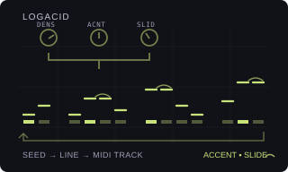

# LOGACID

Version: `0.1.0-experimental` · author: [Semi Erendönmez (@semierendonmez-commits)](https://github.com/semierendonmez-commits)

## Overview

LOGACID is a generative 303-style acid-line generator for the Octatrack. It is a port of the `TB_3PO` Hemisphere
applet by Logarhythm (as extended by Qiemem and djphazer in O_C-Phazerville), taken through Charles Vestal's Schwung port
`tb3po.c` for the Ableton Move: the same random draws in the same order, so a line at the same settings has the same
shape as the Move's.

It has two faces, both writing the line into the track's own sequencer and leaving the playing to the stock
sequencer: tempo, track speed, pattern and track length, swing, trig conditions and slides are stock's, LOGACID keeps
no clock and runs nothing while the pattern plays ([sequencing.md](../../../docs/module-guides/sequencing.md)).

- **A track machine for Flex and Static samples**, in VECTOR's shape: the track's sample plays as stock, and the
  line is note trigs with PTCH locks over two octaves, accents as VOL locks (and FILTER DEPTH locks when the stock
  FILTER is on FX1), and slides as real slides: the slid note's sample holds through the next step, which becomes a
  lock-only step with a PTCH lock and a slide trig, so the pitch glides without a retrigger.
- **A MIDI generator for the MIDI tracks**: note trigs with NOTE, VEL and LEN locks; an accent is a VEL lock, a slide
  a LEN lock reaching into the next note, so a bass synth that slides on overlapping notes (x0xb0x, Open303,
  Schwung 303) plays it as a slide.

Every control change redraws the whole line from the seed and the controls, so the line is reproducible and a turn
back restores it; YES rolls the next seed. The trigs and locks it wrote are ordinary sequencer data: edit single steps
as on any track, and they stay when the generator is turned off.

LOGACID contributes to the Modwerk base's `ot_machines` and `ot_midi_generators` tables
([HOOKS.md](../../../machines/octatrack/HOOKS.md)) and patches no stock site; it needs the base loaded over USB and
has no card form (as Beat Slicer).

## Controls

### Sample track (machine)

SRC SETUP (a double tap on SRC) lists LOGACID after the stock machines; YES makes the track LOGACID, backed by its Flex
or Static pool (the stock pool opens for the sample). The SRC page holds six controls and SRC SETUP six more; a push
on LEVEL shows stock's sample controls (PTCH, STRT, LEN, RATE, RTRG, RTIM), and holding a trig or a scene shows
stock's page, so the generated locks stay editable.

| Page | Encoder | Control | Default | Behaviour |
|---|---|---|---|---|
| SRC | A | DENS | 89 | 0–127. The chance a step plays (0.7 in `tb3po.c`). 0 leaves the one guaranteed note, 127 fills every step. |
| SRC | B | ACNT | 51 | 0–127. The chance a note is accented: it keeps the Part's AMP VOL while plain notes sit AVEL below, and gets a FILTER DEPTH lock of AFLT. |
| SRC | C | SLID | 32 | 0–127. The chance a note slides into the next. A slide into a rest becomes a plain note. |
| SRC | D | ROOT | A | C–B. The pitch class of the scale's root. The line spans stock's −12..+12 semitones (two octaves); the root rotates the pitch classes inside them. Tune the sample to C. |
| SRC | E | SCAL | MINR | Minor, Phrygian, harmonic minor, minor pentatonic, Dorian, major. |
| SRC | F | GATE | 32 | 0–126 in stock's AMP HOLD units (even values): a note's HOLD lock. A slid note holds one step longer for each step it slides through. AMP REL still shapes the tail. |
| SETUP | A | SEED | 1 | 0–127. The variation. YES advances it and wraps. |
| SETUP | B | VAR | OFF | OFF, 1–31. `tb3po.c`'s MUTATE: a pass that re-rolls about a quarter of the steps, half their state, half their pitch, salted with this value. |
| SETUP | C | AVEL | 12 | OFF, 1–31. Plain notes get a VOL lock 4 × this below the Part's AMP VOL; accents keep the Part's VOL. OFF writes no VOL locks. |
| SETUP | D | AFLT | OFF | OFF, 1–7. With the stock FILTER on FX1, an accent's DEPTH lock (knob D of the FILTER page), 18 × this. OFF, or another effect on FX1, writes none. |
| SETUP | E | DIR | FWD | FWD, REV, PING, RND: the order the generated steps are laid on the track. PING runs forward then back; RND is a seeded shuffle. |
| SETUP | F | MOTF | OFF | OFF, 2–32. OFF generates one line over the track's whole length; otherwise a motif of that many steps repeated along it. |

The twelve settings live in the Part's two spare NEIGHBOR slots of the track (nine bytes, seven bits each, after the
`LA` signature), so VAR and AVEL have 32 values and GATE 64 where the Move's have 128. Generator settings are not LFO,
scene or parameter-lock destinations; the PTCH, HOLD, VOL and DEPTH locks it writes are, through stock's own pages.

What it writes, in place and only the bytes that change: the trig mask, the lock-only mask, the slide-trig mask, the
PTCH, HOLD, VOL and FX1 DEPTH locks of its steps and their trig words (straight: no micro-timing, no condition). Other
locks, swing and recorder events stay, and so do steps past the track's length. A rest that keeps another lock
becomes a lock-only step. Choosing FLEX or STATIC again leaves the trigs and locks on the track.

### MIDI track (generator)

MIDI NOTE SETUP (double-tap SRC, or double-tap the track key in MIDI mode) lists OFF and the installed generators in its
empty left half: UP/DOWN and YES choose. A track running LOGACID shows its controls on the SRC page and the AMP page;
FUNC+AMP turns the AMP page to its second. LFO, FX1 and FX2 stay the track's own, and holding a trig or a scene shows
stock's pages, so locks stay stock's.

| Page | Encoder | Control | Default | Behaviour |
|---|---|---|---|---|
| SRC | A–C | DENS, ACNT, SLID | 89, 51, 32 | As on the sample track; an accent is a VEL lock of AVEL, a slide a LEN lock of SLEN. |
| SRC | D | OCT | 2 | 0–9. The octave of the track's NOTE; shown as the note itself (A1 by default, `tb3po.c`'s base note). |
| SRC | E | ROOT | A | C–B. OCT and ROOT together are the track's own NOTE (12 × OCT + ROOT). |
| SRC | F | SCAL | MINR | The six scales. |
| AMP | A | SEED | 1 | 0–127. YES advances it. |
| AMP | B | VAR | OFF | OFF, 1–127. The mutation pass. |
| AMP | C | GATE | track's LEN | 0–127 in stock's LEN units. The track's own LEN: the length of plain notes. |
| AMP | D | SLEN | 72 | 0–127 in stock's LEN units. The LEN lock of a slid note. Set it past one step so the note overlaps the next. |
| AMP | E | AVEL | 118 | 0–127. The VEL lock of an accented note. |
| AMP | F | DIR | FWD | FWD, REV, PING, RND. |
| FUNC+AMP | A | VEL | 72 | 0–127. The track's own VEL: the velocity of plain notes. |
| FUNC+AMP | B | OCTS | 2 | 1–3. How many octaves above the root a note may take. |
| FUNC+AMP | C | MOTF | OFF | OFF, 2–32. |

The MIDI generator's settings live in the track's arpeggiator note bytes (the base's rule for every generator), a
thirteenth byte marking them as LOGACID's. It writes straight trig words for its steps and leaves every other step's
trig word, CC locks, LFO locks and swing alone. No portamento CC (65) is sent and no CC slot is taken.

## Usage

Sample track: choose LOGACID in SRC SETUP and load a one-shot tuned to C (a 303 sample, a sine, a saw). Turn DENS to
hear the line change, ROOT and SCAL for the key, SLID for glides; set AMP REL for the tail. A short HOLD with REL
closed is the classic plucked 303; slides need the sample to be long enough to hold through the next step. With the
stock FILTER on FX1, set its DEPTH low and AFLT up so accents open the filter.

MIDI track: set CHAN to a 303-type synth, choose LOGACID, set SLEN so a slid note reaches past one step.

Both: a knob turn replaces the line, also while the pattern plays; YES rolls a new seed; VAR nudges the current line;
DIR reorders it; MOTF repeats a short motif along a longer track. The line follows the track's own length (the
pattern's, or the track's in per-track length mode).

## Quick tutorial: an acid line on track 1

1. Select track 1 and double-tap SRC for SRC SETUP. Scroll to LOGACID and press YES; load a one-shot tuned to C from the
   stock pool. The track gets a first line.
2. Press SRC: turn DENS for more or fewer notes, ACNT for accents and SLID for slides; ROOT and SCAL set the key.
   Each turn rewrites the track at once, also while playing.
3. Double-tap SRC for SRC SETUP: SEED and VAR for another variation, AVEL for the accent contrast, DIR for the order.
   Press YES on the SRC page for a new seed.
4. Press PLAY: the stock sequencer plays the line at the pattern's tempo and swing, sliding where SLID placed slides.
   Press STOP, or choose FLEX or STATIC in SRC SETUP to leave the generator; the trigs and locks it wrote stay editable.

## Compatibility and limitations

- Octatrack MKI or MKII, OS 1.40C, the Modwerk base loaded over USB (beta) with the machine table and MIDI generators
  (base `52b22249…` or later). Card firmware cannot include it.
- Sample tracks: two octaves (stock's PTCH range) around a sample tuned to C. The number of AMP HOLD units in one
  sequencer step and the slide-trig mask's index are read off the unit and unverified here (`LOGACID_HOLD_STEP`,
  `SLIDE_MASK` in the source); a slid note whose HOLD does not reach the next step retriggers there instead of gliding.
  AFLT applies only with the stock FILTER on FX1 (effect id 4, read from the Part).
- MIDI tracks: slides are overlapping notes; a synth that does not slide on legato plays two overlapping notes. SLEN's
  default (72) is unverified against stock's LEN table.
- Scale Quantizer snaps the PTCH knob, the lock editor and the chromatic keys at edit time; it does not touch the locks
  LOGACID writes, which stay in LOGACID's own scale. Both can be in one project.
- One generator a track. On a sample track LOGACID takes the SRC page (both pages); on a MIDI track the SRC and AMP
  pages, keeping the arpeggiator off (the base's rule). Choosing LOGACID on a MIDI track sets NOTE to A1, VEL to 72 and
  NOT2–4 off.
- No conflicts are declared: the base shares the machine list and the generator list.
- Not yet run on a unit or in the emulator. Nothing below is hardware evidence.

## Implementation

`engine.c` is the firmware-free generator: `tb3po.c`'s xorshift32 and its draws, as 24-bit fractions instead of
floats, over a motif of 1–64 steps, then the direction and motif layout, the slide-into-rest cleanup and the one
guaranteed note. `logacid_write_audio` puts a line into a sample track record in place (masks, PTCH/HOLD/VOL/DEPTH locks,
trig words, mirrored into the battery-backed copy); `logacid_write` does the same for a MIDI track record;
`logacid_pack`/`logacid_unpack` keep the sample track's settings in nine seven-bit bytes. `machine.c` is the machine glue in
the shape of VECTOR's `native.c` over the base: the `struct modwerk_machine_setup` record (`logacid_machine`, signature
`LA`, flags BACKING and SETUP_PAGE, order 50), the page descriptor built from stock's FLEX or STATIC
page with LOGACID's names, formatters and stock's dial renderer, the input layer for encoders A–F, YES and the LEVEL
push, and generation into the current pattern's record with only this track's bit of stock's lock index set.
`generator.c` is the MIDI generator in the shape of VECTOR 0.3.0's `midi.c` (`logacid_midi`, id `'L'`, order 40).

The USB package is built by `sdk/runtime/loader/build.py` from the three sources with
`--subscribe ot_midi_generators:logacid_midi:40 --subscribe ot_machines:logacid_machine:50`; `verify.py` rebuilds it and
compares it with the published one.

## Tests and measurements

See [TESTING.md](TESTING.md). `test_engine.py` runs the engine under the sanitizers: step for step against
`tb3po.c`'s float generator (as written, in the test) over 50,688 seed, scale, octave-range and length cases with no
difference; determinism, scale membership, the slide and at-least-one-note rules, every direction and motif; both
record writers (locks, masks, slide chains, trig words, what they leave alone, idempotence); PTCH values inside two
octaves for every scale and root; the settings packing. With `m68k-elf-gcc` it builds the package and checks both
records at the registry's indices. No hardware, emulator or timing evidence exists yet.

## Authorship and licences

The generator is the `TB_3PO` Hemisphere applet by Logarhythm (MIT, Copyright (c) 2020 Logarhythm; the notice is in
[NOTICE](NOTICE)), with `reseed()` by Qiemem and extensively modified by djphazer in
[O_C-Phazerville](https://github.com/djphazer/O_C-Phazerville) (`software/src/applets/TB3PO.h` at
`92740448e525e6451676a3ff8eb4403cddcaeca7`), ported through
[Charles Vestal's `schwung-tb3po`](https://github.com/charlesvestal/schwung-tb3po) `src/dsp/tb3po.c` at commit
`f49d81d05d1e29ae37728a08e30f193892be3bc9` (GPL-3.0). The Octatrack glue is original, in the shape of VECTOR's
`native.c` and VECTOR 0.3.0's `midi.c` by Jannik Aßfalg (MIT, Modwerk). The module is [GPL-3.0-or-later](LICENSE). The
thumbnail is an original illustration ([presentation/LICENSE](presentation/LICENSE)). No Elektron firmware, extracted
routines, tables, samples or dumps are included; underlying Elektron interface rights remain reserved.

## Screens and audio

No screenshots yet: they are captured in the headless emulator once the module runs there (`scripts/capture-module-ui.py`):
SRC SETUP with LOGACID in the machine list, the SRC page, SRC SETUP's second page, and on a MIDI track MIDI NOTE SETUP
with LOGACID in its list, the SRC page, the AMP page and its second page. No audio preview.
