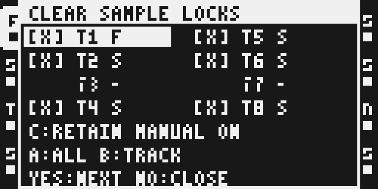
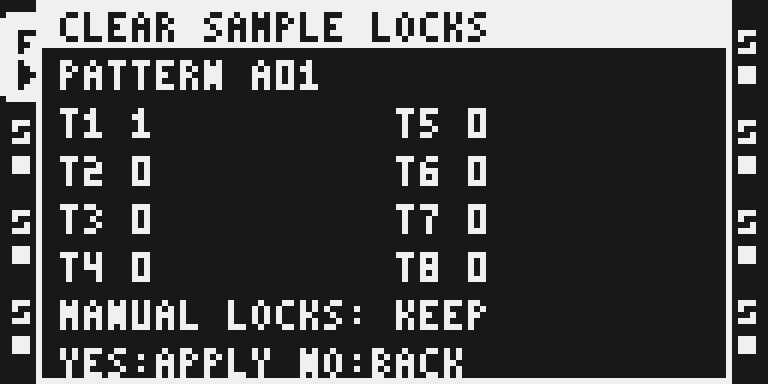

# Pattern Sample Locks

Version: 0.1.4-experimental · author: @twwwy · category: system

## Overview

Two explicit actions in Part Edit: **Lock Samples to Pattern** and **Clear Sample Locks**. The intended edit uses the Octatrack's ordinary SAMPLE locks in the current pattern. It does not create a new project format or change the Part's sample assignment.

**This is a local, emulator-only development prototype. Native editing is enabled. Do not load this build on hardware yet.** Physical reboot behavior, complete edit-history coverage and timing are not qualified. Development stays in the contributor's fork: no push or upstream PR is authorized.

## Controls

Level 1 is the stock **FUNC + PART** menu with Lock Samples to Pattern and Clear Sample Locks added.

Level 2 always displays eight tracks: T1–T4 in the left column, T5–T8 in the right. S means Static, F means Flex. Other machine types show greyed-out track text without selection brackets, cannot be selected, and are skipped by the arrow keys. UP/DOWN move within a column. LEFT/RIGHT move to the other column, preferring the same row or the nearest eligible row. With no eligible tracks all eight remain visible but inactive.

| Control in level 2 | Behavior |
| --- | --- |
| Arrows | Navigate eligible tracks; do not change selection. |
| Encoder A | Clockwise selects all eligible tracks; counterclockwise deselects all. |
| Encoder B | Clockwise selects the highlighted track; counterclockwise deselects it. |
| Encoder C | Existing-lock policy: Lock defaults to Replace existing OFF; Clear defaults to Retain manual locks ON. Clockwise enables the displayed policy, counterclockwise disables it. |
| YES | Open level 3, the confirmation page. At least one eligible track must be selected. |
| NO | Close the entire module popup. |

Level 1 is a headerless list retaining the four stock actions and appending the two new actions. Levels 2 and 3 use white headers with dark text. Text baselines follow a consistent eight-pixel grid. Levels 2 and 3 use the full LCD height; level 2 gives the A/B hint and YES/NO hint their own equally spaced rows.

Level 3 lists the affected SAMPLE lock count separately for each track in the same two-column order. A selected track with no changes shows 0; unselected and disabled tracks show a dash. YES applies, NO returns to level 2 with the selection and policy retained. Arrows and encoders do not change a prepared confirmation.

Final YES stops playback, waits for the transport and independently running tracks to stop, then revalidates the confirmation before editing. Playback stays stopped. An active recorder refuses the action; a two-second STOP timeout makes no edit. NO can cancel while stopping. PLAY is consumed while an edit is pending. Stock RENAME, RELOAD, SAVE and SAVE ALL retain their original callbacks. Other stock keys retire an ordinary modal before passing through.

## Usage

On MKII select the pattern and press **FUNC + PART**. Choose either action with YES. Navigate the eight-track grid with arrows; select with A or B. Review the policy on encoder C. Press YES for the per-track confirmation, then NO to return or YES to apply. NO in level 2 closes the popup.

MKI access is not tested. The adapter recognizes the current shared registry's PL/AB/FM/S2 signatures, excluding those contributed machines from selection.

## Quick tutorial

1. Open FUNC + PART, choose Lock Samples to Pattern, and inspect the eight-track grid. S/F tracks are eligible; greyed-out tracks remain visible.
2. Turn A clockwise to select all, then use arrows and turn B counterclockwise to exclude one track. Leave Replace existing OFF to protect existing SAMPLE locks.
3. Press YES to review the individual track counts. NO returns to level 2; another NO closes. For Clear, Retain manual locks starts ON. Final YES applies to the pattern's working data; use the stock save workflow when you want to save it.

## Ownership and power cycles

Clear defaults to **Retain manual locks ON every time it opens**, including after a reboot. Existing locks are not adopted simply because they match the Part's sample slot. A newly written lock is tagged as module-created; an existing same-value lock keeps its previous origin. Turning Retain manual OFF explicitly permits clearing all SAMPLE locks on the selected tracks.

Origin material has its own tagged, checksummed battery-RAM region, `0x100f9000..0x100fc000` (end exclusive). It is separate from stock patterns, Parts, sample data and the regions used by current catalog modules. It holds up to 704 active track/pattern combinations across one project identity. A full store refuses new locking before editing; it never evicts known ownership. Clearing the last owned lock on a track frees its record. After a fresh boot, a small RAM index is rebuilt from these keyed records for constant-time lookup. Each track's bitmap is checked against its SAMPLE bytes and trig mask before use. Ownership is invalidated before the first pattern store and published after both native copies agree. A damaged, interrupted, missing or mismatched record defaults to retaining the locks. Foreign tagged storage is refused.

The dedicated native SAMPLE editor retires ownership even for a same-value manual overwrite. Native paste/clear gestures conservatively retire the target pattern's ownership. Unrecognized changes to a track's SAMPLE bytes or trig mask make its record unknown, so other previously created locks on that track can also be retained. Clear is not Undo.

A fresh emulator process restored from battery memory has recovered the distinction between created and manual locks; see the exact build receipts in TESTING.md. This is **emulated battery-backed startup, not a physical power-cycle result**. The module package was reloaded over emulated USB; automatic module-set restore was not tested.

The battery record belongs to one instrument and one project identity. It does not travel with a project copied to another instrument, and changing projects forgets prior ownership at the next mutating operation. All sample choices remain ordinary native SAMPLE locks. **History made while the module is absent, same-value edits through every other path, complete copy/undo/reload handling, and unload/reinstall invalidation remain qualification blockers.** Do not assume such history is protected by the current prototype.

## Compatibility and CPU cost

- Four guarded, currently unshared sites: three Part Edit openers and the dedicated SAMPLE editor. UI events come from the base's existing `module_tick`, `module_draw`, `module_key` and `module_enc` hooks. The declaration compatibility check passes beside every active catalog module and the base. This does not prove companion runtime behavior.
- The private 12 KiB battery region is declared as a resource and checked against the actual base diagnostics, effect-map and crash/stall definitions by the module regression gate. It does not overlap Play Modes or stock settings. Upstream PLOCKS P2, which is outside this catalog, uses an overlapping region and is not supported by this prototype.
- Stock retains its callback array, label array, selection destination and input layers. No module callback/label pointer is stored in a stock popup.
- No DSP code or audio-frame hook. Closed-menu work is constant and does not scan patterns. Source/ownership checks occur on explicit UI intent or native SAMPLE edits.
- Only changed SAMPLE bytes are written, in working RAM and its battery mirror. The lock-index update changes only the affected track bits; it avoids stock's full 16-track lock-index rebuild. Only affected tracks are republished.
- A bounded publication guard rechecks the source and stopped state before the first edit. Hashing, preparing edits and searching other parameter locks happen outside it. Its worst-case interrupt delay and total CPU cost still require hardware measurement.
- No PCM edits, implicit project save, flash or physical testing. Locks pin sample **slots**; replacing the file in a slot changes the sound. New trigs need another explicit Lock action.
- USB prototype only. Stock-only card integration and future contributed-machine signatures remain unqualified. Published PL/AB/FM/S2 machine signatures are excluded from selection.

## Tests and measurements

See [TESTING.md](TESTING.md). `python3 -B verify.py` runs portable planner, ownership-storage and UI regressions with AddressSanitizer and UndefinedBehaviorSanitizer. The pinned Docker compiler builds the freestanding ColdFire translation unit; its object must pass `sdk/runtime/m68k_codegen.py` and have no unresolved symbols before linking the private runtime package.

## Authorship and licences

Original source and UI by twwwy, MIT. Small lettering is reused from twwwy's original MIT Beat Slicer lettering, copied into this package with attribution; no other module's code is called or required. Modwerk's shared runtime builder, emulator tools and event ABI retain their own licences. No firmware, extracted stock code, stock tables or built images belong in Git.

## Screens and audio

UI screenshots come from the actual MKII emulator framebuffer after native panel gestures and USB module loading. Their receipt names the base, module package and emulator hashes. A screenshot alone establishes no hardware, persistence or audio result. Current layout images use `media/capture.json`; separate native-operation and fresh-start receipts record the functional checks. No audio preview is required for this editing utility.

[Lock confirmation](media/lock-confirm.png) · [Clear confirmation](media/clear-confirm.png)

[Maximum 512-lock confirmation](media/maximum-lock-confirm.png) · [Completed native edit](media/native-apply-stopped.png)
