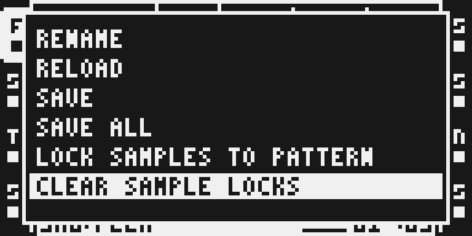
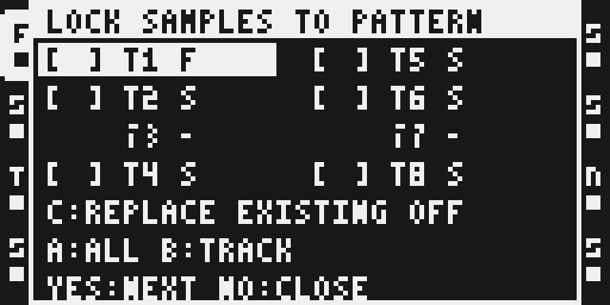
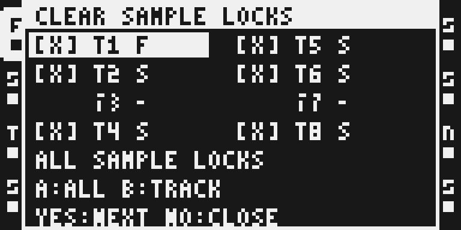

# Pattern Sample Locks

Version: 0.1.6-experimental · author: @twwwy · category: system

## Overview

Two Part Edit actions: **Lock Samples to Pattern** writes the Part's assigned sample into existing sample trigs; **Clear Sample Locks** removes every SAMPLE lock on selected tracks, including manual locks.

**Private development prototype; physical qualification is incomplete.** Use a backed-up disposable project for the supervised RAM trial in [DEVICE_TEST.md](DEVICE_TEST.md). Development stays in the contributor's fork; no upstream PR or release is authorized.

## Controls

Level 1 is **FUNC + PART**. The headerless stock list keeps RENAME, RELOAD, SAVE and SAVE ALL, then appends the two actions.

Level 2 always lists eight tracks in two columns: T1–T4 left, T5–T8 right. S means Static and F means Flex. Other machines are greyed out, have no brackets, cannot be selected and are skipped by arrows. Levels 2 and 3 use full-height popups, white headers and equal eight-pixel text spacing.

| Control | Level 2 behavior |
| --- | --- |
| Arrows | Navigate eligible tracks without changing selection. |
| Encoder A | Clockwise selects all eligible tracks; counterclockwise deselects all. |
| Encoder B | Clockwise selects the highlighted track; counterclockwise deselects it. |
| Encoder C, Lock only | Replace existing: OFF by default. Clockwise ON, counterclockwise OFF. |
| Encoder C, Clear | Inert. Clear includes every selected SAMPLE lock. |
| YES | Open level 3 with per-track change counts. |
| NO | Close the entire module popup. |

Level 3 identifies the pattern and shows a count for each selected track; unselected/disabled tracks show a dash. YES applies, NO returns to level 2 with selection/policy retained. Confirmation accepts no selection or policy changes.

Final YES stops playback and waits for transport and independent tracks to stop. Playback stays stopped. An active recorder refuses; STOP timeout makes no edit. NO cancels a pending stop; PLAY is consumed until completion/cancellation.

## Usage

On MKII press FUNC + PART, choose an action with YES. Navigate with arrows, select with A/B and review the Lock replacement policy on C. Press YES to review counts, then YES to apply or NO to return. NO in level 2 closes.

Only ordinary Flex/Static tracks are eligible. Current PL/AB/FM/S2 contributed-machine signatures are excluded. MKI controls and hardware behavior remain untested.

## Quick tutorial

1. Create a disposable pattern with sample trigs and an existing SAMPLE lock.
2. Open Lock, select a track and leave Replace existing OFF. Confirm: empty SAMPLE fields on sample trigs receive the Part assignment; existing locks remain unchanged.
3. Open Clear and select tracks. Review **INCLUDES MANUAL LOCKS** and the counts. Confirm to remove every selected SAMPLE lock. Other parameter locks remain.
4. Use ordinary Save Project to save the pattern. Nothing saves implicitly.

## Lock and Clear rules

Lock preserves **all existing** SAMPLE locks by default, including ones written by an earlier Lock. Explicit replacement may overwrite them. It visits existing sample trigs across all 64 stored steps, including steps beyond playback length; no assigned sample refuses the selection.

Clear removes all SAMPLE locks across all 64 stored steps on selected eligible tracks, including manual locks and locks on steps without a sample trig. It preserves other parameter locks, trig flags, other tracks and Part assignments. Clear is not a custom Undo operation.

There is **no ownership bookkeeping**: no battery-RAM reservation, CF metadata, ownership snapshot, clipboard companion or edit-history hook. Native copy/paste, clear, Undo, bank and project operations retain ordinary behavior. Saved projects contain ordinary SAMPLE locks and need no metadata to load without this module.

## Compatibility and CPU cost

- Three guarded Part Edit opener sites and four standard UI hooks. No lifecycle-table contribution or custom base extension.
- No effect slot, DSP code, audio-frame callback, private retained storage or module dependency.
- Stock keeps its own popup labels, callbacks and selection pointers. No module pointer is retained in a stock popup.
- Source, Part assignments, SAMPLE bytes, trig masks, canonical battery mirror and lock-index bytes are revalidated under the native level-four task lock, leaving frame/DMA interrupts enabled.
- SAMPLE/index writes use batches of at most sixteen under full interrupt masking. Only selected SAMPLE bytes, their canonical mirror, affected index bits and native dirty/publication state change.
- Compiled allocation: 8,620 bytes initialized code/data and 6,992 bytes BSS. These are build sizes, not measured physical CPU/stack use.
- Current results belong in [TESTING.md](TESTING.md); historical ownership-prototype timings do not qualify this version.

## Tests and measurements

Run python3 -B verify.py for planner/UI sanitizer regressions. The pinned MCF54455 compile/link and instruction guard must pass before packaging. Emulator results never establish hardware, audible output or physical reboot qualification.

Standard Modwerk runtime loading is used. Read the device's actual base, capabilities and inventory before a trial. Keep is separate. Firmware/packages stay private.

## Authorship and licences

Original source and UI by twwwy, MIT. Small lettering is reused from twwwy's original MIT Beat Slicer with attribution; no other module is called or required. Shared runtime, builder and emulator tools retain their licences. No firmware, extracted stock code/tables or built images belong in Git.

## Screens and audio

Screens are actual emulator LCD captures. The DSP-enabled 0.1.6 UI/native run and fresh stock-project reload passed. Maximum-edit evidence and its DSP execution limits are detailed in [TESTING.md](TESTING.md); older ownership results are archived in [TESTING-v015.md](TESTING-v015.md).

