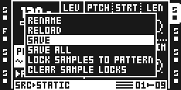
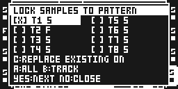
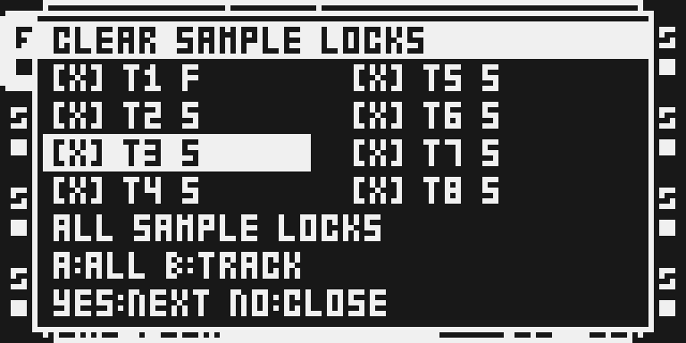
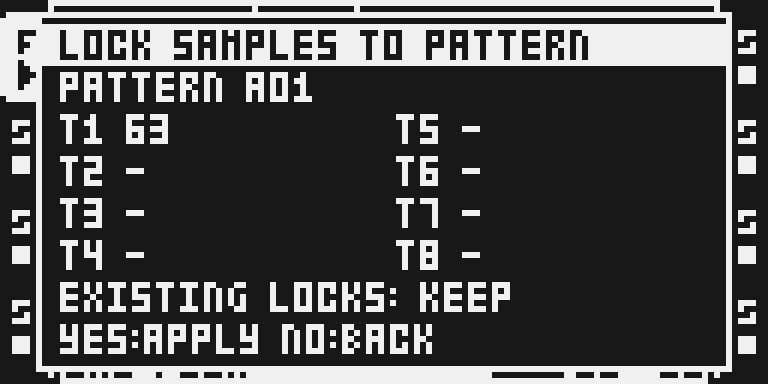
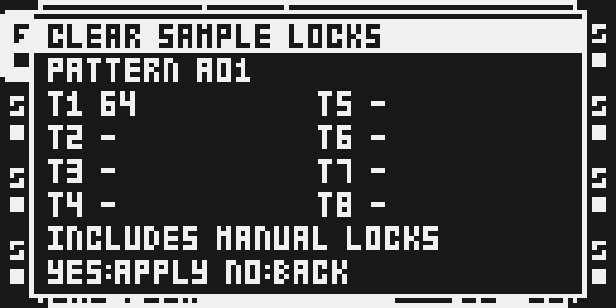
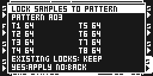
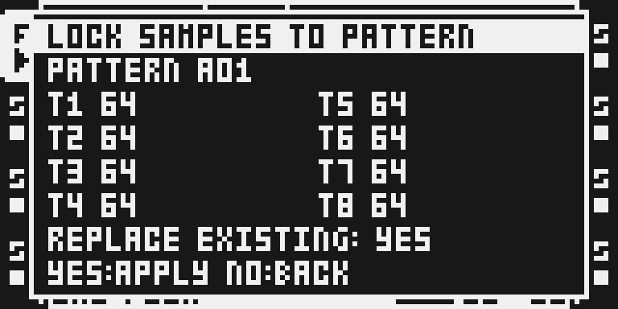
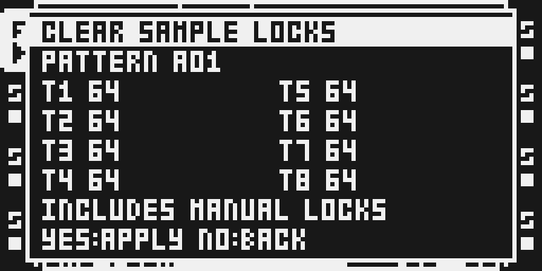

# Pattern Sample Locks

Version: 0.1.8-experimental · author: @twwwy · category: system

## Overview

Two Part Edit actions: **Lock Samples to Pattern** writes the Part's assigned sample into existing sample trigs; **Clear Sample Locks** removes every SAMPLE lock on selected tracks, including manual locks.

**Private development prototype; full physical qualification is incomplete.** Use a backed-up disposable project for the supervised RAM trial in [DEVICE_TEST.md](DEVICE_TEST.md). Source prototype prepared for upstream owner review; publication remains unapproved.

**The first beta is scoped to USB loading through the Modwerk base.** Card
firmware is unsupported and must refuse this module. Card support is deferred;
this scope was selected by the author and still needs first-release review.

## Controls

Level 1 is **FUNC + PART**. The headerless stock list keeps RENAME, RELOAD, SAVE and SAVE ALL, then appends the two actions.

Level 2 always lists eight tracks in two columns: T1–T4 left, T5–T8 right. S means Static and F means Flex. Other machines are greyed out, have no brackets, cannot be selected and are skipped by arrows. Levels 2 and 3 use tall popups, white headers and equal seven-pixel text spacing.

| Control | Level 2 behavior |
| --- | --- |
| Arrows | Navigate eligible tracks without changing selection. |
| Encoder A | Clockwise selects all eligible tracks; counterclockwise deselects all. |
| Encoder B | Clockwise selects the highlighted track; counterclockwise deselects it. |
| Encoder C, Lock only | Replace existing: OFF by default. Clockwise ON, counterclockwise OFF. |
| Encoder C, Clear | Inert. Clear includes every selected SAMPLE lock. |
| YES | Open level 3 with per-track change counts. |
| NO | Close the entire module popup. |

Level 3 identifies the pattern and shows a count for each selected track; unselected/disabled tracks show a dash. YES applies and closes the popup on success; there is no extra success acknowledgement. NO returns to level 2 with selection/policy retained. Errors remain visible. Confirmation accepts no selection or policy changes.

Final YES keeps playback as it was: playing continues and stopped stays stopped. Active live recording or a sampler recorder refuses the operation without changing transport. Transport, recorder and project gestures close an armed menu before reaching stock controls.

After a successful operation, each action remembers its own selected tracks and highlighted cursor; Lock also remembers Replace existing. Level one highlights the last successfully used action. Selecting All with A remembers that intention for the next pattern’s eligible tracks; a custom selection is intersected with currently eligible tracks. Cancelled and refused operations keep the previous saved settings. Preferences live only in module RAM: they survive pattern/bank changes and project reload while the module stays loaded, and reset on module reload or power cycling. First-use selection is empty and Replace existing is OFF.

## Usage

On MKII press FUNC + PART, choose an action with YES. Navigate with arrows, select with A/B and review the Lock replacement policy on C. Press YES to review counts, then YES to apply or NO to return. NO in level 2 closes.

Only ordinary Flex/Static tracks are eligible. Current PL/AB/FM/S2 contributed-machine signatures are excluded. MKI controls and hardware behavior remain untested.

## Quick tutorial

1. Create a disposable pattern with sample trigs and an existing SAMPLE lock.
2. Open Lock, select a track and leave Replace existing OFF. Confirm: empty SAMPLE fields on sample trigs receive the Part assignment; existing locks remain unchanged.
3. Open Clear and select tracks. Review **INCLUDES MANUAL LOCKS** and the counts. Confirm to remove every selected SAMPLE lock. Other parameter locks remain.
4. Use ordinary Save Project to save the pattern. Nothing saves implicitly.

## Lock and Clear rules

Lock preserves **all existing** SAMPLE locks by default, including ones written by an earlier Lock. Explicit replacement may overwrite them. It visits existing sample trigs across all 64 stored steps, including steps beyond playback length; no assigned sample refuses the selection.

Clear removes all SAMPLE locks across all 64 stored steps on selected eligible tracks, including manual locks and locks on steps without a sample trig. It preserves other parameter locks, trig flags, other tracks and Part assignments. Clear is not a custom Undo operation.

There is **no ownership bookkeeping**: no battery-RAM reservation, CF metadata, ownership snapshot, clipboard companion or edit-history hook. Native copy/paste, clear, Undo, bank and project operations retain ordinary behavior. Saved projects contain ordinary SAMPLE locks and need no metadata to load without this module.

## Compatibility and CPU cost

- Three guarded Part Edit opener sites and four standard UI hooks. No lifecycle-table contribution or custom base extension.
- No effect slot, DSP code, audio-frame callback, private retained storage or module dependency.
- Stock keeps its own popup labels, callbacks and selection pointers. No module pointer is retained in a stock popup.
- Source, Part assignments, SAMPLE bytes, trig masks, canonical battery mirror and lock-index bytes are revalidated under the native level-two task guard, leaving sequencer, USB, audio-frame and DMA interrupts enabled.
- Each changed step publishes at most eight SAMPLE/mirror pairs and one lock-index byte under a brief full interrupt guard; interrupts resume between steps. Only selected SAMPLE bytes, their canonical mirror, affected index bits and native dirty/publication state change.
- Compiled allocation: 8,748 bytes initialized code/data and 1,328 bytes BSS. These are build sizes, not measured physical CPU/stack use.
- Current MKII checks include live 512-field edits, native project reload, a kept nineteen-module restart and removal/Undo on the named flashed base. Observed host completion bounds are below 18.44 ms, including USB/UI latency. Full publication and cost qualification remain incomplete. See [TESTING.md](TESTING.md).

All three levels use the instrument’s own font and seven-pixel row spacing. Level one stays headerless; levels two and three keep white headers and two-column track grids. The popups fit all their rows without clipping.

## Tests and measurements

Run python3 -B verify.py for planner/UI sanitizer regressions. The pinned MCF54455 compile/link and instruction guard must pass before packaging. Emulator results never establish hardware, audible output or physical reboot qualification.

[Apply profiling](APPLY_PROFILING.md) measures the unchanged runtime in phases before choosing a CPU optimization.

[Local beta preparation](BETA_PREPARATION.md) records reproducible package,
stack and browser-component checks, the remaining publication blockers and a
future supervised MKII checklist. The candidate remains private and unqualified.

[Private reconstruction](RECONSTRUCTION.md) packages the identical runtime with
hash-guarded copies and records scanner, source-boundary and loader checks.

Standard Modwerk runtime loading is used. Read the device's actual base, capabilities and inventory before a trial. Keep is separate. Firmware/packages stay private.

## Authorship and licences

Original source and UI by twwwy, MIT. Small lettering is reused from twwwy's original MIT Beat Slicer with attribution; no other module is called or required. Shared runtime, builder and emulator tools retain their licences. No firmware, extracted stock code/tables or built images belong in Git.

## Screens and audio

All images below capture exact version 0.1.8. Physical MKII and DSP-enabled emulator captures are labelled separately in the manifest. [TESTING.md](TESTING.md) records their build identities and limits; [PROTOTYPE_HISTORY.md](PROTOTYPE_HISTORY.md) consolidates retired versions. No audio recording is supplied.

