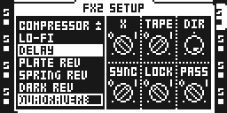
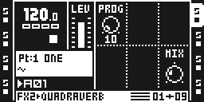

# Quadraverb

Version 0.1.0-experimental (built, not yet run on a unit) · the Alesis Quadraverb (1989), from Modwerk's own reverse engineering of its DSP · an FX2 effect for the Octatrack MKI and MKII on the Modwerk base over USB.

## Overview

The factory programs of the Alesis Quadraverb on FX2: rooms, halls, chambers and plates, choruses, echoes, and the guitar, string and vocal programs that combine them. Each is the original's factory program, the 96-step DSP program its firmware builds, compiled to DSP code when you pick it and run step for step at 44.1 kHz. Its sweeps move as the original's do. Its long delay lines live in the Octatrack's main memory, and the base moves them to and from the DSP every 16 samples. 48 of its 90 programs are in this release; Compatibility and limitations says which are not, and why.

Nobody has compared it with a real Quadraverb: there was none to hand. Every claim here is about the original's firmware, run in an emulator, and the engine's arithmetic, which is an assumption where the firmware does not say (FIRMWARE.md, ENGINE.md).

## Controls

| Knob | Name | Range | Default | What it does |
| --- | --- | --- | --- | --- |
| A | PROG | 00-89 (48 programs) | 10 | The factory program, by its number on the original: for example 10-12 rooms, 13-16 halls, 17-19 plates, 20-22 chambers, 04 and 33 choruses, 34-36 chorus with room, reverb or delay, 44 and 46-48 echoes, 66 HOLMES' Plate. Programs not in this release are skipped. |
| F | MIX | 0-127 | 40 | Dry and wet: 0 is exactly dry, 127 wet only. |

Both are ordinary FX2 knobs, so parameter locks, LFOs and scenes reach them as any effect's (not tried on a unit). A new program starts from silence; the dry signal keeps playing at its MIX level meanwhile.

## Usage

1. Select a track and press **FX2**, then **FUNC + FX2** for FX2 SETUP.
2. Turn **LEVEL** to QUADRAVERB and press **YES**, then press **FX2** for the main page.
3. Turn **A** for the program and **F** for the mix.

## Quick tutorial

1. Load a drum loop on track 1, press FX2, then FUNC + FX2, scroll to QUADRAVERB with LEVEL, press YES, then FX2: the page shows PROG and MIX.
2. Play the pattern and turn A slowly: 10 is a small room, 15 a concert hall, 19 a large vocal plate.
3. Turn F (MIX) up to hear more of the reverb. Turn it to 0 to get the dry loop back.

## Compatibility and limitations

- USB only: it needs the Modwerk base's program areas and stream channel (the package requires `programs`, loader ABI 9). They are in the base 0.8.3 draft, on development twins only so far.
- FX2 only. Each instance uses the first 15,870 words of its track's 16K FX2 buffer for its short delay lines, so it cannot share a core's FX2 memory with Analog BD. Its long lines live in a 144 KiB ring pool on the ColdFire: two chambers, or a plate beside a small program, at once; 00, 53, 71 and 83 only alone; a slot without room stays dry.
- One instance a DSP core at most: the base keeps two copies of a program's code a slot (up to 1,168 words each) in the about 4,700 words a core has for effect code, beside a Part's stock effects.
- DSP time: 246-342 chip cycles a sample an instance by the stall model on traces in the DSP emulator, 353 while a pick fades it, under the base's admission limit; not measured on a unit. Many programs move more data a frame than the stream channel has carried on a unit so far (160 halfwords each way, reads alone 256): 31 of the 48 stay within 160, the rooms and halls need 208-247 in, the plates up to 352 in and 144 out.
- Not like the original: 44.1 kHz instead of about 42 kHz, so reverb times, delays and sweeps are about 5 % shorter and faster; the input is the average of left and right; words are 24 bits in the DSP and 16 bits where they cross to the ColdFire. Nothing records the original's own width.
- Not in this release: the gated programs and the sweeps a signal onset restarts (03, 23-29, 31, 32, 86-88), whose gate needs a signal detector the original has in hardware, and 73 VERB SHIFTER; the pitch shifts (07, 37, 51, 59, 60, 70) and the Leslies (08, 38, 39, 67, 82), whose code is too long to sit beside a Part's stock effects; 05, 30, 40, 41, 56, 76 and 77, which the engine does not build in this form yet; and 06, 09, 42, 43, 45, 55, 57, 68, 69 and 72, which do not yet match the model bit for bit in this form.
- A new program fades the old one's wet out over 256 samples and starts from silence; unlike the original, the old tail does not run on into the new program (TESTING.md, "The fade at a pick").
- MIDI modulation of sweep rate and depth, which the original takes, is not taken.
- Built from the owner's own Quadraverb 1.07 ROM image on the developer's computer. The program sources compiled from it (`gen/`) are in this repository under the owner's waiver of 27 November 2026; the ROM is not.

## Tests and measurements

See [TESTING.md](TESTING.md): the engine against the integer model in the DSP emulator (89 of the 90 factory programs bit-exact in the open form, and the 48 of this release in the form it ships), the development builds priced on the owner's Octatrack MKII, and what is not tested yet. How the engine works: [ENGINE.md](ENGINE.md). What was read from the firmware: [FIRMWARE.md](FIRMWARE.md).

## Authorship and licences

This module plays other people's work:

- **Alesis** made the Quadraverb (1989) and its factory programs. Its firmware credits software to Fast Forward Designs (Marcus Ryle, Michel Doidic, Carol Nakahara) and hardware to Keith Barr and Alan Zak. The build reads the programs from the owner's own ROM image, which is not in this repository, and compiles them into `gen/`, which is. The repository owner waived the firmware rule for these programs and their sources on 27 November 2026, as he did for Midiverb I/II, and allowed the non-reverb programs in this one module (a one-effect waiver like Midiverb's).
- **Wavefront Semiconductor's** application notes for the AL3201 (AN3201-04, AN3201-06), a later Keith Barr design, gave the idea that a write scales the accumulator.

The 8051 emulator, the DSP model, the engine and the tools are Modwerk's own, under the MIT licence in [LICENSE](LICENSE); they copy nothing from the firmware. Not affiliated with or endorsed by Alesis or Elektron.

## Screens and audio

Emulator captures, not hardware ones: the emulated Octatrack MKII's LCD on the base 0.8.3 development twin, with this
release's package installed (media/capture.json). Nothing was heard: that emulator runs no DSP.

Select an audio track, hold FUNC and press FX2. Turn LEVEL down the list to QUADRAVERB and press YES to put it on FX2.

Press FX2 for its page: PROG (A) picks the program, MIX (F) sets dry and wet.

Turn PROG: the dial shows the program by its number on the original Quadraverb, here 10, SMALL ROOM.

Turn MIX up to hear more of the reverb: 0 is exactly dry, 127 wet only.
