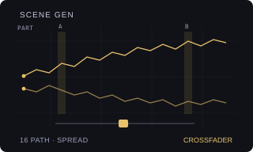

# SCENE GEN

Version: `0.1.0-experimental` · author: [Semi Erendönmez (@semierendonmez-commits)](https://github.com/semierendonmez-commits)

## Overview

SCENE GEN writes scene locks for you, so the crossfader has somewhere to go. You choose which parameters and how far
they may move from the Part's own values; YES fills a scene, or all sixteen, with locks drawn around those values:

- **SCENE A** or **SCENE B**: the scene selected on that side gets new locks for the chosen parameters.
- **16 RAND**: all sixteen scenes, each drawn on its own around the Part's values.
- **16 PATH**: a walk. Scene 1 is a step from the Part's values and each next scene a step from the one before (half the
  spread a step, turning back at each parameter's ends), so the crossfader between neighbouring scenes is a short
  move and between distant ones a long journey. Pick scene 1 on A and scene 16 on B, or any two, and travel.

Every lock stays inside its parameter's range (read from the page as stock draws it), the locks of other parameters
stay as they were, and the last generation can be undone. The scenes are the Part's own: they save, reload, copy,
mute and edit as any scene does. SCENE GEN keeps no clock and runs nothing while the pattern plays.

SCENE GEN contributes four rows to the Modwerk base's `ot_sequencer_rows` table
([HOOKS.md](../../machines/octatrack/HOOKS.md)) and patches no stock site; it needs the base loaded over USB and
has no card form. A shortcut on the scene keys needs a scene-key hook shared in the base; until then the rows are the
way in.

## Controls

PROJECT > CONTROL > SEQUENCER lists stock's three rows (CHAIN AFTER and the others), then SCENE GEN's four. LEVEL
changes the selected row's value; YES acts on SCENE GEN.

| Row | Default | Values |
|---|---|---|
| SCN TARGET | SCENE B | SCENE A, SCENE B (the scene selected on that side), 16 RAND, 16 PATH. |
| SCN PARAMS | TRK FX1+FX2 | TRK or ALL (the active track or all eight audio tracks), then page 1 of SRC, LFO, AMP, FX1, FX2, FX1+FX2 or ALL. AMP's XVOL is never generated. |
| SCN SPREAD | 32 | 1–127: how far a lock may move from the Part's value, as a share of the parameter's range (127: anywhere in it). 16 PATH steps half of it a scene. |
| SCENE GEN | YES | YES generates with a new draw; LEVEL to the left restores the scenes as they were before the last generation (once). The row then shows DONE, UNDONE, NO CHANGE or NO UNDO. |

Messages: SCENE GENERATED, 16 SCENES GENERATED, SCENES RESTORED, NOTHING TO GENERATE (no chosen parameter has a
knob there), SELECT AN AUDIO TRACK (TRK while a MIDI track is active).

The settings live in the module, not the project: after a restart they are the defaults again.

## Usage

Make a loop you like, with the Part's values where the sound starts. Choose TRK FX1+FX2 (or ALL FX1+FX2 for the whole
mix), SPREAD 32 to 48, 16 PATH, and press YES. Leave the menu, put scene 1 on A and scene 4 on B and move the fader;
step on through the scenes by selecting new A and B scenes as you go. For one quick variation, choose SCENE B and press
YES: the B side now holds a fresh take on the same parameters. Keep what you like with Apply Scene or by saving the Part.

## Quick tutorial: a walk through sixteen scenes

1. On track 1, set FX1 to a filter and FX2 to a delay, and set their knobs where the sound starts.
2. Press PROJECT > CONTROL > SEQUENCER. Set SCN TARGET to 16 PATH, SCN PARAMS to TRK FX1+FX2 and SCN SPREAD to 40. Go to SCENE GEN and press YES: 16 SCENES GENERATED.
3. Leave the menu. Hold SCENE A and press trig 1, hold SCENE B and press trig 2, and move the crossfader: a short move. Choose trig 16 for B: a long journey.
4. Not the right draw? Go back to SCENE GEN and press YES again; turn LEVEL to the left to get the scenes from before the last YES.

## Compatibility and limitations

- Octatrack MKI or MKII, OS 1.40C, the Modwerk base loaded over USB (beta) with the SEQUENCER rows. Card firmware cannot include it.
- Generating replaces the chosen parameters' locks in the target scenes. Undo holds one step, while the same bank and
  Part are active; there is no undo after a Part or bank change.
- Page 1 only (stock cannot scene-lock page 2). XVOL and XLV are never touched. With MASTER TRACK on, track 8's
  pages are generated like any other track's.
- The SEQUENCER window shows stock's three rows and up to eight more, shared with other modules' rows.
- No conflicts are declared. Apply Scene and SCENE GEN work together (SCENE GEN writes scenes; Apply Scene stamps them
  onto the Part). Not yet run on a unit or in the emulator; nothing below is hardware evidence.

## Implementation

`engine.c` draws the locks from plain arrays: the Part's values and each parameter's range in, the scenes' lock rows
out. `rows.c` is the glue: four `struct modwerk_sequencer_row` records (`scenegen_rows`, order 50) with getters and
setters in stock's convention. YES reads the active Part: per track the PLAYBACK values of its machine at Part + 0x2a
+ t × 30 + machine × 6 and the LFO, AMP and FX values at Part + 0x114 + t × 24, each parameter's range from its
page's descriptor (drawn mask at + 0x18e, lowest at + 0x6a, count at + 0x9a), and the scene lock rows at Part + 0x662
+ (scene × 8 + t) × 32 (the layout Apply Scene documents). It copies the scene block for undo, writes the new locks,
mirrors them into the Part's battery copy, marks the Part edited and runs the crossfader morph once, as a fader move
would, so STRT, LEN and RATE reach the voices.

The USB package is built by `sdk/runtime/loader/build.py` from the two sources with
`--subscribe ot_sequencer_rows:scenegen_rows:50`; `verify.py` rebuilds it and compares it with the published one.

## Tests and measurements

See [TESTING.md](TESTING.md). `test_engine.py` runs the engine under the sanitizers over 4,000 random Parts (knobs with
full, small and missing ranges), targets, pages, scopes and spreads: deterministic; only the chosen parameters of the
target scenes on the chosen tracks change; AMP's XVOL never; every lock inside its range and within SPREAD of the
Part's value (one scene, 16 RAND) or within half of it of the scene before (16 PATH). With `m68k-elf-gcc` it builds
the package and checks the four rows at the registry's index.

## Authorship and licences

Original work. The scene and page-descriptor layout follows what Apply Scene by Nathaniel Pavel (MIT, Modwerk)
documents; none of its code is used. The 16 PATH walk is an idea from SEEDWALK, the author's own plug-in. The module is
[GPL-3.0-or-later](LICENSE); the thumbnail is an original illustration ([presentation/LICENSE](presentation/LICENSE)).
No Elektron firmware, extracted routines, tables, samples or dumps are included; underlying Elektron interface rights
remain reserved.

## Screens and audio

No screenshots yet: PROJECT > CONTROL > SEQUENCER with the four rows is captured in the headless emulator once the
module runs there (`scripts/capture-module-ui.py`). No audio preview.
