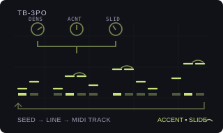

# TB-3PO

Version: `0.1.0-experimental` · author: [Semi Erendönmez (@semierendonmez-commits)](https://github.com/semierendonmez-commits)

## Overview

TB-3PO is a generative 303-style acid-line generator for the Octatrack's MIDI tracks. It is a port of the Phazerville
Hemisphere Suite `TB_3PO` applet by djphazer and the Hemisphere Suite contributors, taken through Charles Vestal's
Schwung port `tb3po.c` for the Ableton Move: the same random draws in the same order, so a line at the same settings
has the same shape as the Move's.

It writes the line into the MIDI track's own sequencer: a note is a trig with a NOTE lock, an accent adds a VEL lock,
a slide adds a LEN lock that reaches into the next note, so a TB-303-type synth that slides on overlapping notes
(TB-03, TD-3, x0xb0x, Open303, Schwung 303) plays it as a slide. The stock MIDI sequencer plays what it wrote, at the
pattern's tempo, track speed, length and swing, with the track's trig conditions and note-offs. TB-3PO keeps no
clock, runs nothing while the pattern plays and sends no MIDI itself ([sequencing.md](../../../../docs/module-guides/sequencing.md)).

Every control change redraws the whole line from the seed and the controls, so the line is reproducible and a turn
back restores it; YES rolls the next seed. The trigs and locks it wrote are ordinary sequencer data: edit single steps
as on any MIDI track, and they stay when the generator is turned off.

TB-3PO contributes to the Modwerk base's `ot_midi_generators` table
([HOOKS.md](../../../machines/octatrack/HOOKS.md)) and patches no stock site; it needs the base loaded over USB and
has no card form (as Beat Slicer).

## Controls

MIDI NOTE SETUP (double-tap SRC, or double-tap the track key in MIDI mode) lists OFF and the installed generators in its
empty left half: UP/DOWN and YES choose. A track running TB-3PO shows its controls on the SRC page and the AMP page;
FUNC+AMP turns the AMP page to its second. LFO, FX1 and FX2 stay the track's own, and holding a trig or a scene shows
stock's pages, so locks stay stock's.

| Page | Encoder | Control | Default | Behaviour |
|---|---|---|---|---|
| SRC | A | DENS | 89 | 0–127. The chance a step plays (0.7 in `tb3po.c`). 0 leaves the one guaranteed note, 127 fills every step. |
| SRC | B | ACNT | 51 | 0–127. The chance a note is accented: it gets a VEL lock of AVEL. |
| SRC | C | SLID | 32 | 0–127. The chance a note slides into the next: it gets a LEN lock of SLEN. A slide into a rest becomes a plain note. |
| SRC | D | OCT | 2 | 0–9. The octave of the track's NOTE; shown as the note itself (A1 by default, `tb3po.c`'s base note). |
| SRC | E | ROOT | A | C–B. The root. OCT and ROOT together are the track's own NOTE (12 × OCT + ROOT). |
| SRC | F | SCAL | MINR | Minor, Phrygian, harmonic minor, minor pentatonic, Dorian, major: the degrees the notes are drawn from. |
| AMP | A | SEED | 1 | 0–127. The variation. YES advances it and wraps. |
| AMP | B | VAR | OFF | OFF, 1–127. `tb3po.c`'s MUTATE: a pass that re-rolls about a quarter of the steps, half their state, half their pitch, salted with this value. OFF is the seed's own line. |
| AMP | C | GATE | track's LEN | 0–127 in stock's LEN units. The track's own LEN: the length of plain notes. Not changed when the generator is chosen. |
| AMP | D | SLEN | 72 | 0–127 in stock's LEN units. The LEN lock of a slid note. Set it past one step so the note overlaps the next (see Compatibility). |
| AMP | E | AVEL | 118 | 0–127. The VEL lock of an accented note. |
| AMP | F | DIR | FWD | FWD, REV, PING, RND: the order the generated steps are laid on the track (`tb3po.c`'s playback directions, laid out once). PING runs forward then back; RND is a seeded shuffle. |
| FUNC+AMP | A | VEL | 72 | 0–127. The track's own VEL: the velocity of plain notes. |
| FUNC+AMP | B | OCTS | 2 | 1–3. How many octaves above the root a note may take. |
| FUNC+AMP | C | MOTF | OFF | OFF, 2–32. OFF generates one line over the track's whole length; otherwise a motif of that many steps repeated along it. |

Values are stored in the range the arp note bytes keep (0–127). Generator settings are not LFO, scene or parameter-lock
destinations; the NOTE, VEL and LEN locks it writes are, through stock's own pages.

## Usage

Set the MIDI track's CHAN to a 303-type synth. Choose TB-3PO in MIDI NOTE SETUP: an empty track gets a first line
at once, a track with notes waits for a control. Turn a control to replace the line, also while the pattern plays;
press YES on a generator page for a new seed. Use VAR for a nudge of the current line and DIR for its order.

The line follows the track's own length: the pattern's, or the track's in per-track length mode. A longer pattern
gets a longer line (MOTF OFF) or a repeated motif. Track speed, swing, trig conditions, micro-timing and note-offs
are the stock sequencer's; TB-3PO writes straight trig words (no micro-timing, no condition) for the steps it places
and leaves the trig words of every other step alone.

What it writes, in place, only the bytes that change: the note trig mask, the lock-only mask for a rest that keeps
another lock, the NOTE, VEL and LEN locks of its steps, and their trig words. CC locks, LFO locks and swing stay.
Choosing OFF leaves the trigs and locks on the track.

## Quick tutorial: an acid line on MIDI track 1

1. Press MIDI, select track 1 and set its CHAN in MIDI NOTE SETUP (double-tap SRC) to the channel of a 303-type synth.
   UP/DOWN to TB-3PO in the list on the left and press YES: the track gets a first line.
2. Press SRC: turn DENS for more or fewer notes, ACNT for accents and SLID for slides; OCT, ROOT and SCAL set the key.
   Each turn rewrites the track at once, also while playing.
3. Press AMP: SEED and VAR for another variation, DIR for the order; set SLEN so a slid note reaches past one step.
   Press YES for a new seed.
4. Press PLAY: the stock MIDI sequencer plays the line at the pattern's tempo and swing. Press STOP, or choose OFF in
   MIDI NOTE SETUP to leave the generator; the trigs and locks it wrote stay editable.

## Compatibility and limitations

- Octatrack MKI or MKII, OS 1.40C, the Modwerk base loaded over USB (beta) with MIDI generators
  (`ot_midi_generators`, base `52b22249…` or later). Card firmware cannot include it.
- Slides are overlapping notes: a LEN lock past the next step. A synth that does not slide on legato plays two
  overlapping notes instead. No portamento CC (65) is sent and no CC slot is taken.
- SLEN's default (72) is unverified against stock's LEN table: set it so a slid note reaches past one step on your
  unit. The LEN values above one step are to be read off the stock formatter in the emulator (TESTING.md).
- One generator a MIDI track; the generator takes the track's SRC and AMP pages and keeps its arpeggiator off (the
  base's rule for every generator). NOT2–4 are turned off when TB-3PO is chosen, since the SRC page has no place for
  them; set them on stock's page by holding a trig.
- Its settings live in the track's arpeggiator note bytes (the base's rule), a thirteenth byte marking them as
  TB-3PO's. Leaving the generator resets them with the base's arp reset; the line itself stays.
- No conflicts are declared. On the card there is nothing to conflict with; over USB the base shares the list.
- Not yet run on a unit or in the emulator. Nothing below is hardware evidence.

## Implementation

`engine.c` is the firmware-free generator: `tb3po.c`'s xorshift32 and its draws, as 24-bit fractions instead of
floats (`tb3po.c` keeps 24 bits of each word itself), over a motif of 1–64 steps, then the direction and motif
layout, the slide-into-rest cleanup and the one guaranteed note. `tb3po_write` puts a `Tb3poPattern` into a MIDI
track record in place: five masks, three locks a step and the trig words of the steps that change, mirrored into the
battery-backed copy. `generator.c` is the Octatrack glue in the shape of VECTOR 0.3.0's `midi.c`: the
`struct modwerk_midi_generator` record (`tb3po_midi`, id `'T'`, pages SRC and ARP, order 40), its page descriptors
built from stock's NOTE and ARP descriptors with value-text cells and TB-3PO's formatters (GATE, SLEN and OCT use
stock's own LEN and NOTE formatters), the settings in the arp note bytes, and generation into the current pattern's
record with only this track's bit of stock's lock index set and stock's track update called (MIDI tracks 8–15).

The USB package is built by `sdk/runtime/loader/build.py` from `engine.c` and `generator.c` with
`--subscribe ot_midi_generators:tb3po_midi:40`; `verify.py` rebuilds it and compares it with the published one.

## Tests and measurements

See [TESTING.md](TESTING.md). `test_engine.py` runs the engine under the sanitizers: step for step against
`tb3po.c`'s float generator (as written, in the test) over 50,688 seed, scale, octave-range and length cases with no
difference; determinism, scale membership, the slide and at-least-one-note rules, every direction and motif; and the
record writer (locks, masks, trig words, what it leaves alone, idempotence). With `m68k-elf-gcc` it builds the package
and checks the generator record at the registry's index. No hardware, emulator or timing evidence exists yet.

## Authorship and licences

The generator is the Phazerville Hemisphere Suite `TB_3PO` applet by
[djphazer and contributors](https://github.com/djphazer/O_C-Phazerville) (GPL-3.0), ported through
[Charles Vestal's `schwung-tb3po`](https://github.com/charlesvestal/schwung-tb3po) `src/dsp/tb3po.c` at commit
`f49d81d05d1e29ae37728a08e30f193892be3bc9` (GPL-3.0). The Octatrack glue is original, in the shape of VECTOR 0.3.0's
`midi.c` by Jannik Aßfalg (MIT, Modwerk). The module is [GPL-3.0-or-later](LICENSE). The thumbnail is an original
illustration ([presentation/LICENSE](presentation/LICENSE)). No Elektron firmware, extracted routines, tables,
samples or dumps are included; underlying Elektron interface rights remain reserved.

## Screens and audio

No screenshots yet: they are captured in the headless emulator once the module runs there (`scripts/capture-module-ui.py`),
of MIDI NOTE SETUP with TB-3PO in the list, the SRC page, the AMP page and its second page. No audio preview.
