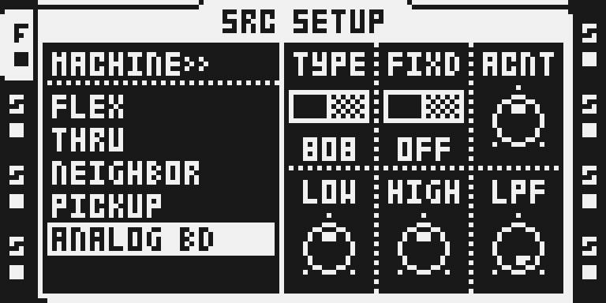
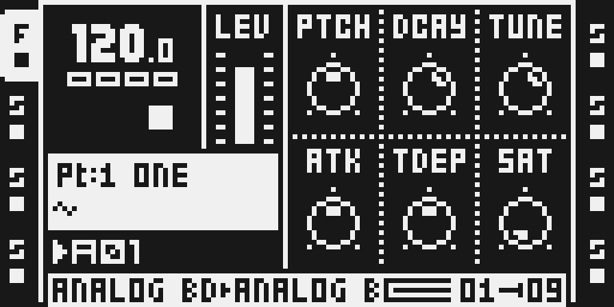
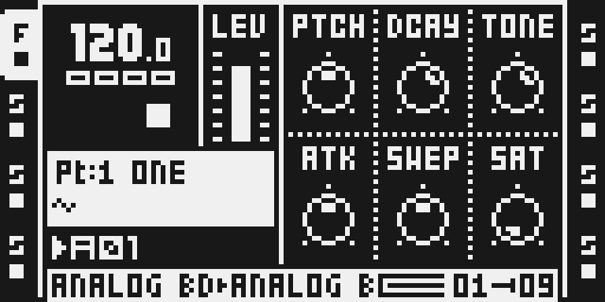

# Analog BD

Version `0.1.7-experimental` gives the 909 the sound fitted to Skee Mask's recorded TR-909 and runs both models on about half the DSP work. The 909's body is read from the recorded 909's measured cycle, its click follows the body's opening as on the recording, its attack noise is louder and longer, and each hit's pitch sweep varies slightly (FIXD ON keeps every hit the same). **PITCH and DECAY have new 909 ranges, so saved 909 kicks sound different** ([Controls](#controls)). Peak executed DSP instructions per voice fall from 375 to 184 per sample on the 909 and from 252 to 177 on the 808 (emulator count, not chip timing). The declared price of 411 per voice is unchanged until the new engine is measured, so the Octatrack refuses effects for DSP FULL where it did before. **Not yet run on a unit** (TESTING.md). Version 0.1.6 added the TYPE and FIXD switches and reordered SRC SETUP; 0.1.5 restored valid stock playback and SETUP defaults when leaving Analog BD.

## Overview

Analog BD synthesizes 808 and 909 bassdrums inside the Octatrack DSP. The 909 is fitted to recordings of one TR-909 (Skee Mask's, from its direct out): its body is read from the recorded cycle up to the 40th harmonic, whose shape above the fundamental follows the pitch sweep and the envelope; its click is the recorded trigger pulse's filtered response, fired 16 samples (0.36 ms) after the body opens, as on the recording; its attack noise matches the recording's level and 7.9 ms decay. Minimum and maximum Attack are fitted together. Tune uses the final recorded hits for its high endpoint, including a small settled-pitch difference.

The pitch sweep's depth (up to ±1.45 %, as measured between same-setting hits of the recording), the click strength (±0.7 %) and the noise vary between consecutive hits unless the FIXD switch (SRC SETUP, top middle) is ON. Timing is never randomised. The model's transient shapes remain more consistent than the recording, so individual-hit reproduction is approximate. The reference instrument has a decay modification and was recorded with decay a little above halfway; its full modified decay range is not reproduced.

Moving controls stay smooth: the 909's TDEP excursion and thump and both models' SAT position move a quarter of the remaining way each 16-sample block (about 1.3 ms to settle by half), and SAT's drive and make-up ramp sample by sample within the block. A voice that is silent after its hit has ended rests, and its next hit starts from its knobs. No new saved parameter is added.

## Controls

All ranges are 0–127 except the two switches. The stored bytes are those of 0.1.6; on the 909, PITCH and DECAY mean something new in 0.1.7 (below).

| Control | Assignment default | Behavior |
| --- | --- | --- |
| PTCH | 64 | Body pitch. 909: one octave, 32.7 Hz at 0, the recorded 909's 45.6 Hz at 64, 65.4 Hz at 127; the sweep follows the settled pitch. |
| DCAY | 80 | Body decay. 909: 15 ms at 0, the recording's 247 ms at 80, 600 ms at 127. The 808 keeps its own law. |
| TONE / TUNE | 80 | 808 transient tone / 909 pitch-envelope duration and fitted endpoint excursion, with a small settled-pitch difference. |
| ATK | 64 | 808 transient control; 909 fast/long pulse strength with a retained minimum transient. |
| SWEP / TDEP | 64 | Original 808 sweep; smoothed 909 pitch excursion and associated thump. |
| SAT | 0 | Shared desk drive with smoothed table interpolation. |
| ACNT | 64 | Accent in SRC SETUP. Loud combinations can reach the existing output limiter. |
| LPF | 127 (OFF) | Bottom right. 0 is 500 Hz, ORIG (the existing nominal network) is 63, 126 is 18 kHz, and 127, fully clockwise and the default, is OFF. OFF is also the direct-out comparison. 0.1.5's default was 18 kHz, practically the same sound. |
| LOW / HIGH | 64 / 64 | Shared desk bands; 64 is neutral. Since 0.1.7 the two bands are weighted, not saturated on their own; SAT's input and output stages still saturate. High LOW/ACNT can limit. |
| FIXD | OFF | Top middle of SRC SETUP, an OFF/ON switch on both models. 909: ON fixes the sweep depth and the click strength and restarts the noise from its seed at every hit, so the attack is identical each time; OFF varies them (above). 808: OFF scales each hit's trigger transient by 1 ± 4 % (a per-hit random step); ON is the 0.1.5 sound. Saved as 0 (OFF) or 1 (ON); any other stored value, such as a 0.1.5 track's accent, plays OFF. |

SRC SETUP reads TYPE, FIXD, ACNT on the top row and LOW, HIGH, LPF below. The top-left TYPE switch chooses 808 (left) or 909 (right) and FIXD (top middle) is OFF or ON on both models; both are stock's two-state switch, like AMP SETUP's SYNC. 0.1.6 removes the engine browser: a double-tap on the TRACK key opens the machine list, as on any track, and RIGHT on the machine row does nothing. AMP and both FX pages retain their existing behavior.

**Projects saved with 0.1.6.** Every value loads where it was, but a 909 track's PITCH and DECAY now give the 0.1.7 ranges: PITCH 49 and DECAY 100, the 0.1.6 reference settings, now give about 42 Hz (was 45.6) and a 360 ms decay (was 247). Set them again (the recorded 909 is PITCH 64, DECAY 80). The 808 sounds as before; with LOW or HIGH far from 64 and SAT high it differs slightly (about -45 dB).

**Projects saved with 0.1.5.** TYPE is the same stored byte the browser edited, so they keep their 808/909 choice. ACNT, LPF and FIXD moved on the page and are not converted, so a 0.1.5 track loads with its old LPF value as ACNT (127 by default, the loudest accent), the old hidden slot's 0 as LPF (500 Hz), and FIXD OFF (its old ACNT byte is read as OFF, so an 808 track now varies slightly). Set ACNT, LPF and FIXD again on each Analog BD track of a 0.1.5 project, then save it. Keep a copy of the project if you may go back to 0.1.5.

## Usage

Use separate Attack and Tune sweeps so their effects are easy to hear. For the direct-out reference, bypass LPF; then adjust it separately for your own sound. Projects saved with 0.1.6 need the 909's PITCH and DECAY set again, and with 0.1.5 also ACNT, LPF and FIXD (above). Keep a separate project copy for stock firmware.

### Compare the 909 direct-out response

1. In a disposable project, hold FUNC and press SRC for SRC SETUP, choose ANALOG BD and press YES. Turn the top-left TYPE switch to the right for the 909. Set LOW/HIGH to 64 and SAT to 0.
2. For the direct-out reference, set PTCH 64, DCAY 80, TUNE 0, TDEP 64, ACNT 72 and LPF 127 (OFF). Trigger repeated hits at 70 BPM and sweep ATK alone through 0–127, then hold it at one value to hear the small strength/noise differences.
3. Hold ATK at 0 and sweep TUNE through its endpoints separately. Return SAT to 0 and TDEP to 64, then press STOP and let the tail finish. Turn TYPE to the left to compare the 808; its saved knob values remain intact.

### Switch back to Flex

Changing an Analog BD track to FLEX or another stock machine now restores the twelve borrowed SRC playback and SETUP bytes in both working Part copies before removing the Analog BD marker. You do not need SRC + PLAY for this transition in 0.1.5. Reselecting ANALOG BD keeps its patch. This fixes the invalid SETUP values that could reject the retained bank at power-up in [issue #363](https://github.com/repeat98/modwerk/issues/363#issuecomment-6083911774).

1. Select FLEX in the track machine chooser or SRC SETUP, then select your sample.
2. Check its SRC settings and sample assignment, then play the pattern.
3. Review existing SRC parameter locks, scenes and LFO destinations: they still target the same parameter slots and may need adjustment for the sample.

For 0.1.4 and earlier, reset SRC with SRC + PLAY immediately after switching and before powering off; undoing that reset restores the invalid values. LOAD PROJECT or leaving USB disk mode can recover the saved baseline after a rejected restore. The reported sequencer halt with unreleased Output Matrix in MATRIX mode remains unverified by this release.

## Compatibility and limitations

The target remains Octatrack 1.40C with the existing Analog BD registration and SPRING REV reservation. SYNTH, MACHINEDRUM and POLY registration conflicts remain unchanged. Existing stock-firmware project-clamping limitations still apply.

The supplied 909 recordings cover one modified instrument and one decay setting. Intermediate physical knob positions are unknown. Body/Attack/Tune agreement is close, not a 1:1 recreation of every setting or every hit. 0.1.7 has not run on a unit: its physical audio, persistence, several instances, maximum FX load, chip timing and complete memory bounds are untested (TESTING.md). Earlier MKII reports are of earlier versions.

## Tests and measurements

[TESTING.md](TESTING.md) binds the results to this source. For 0.1.7 the DSP engine's output matches its float model (`dsp909.Voice`, `dsp808.Voice`) at -72 dB or better in every test case (moving knobs, retriggers at every frame offset, SAT/LOW/HIGH extremes), and the new 909 model matches the October refit's at -63 dB, with the same level in every band. Against the recordings, at matched level the 909's first 25 ms are within 1.5 dB in every band below 4 kHz at both Attack endpoints and the Tune maximum (the Tune maximum's lowest band 3 dB low); above 4 kHz its body is about 6 dB quieter than the recording.

Peak executed DSP instructions per voice: 909 184 per sample (375 in 0.1.6), 808 177 (252); a resting voice 3. Glue and both engines take 1024 P words per core (1008 in 0.1.6); the 909's tables and voices fill X from $2841 to $3200 as before. Every instruction form is one that stock or 0.1.6 already runs on the chip. These are emulator counts, not chip timing or maximum-load headroom; the declared price (411 per voice) is unchanged. See [CPU.md](CPU.md).

## Authorship and licences

Original 808/909 engines and integration: repeat98 (Jannik Aßfalg). Composition infrastructure: Sam Banks. Existing tooling/author notices and MIT terms remain in [LICENSE](LICENSE); the approved upstream import remains pinned to `sambanks/octabam` commit `363861e31ee963c478fab2b190a0fabe1d7ce37b`.

Many thanks to **Skee Mask**, who kindly recorded his TR-909 so we could match Analog BD more closely. The reference recordings remain private and are not distributed or covered by the source-code licence. The fitting and source changes retain the existing MIT terms. No firmware, extracted stock code or private project is included.

## Screens and audio

These are actual MKII controller-emulator LCD pixels from a native card build of this 0.1.6 source (Analog BD alone), with the real DSP enabled, an empty scratch card and transport stopped. [Capture provenance](media/capture.json) records the image, tool and panel plan. UI captures demonstrate controls and access; they do not prove physical audio or persistence.

Select a track, hold FUNC and press SRC, move down to ANALOG BD and press YES. SRC SETUP reads TYPE, FIXD and ACNT above LOW, HIGH and LPF; LOW/HIGH 64 give a neutral desk. Use LPF OFF (127, fully clockwise, the default) when comparing the direct-out reference, then adjust filtering separately.

Turn A (TYPE) to the right for the 909 and press SRC for PTCH, DCAY, TUNE, ATK, TDEP and SAT. Try Attack alone with Tune fixed, then a separate Tune sweep; finish with STOP and let the tail decay.

Turn TYPE to the left for the 808: E is SWEP in place of TDEP and the third encoder is TONE. Switching keeps the other control bytes.

**Audio preview.** [Listen](media/audio-preview.mp3). At 128 BPM: default 808 (0 s), 909 TUNE 0 (3.75 s) and 127 (5.625 s), slow TUNE 0→127 (7.5 s), built-in Mackie SAT 0→95 (15 s). Tune Depth stays at default 64, PTCH at 49 and 909 ATK at 0; only TUNE and SAT sweep. 22.5 s, no added gaps, one common gain. Offline render through Analog BD 0.1.5's own DSP, not a physical Octatrack recording. Exact engine identity, trigger timing and automation are in [audio-preview.json](media/audio-preview.json); [media rights](media/LICENSE.md) covers the generated audio.
