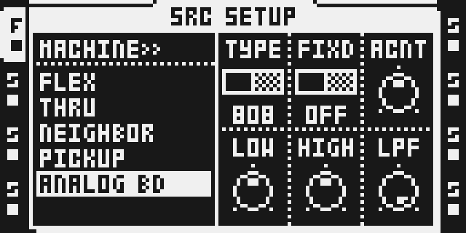
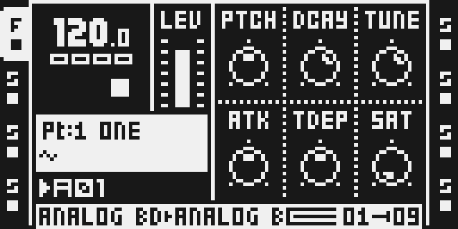
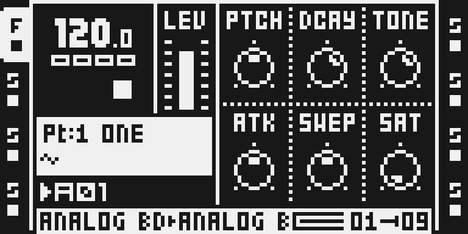

# Analog BD

Version `0.1.6-experimental` adds two switches to SRC SETUP: the top-left TYPE switch (808 or 909) in place of the engine browser, and FIXD at the top middle on both models (ON: every hit opens identically; OFF, the default: a slight hit-to-hit variation, as the 909 had in 0.1.5 and now the 808 too). A double-tap on the TRACK key now opens the machine list. Both engines execute about 15% fewer DSP instructions on average with bit-identical output (emulator count; peaks about 8% lower on the 909 and 5% on the 808). On a MKII one voice loads its DSP core about 26% (909) and 21% (808) less than in 0.1.5 (TESTING.md). The declared price of 411 per voice is unchanged. **Projects saved with 0.1.5 keep their 808/909 choice, but ACNT, LPF and FIXD need setting again** ([Controls](#controls)). Tested on a MKII (TESTING.md). Version 0.1.5 restored valid stock playback and SETUP defaults when leaving Analog BD, preventing the working bank from being rejected on the next power-up. The owner reports FLEX persists on exact private build AB015FIX01 and directed publication with the remaining qualification limits recorded in TESTING.md. The 909 with FIXD OFF and the 808 with FIXD ON sound as in 0.1.5.

## Overview

Analog BD synthesizes 808 and 909 bassdrums inside the Octatrack DSP. The 909 update fits harmonic phase/asymmetry as well as magnitude, and refines the complete hit's envelope/DC response. Minimum and maximum Attack are fitted together with both fast onset and longer discharge following the knob. Tune uses the final recorded hits for its high endpoint, including a small settled-pitch difference; the sweep is not treated as evenly spaced knob positions.

Pulse strength and shaped noise vary subtly between consecutive hits unless the FIXD switch (SRC SETUP, top middle) is ON. Timing and pitch receive no random variation. The model's transient shapes remain more consistent than the recording, so individual-hit reproduction is approximate. The reference instrument has a decay modification and was recorded with decay a little above halfway; its full modified decay range is not reproduced.

Existing 0.1.3 smoothing is retained: 909 TDEP excursion/thump and both models' SAT position slew by 1/64 of the remaining difference per sample, about 1.44 ms at 44.1 kHz. SAT drive, makeup and coupling interpolate along that common position. First use seeds the patch directly and retriggers retain smoothing history. No new saved parameter is added.

## Controls

All ranges are 0–127 except the two switches. The SRC page's bytes are unchanged from 0.1.5; SRC SETUP's moved in 0.1.6 (below).

| Control | Assignment default | Behavior |
| --- | --- | --- |
| PTCH | 64 | Body pitch; 909 spans approximately 30–100 Hz. |
| DCAY | 80 | Original body-decay law for each model. |
| TONE / TUNE | 80 | 808 transient tone / 909 pitch-envelope duration and fitted endpoint excursion, with a small settled-pitch difference. |
| ATK | 64 | 808 transient control; 909 fast/long pulse strength with a retained minimum transient. |
| SWEP / TDEP | 64 | Original 808 sweep; smoothed 909 pitch excursion and associated thump. |
| SAT | 0 | Shared desk drive with smoothed table interpolation. |
| ACNT | 64 | Accent in SRC SETUP. Loud combinations can reach the existing output limiter. |
| LPF | 127 (OFF) | Bottom right. 0 is 500 Hz, ORIG (the existing nominal network) is 63, 126 is 18 kHz, and 127, fully clockwise and the default, is OFF. OFF is also the direct-out comparison. 0.1.5's default was 18 kHz, practically the same sound. |
| LOW / HIGH | 64 / 64 | Shared desk bands; 64 is neutral. High LOW/ACNT can limit. |
| FIXD | OFF | Top middle of SRC SETUP, an OFF/ON switch on both models. 909: ON sets the click strength to its mean (0.96) and restarts the noise from its seed at every hit, so the attack is identical each time (the filters' tails still carry a little over, about -64 dB); OFF is the 0.1.5 sound. 808: OFF scales each hit's trigger transient by 1 ± 4 % (a per-hit random step); ON is the 0.1.5 sound. Saved as 0 (OFF) or 1 (ON); any other stored value, such as a 0.1.5 track's accent, plays OFF. |

SRC SETUP reads TYPE, FIXD, ACNT on the top row and LOW, HIGH, LPF below. The top-left TYPE switch chooses 808 (left) or 909 (right) and FIXD (top middle) is OFF or ON on both models; both are stock's two-state switch, like AMP SETUP's SYNC. 0.1.6 removes the engine browser: a double-tap on the TRACK key opens the machine list, as on any track, and RIGHT on the machine row does nothing. AMP and both FX pages retain their existing behavior.

**Projects saved with 0.1.5.** TYPE is the same stored byte the browser edited, so they keep their 808/909 choice. ACNT, LPF and FIXD moved on the page and are not converted, so a 0.1.5 track loads with its old LPF value as ACNT (127 by default, the loudest accent), the old hidden slot's 0 as LPF (500 Hz), and FIXD OFF (its old ACNT byte is read as OFF, so an 808 track now varies slightly). Set ACNT, LPF and FIXD again on each Analog BD track of a 0.1.5 project, then save it. Keep a copy of the project if you may go back to 0.1.5.

## Usage

Use separate Attack and Tune sweeps so their effects are easy to hear. For the direct-out reference, bypass LPF; then adjust it separately for your own sound. Projects saved with 0.1.5 need ACNT, LPF and FIXD set again (above). Keep a separate project copy for stock firmware.

### Compare the 909 direct-out response

1. In a disposable project, hold FUNC and press SRC for SRC SETUP, choose ANALOG BD and press YES. Turn the top-left TYPE switch to the right for the 909. Set LOW/HIGH to 64 and SAT to 0.
2. For the direct-out reference, set PTCH 49, DCAY 100, TUNE 0, TDEP 64, ACNT 72 and LPF 127 (OFF). Trigger repeated hits at 70 BPM and sweep ATK alone through 0–127, then hold it at one value to hear the small strength/noise differences.
3. Hold ATK at 0 and sweep TUNE through its endpoints separately. Return SAT to 0 and TDEP to 64, then press STOP and let the tail finish. Turn TYPE to the left to compare the 808; its saved knob values remain intact.

### Switch back to Flex

Changing an Analog BD track to FLEX or another stock machine now restores the twelve borrowed SRC playback and SETUP bytes in both working Part copies before removing the Analog BD marker. You do not need SRC + PLAY for this transition in 0.1.5. Reselecting ANALOG BD keeps its patch. This fixes the invalid SETUP values that could reject the retained bank at power-up in [issue #363](https://github.com/repeat98/modwerk/issues/363#issuecomment-6083911774).

1. Select FLEX in the track machine chooser or SRC SETUP, then select your sample.
2. Check its SRC settings and sample assignment, then play the pattern.
3. Review existing SRC parameter locks, scenes and LFO destinations: they still target the same parameter slots and may need adjustment for the sample.

For 0.1.4 and earlier, reset SRC with SRC + PLAY immediately after switching and before powering off; undoing that reset restores the invalid values. LOAD PROJECT or leaving USB disk mode can recover the saved baseline after a rejected restore. The reported sequencer halt with unreleased Output Matrix in MATRIX mode remains unverified by this release.

## Compatibility and limitations

The target remains Octatrack 1.40C with the existing Analog BD registration and SPRING REV reservation. SYNTH, MACHINEDRUM and POLY registration conflicts remain unchanged. Existing stock-firmware project-clamping limitations still apply.

The supplied 909 recordings cover one modified instrument and one decay setting. Intermediate physical knob positions are unknown. Body/Attack/Tune agreement is closer, not a 1:1 recreation of every setting or every hit. The owner reports FLEX reboot persistence for AB015FIX01. Current-source physical audio, broader Part/project and multiple-instance persistence, maximum FX load, chip timing and complete lifetime/stack memory bounds remain unverified. Earlier 0.1.3 MKII reports remain historical. The owner approved this exact release with those named qualification limits; no hardware pass is inferred.

## Tests and measurements

[TESTING.md](TESTING.md) binds the results to this source. For 0.1.6, `dsp_host` renders of 52 scenarios and `verify_analog_bd_exact.py`'s 16 audio and state hashes are bit-identical to 0.1.5 wherever the settings mean the same: the 909 with FIXD OFF and the 808 with FIXD ON (each old setting moved to its new slot). The float models match the DSP at -76 dB (909) and -100 dB (808). On a MKII the SETUP layout, TYPE, FIXD on both models, HIGH, LPF, the double tap, T2 → T1 and the pool double taps were checked, and the module set survived a power cycle; loading a 0.1.5 project was not tested.

Both engines execute about 15% fewer DSP instructions on average than 0.1.5 (emulator count; peaks about 8% lower on the 909 and 5% on the 808). On a MKII (dev base meter, one voice, 16 trigs a bar) one voice loads its core about 26% (909) and 21% (808) less. Combined code is 1008 P words/core in the card build (997 in 0.1.5) and 1009 resident (998): 26 fewer from the rescheduling, 37 more for the FIXD tests and the 808's per-hit variation. The 35-word stock helper, the X upload, voice blocks and Y allocations are unchanged. The declared price (411 per voice) is unchanged; these figures are not maximum-load headroom. See [CPU.md](CPU.md).

## Authorship and licences

Original 808/909 engines and integration: repeat98 (Jannik Aßfalg). Composition infrastructure: Sam Banks. Existing tooling/author notices and MIT terms remain in [LICENSE](LICENSE); the approved upstream import remains pinned to `sambanks/octabam` commit `363861e31ee963c478fab2b190a0fabe1d7ce37b`.

Many thanks to **Skee Mask**, who kindly recorded his TR-909 so we could match Analog BD more closely. The reference recordings remain private and are not distributed or covered by the source-code licence. The fitting and source changes retain the existing MIT terms. No firmware, extracted stock code or private project is included.

## Screens and audio

These are actual MKII controller-emulator LCD pixels from a native card build of this 0.1.6 source (Analog BD alone), with the real DSP enabled, an empty scratch card and transport stopped. [Capture provenance](media/capture.json) records the image, tool and panel plan. UI captures demonstrate controls and access; they do not prove physical audio or persistence.

Select a track, hold FUNC and press SRC, move down to ANALOG BD and press YES. SRC SETUP reads TYPE, FIXD and ACNT above LOW, HIGH and LPF; LOW/HIGH 64 give a neutral desk. Use LPF OFF (127, fully clockwise, the default) when comparing the direct-out reference, then adjust filtering separately.

Turn A (TYPE) to the right for the 909 and press SRC for PTCH, DCAY, TUNE, ATK, TDEP and SAT. Try Attack alone with Tune fixed, then a separate Tune sweep; finish with STOP and let the tail decay.

Turn TYPE to the left for the 808: E is SWEP in place of TDEP and the third encoder is TONE. Switching keeps the other control bytes.

**Audio preview.** [Listen](media/audio-preview.mp3). At 128 BPM: default 808 (0 s), 909 TUNE 0 (3.75 s) and 127 (5.625 s), slow TUNE 0→127 (7.5 s), built-in Mackie SAT 0→95 (15 s). Tune Depth stays at default 64, PTCH at 49 and 909 ATK at 0; only TUNE and SAT sweep. 22.5 s, no added gaps, one common gain. Offline render through Analog BD 0.1.5's own DSP, not a physical Octatrack recording. Exact engine identity, trigger timing and automation are in [audio-preview.json](media/audio-preview.json); [media rights](media/LICENSE.md) covers the generated audio.
