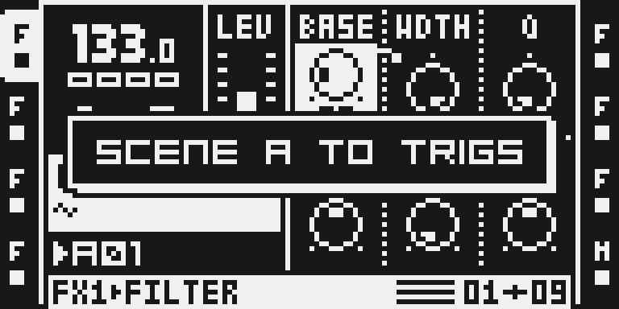
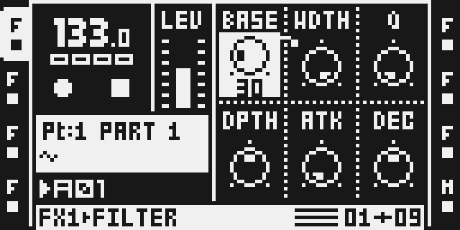
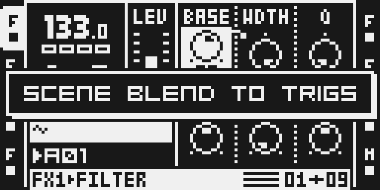

# Apply Scene

Version: 0.2.0-experimental · author: Nathaniel Pavel (@npp1993)

Hold [SCENE A] and press [YES]: scene A's locked values become the active Part's own values. [SCENE B] + [YES] does the same with scene B. Hold both scene keys and press [YES] to keep the sound the crossfader blends right now instead.

In grid recording, hold one or more trigs and press [SCENE A], [SCENE B] or both: the scene's values, or the blend, become p-locks on those steps.

## Overview

Scenes on the Octatrack lock target values. The crossfader blends side A's value into side B's value for every parameter either scene locks; a side with no lock uses the Part's own value. Apply Scene writes scene values into the active Part, as if you had turned each knob there yourself:

- **One scene** (SCENE A or SCENE B + YES): every parameter that scene locks takes its locked value. Parameters it does not lock stay as they are. The crossfader position does not matter.
- **The blend** (SCENE A and SCENE B + YES): every parameter either scene locks takes the value the crossfader plays right now.

- **On trigs** (grid recording: hold trigs, then SCENE A, SCENE B or both): the same values become p-locks on the held steps of the active track instead of Part values.

The rule for both gestures:

- **One scene key** writes that scene's locks, whatever the crossfader position and whether or not the scene is muted. A scene works as a set of values you can stamp onto the Part or onto trigs.
- **Both scene keys** write what you hear right now: the crossfader's blend, with a muted scene counting as unlocked, as stock's morph plays it.

From there you keep working as usual: turn knobs, make new scenes, morph again.

The scenes, the scene selection, the scene mutes, the crossfader and the saved Part are not touched. RELOAD PART therefore brings back the Part as it was last saved.

## Controls

| Gesture | What it does |
|---|---|
| Hold [SCENE A], press [YES] | Writes scene A's locks into the active Part: SCENE A APPLIED |
| Hold [SCENE B], press [YES] | Writes scene B's locks into the active Part: SCENE B APPLIED |
| Hold [SCENE A] and [SCENE B], press [YES] | Writes the current crossfader blend into the active Part: SCENE BLEND APPLIED |
| Grid recording: hold trigs, press [SCENE A] | Writes scene A's locks as p-locks on the held steps: SCENE A TO TRIGS |
| Grid recording: hold trigs, press [SCENE B] | The same with scene B: SCENE B TO TRIGS |
| Grid recording: hold trigs, press [SCENE A] and [SCENE B] | Writes the current crossfader blend as p-locks on the held steps: SCENE BLEND TO TRIGS |

When no value differs from the Part (the scene has no locks, you applied the same thing twice, or both scenes are muted for the blend), the screen shows NOTHING TO APPLY instead.

On trigs, the locks are written when you let go of the last scene key, so pressing both keys for the blend never writes scene A on its own first. When no step would change, the screen shows NOTHING TO LOCK.

There are no settings.

## Usage

1. Lock some parameters in SCENE A and SCENE B in the usual way (hold the scene key and turn knobs on any page).
2. To keep one scene: hold SCENE A (or SCENE B) and press YES. SCENE A APPLIED (or SCENE B APPLIED) appears.
3. To keep an in-between sound: move the crossfader until the sound is right, hold both SCENE A and SCENE B, and press YES. SCENE BLEND APPLIED appears.
4. Save the Part to keep it (FUNC + PART, SAVE), or RELOAD PART (FUNC + CUE) to go back to the last saved Part.
5. To put a scene on particular steps instead: press REC for grid recording, hold the trigs, press SCENE A (or SCENE B, or both for the blend) and let go. SCENE A TO TRIGS appears and the trigs show their new p-locks. Save the project to keep them; to remove a step's locks, hold its trig and press PLAY, as on stock.

## What is written

For each of the eight audio tracks, every scene-lockable parameter that the chosen scene locks (or, for the blend, that either selected scene locks):

- SRC page 1 of the machine the track uses (Flex, Static, Thru, Neighbor or Pickup; the stored pages of the other machines are not touched);
- LFO page 1 (SPD1 to SPD3, DEP1 to DEP3);
- AMP page 1;
- FX1 and FX2 page 1.

With one scene the value is that scene's lock, whether or not the scene is muted (you asked for it by name). With the blend it is the value stock's scene morph plays: side A's lock (or the Part value when A has none or SCENE A is muted) blended with side B's the same way, weighted by the crossfader. Stock hands the DSP a value with a fraction; the Part stores whole knob steps, so the blended value is the nearest step. The write goes through stock's own parameter store, the one MIDI CC uses: it skips parameters the page does not have and keeps every value inside the parameter's range, then marks the Part as edited.

### On trigs

The same parameters, written as p-locks on each held step of the active track, the way turning a knob with that trig held writes one:

- With one scene, every parameter that scene locks gets that lock on every held step, replacing a p-lock the step already had for it. The step's other p-locks stay.
- With the blend, every parameter either scene locks gets the value that step plays right now at this crossfader position: a side with no scene lock uses the step's own p-lock, or the Part value where the step has none.
- Parameters the page does not have are skipped, and values stay inside each parameter's range, as stock's own p-lock does. The trigs you hold stay where they are.
- Only the steps on the trig page you see, on the active track, in grid recording.
- Pressing a trig while the scene key is held still selects a scene, and turning a knob still writes a scene lock, as on stock. Then no p-lock is written.
- There is no undo: hold the trig and press PLAY to clear that step's p-locks (stock), which also clears p-locks you set by hand on it.

Not written: XVOL and XLV (the crossfader volume locks have no Part knob and stay scene locks), trig locks and LFO modulation (the result is the sound on steps without a trig lock), page 2 (stock cannot scene-lock it), and with MASTER TRACK on, track 8's SRC and AMP. Nothing happens in MIDI mode.

## Quick tutorial

1. On a track playing a loop, hold SCENE A and turn FX1's first knob to the left; hold SCENE B and turn it to the right.
2. Hold SCENE A and press YES. SCENE A APPLIED appears, and FX1's first knob now shows scene A's value. Put the crossfader in the middle, hold SCENE A and SCENE B and press YES: SCENE BLEND APPLIED, and the knob shows the middle value.
3. Move the crossfader to either end: the sound still reaches each scene's lock. Press FUNC + CUE to reload the Part and the knob returns to where it was.
4. Press REC, hold a trig, press SCENE A and let go: SCENE A TO TRIGS, and holding the trig shows scene A's value as its p-lock. Hold the trig and press PLAY to clear it again.

## Compatibility and limitations

- Changes one stock gesture: YES with SCENE A, SCENE B or both held no longer shows ARM ALL. YES alone still does.
- Adds one gesture: in grid recording, SCENE A or SCENE B pressed while trigs are held. On stock that press does nothing beyond what SCENE alone does (measured under the emulator, 22 Oct 2026); with the module, letting go of the scene key writes p-locks. Pressing a trig or turning a knob inside it still does what stock does, and then nothing is written. SCENE first, then a trig, still selects a scene.
- Which keys are down decides the mode, in either press order. With both held, releasing one leaves the other's single-scene apply.
- After applying, the crossfader stays where it is and the scenes keep their locks. A parameter locked in both scenes does not change sound. A parameter locked in only one scene can: after a one-scene apply it plays that lock at every fader position, and after the blend stock blends that lock with the new base, so the sound can jump.
- Undo is stock RELOAD PART, which also discards any other unsaved edits since the last Part save.
- One apply runs a few million ColdFire instructions in the UI task (measured under the emulator; see TESTING.md). How long that takes on the unit is not measured yet.
- Patch sites: the entries of stock's YES handler (0x4005e4c8) and of the SCENE key's press (0x4004348c) and release (0x40054ca4) handlers. No DSP code, no saved data of its own.
- Tested on one MKII over USB: the Part apply with 0.1.0; TRIG + SCENE with 0.2.0, including playback by ear, a project save and a power cycle. Not tested on the MKI. See [TESTING.md](TESTING.md).

## Tests and measurements

See [TESTING.md](TESTING.md). `verify.py` runs the built image under ot_emu.

## Authorship and licences

Original code by Nathaniel Pavel (@npp1993), MIT (see [LICENSE](LICENSE)). Stock code is referenced by address, length and SHA-256 only.

## Screens and audio

Real LCD captures from the headless emulator on a private native build of this source (MAIN OS SHA-256 `c625bbd1…00fc48d`), 23 October 2026. They show the interface, not hardware behaviour or sound.

1. 
   Lock a value in a scene the usual way: hold SCENE A and turn a knob. Here FX1's BASE is locked to 30 in scene A; the Part's own value stays 0.
2. 
   Hold SCENE A and press YES: every value scene A locks is written into the active Part, and SCENE A APPLIED confirms it. SCENE B + YES does the same for scene B.
3. 
   Release SCENE A: BASE now shows 30 as the Part's own value, like a knob you turned yourself. The scenes are untouched, and RELOAD PART (FUNC + CUE) brings back the last saved Part.
4. 
   To keep an in-between sound, move the crossfader, hold SCENE A and SCENE B, and press YES: the sound the crossfader plays now is written into the Part, and SCENE BLEND APPLIED appears. Here the crossfader is in the middle.
5. 
   When no value would change, for example SCENE A + YES pressed a second time, the screen says NOTHING TO APPLY and the Part stays as it is.
6. 
   To put a scene on chosen steps instead: press REC for grid recording, hold a trig, press SCENE A and let go. SCENE A TO TRIGS appears and every value scene A locks becomes a p-lock on that step.
7. 
   Hold the trig again to see its p-locks: BASE on step 1 is now 30, scene A's value. The scene and the Part are unchanged; hold the trig and press PLAY to clear its p-locks.
8. 
   Hold a trig and press SCENE A and SCENE B to lock what the crossfader plays right now onto that step: SCENE BLEND TO TRIGS. Here the crossfader is in the middle.

There is no audio preview: APPLY SCENE adds no sound of its own.
